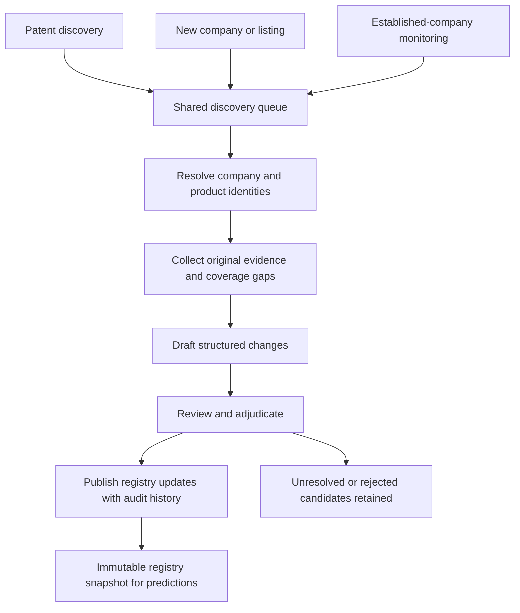
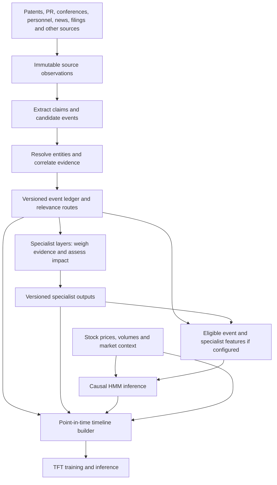

# Entity discovery, event pipeline and data acceptance

Updated October 19, 2026. This is the single implementation and review plan for company/product/person discovery, patent evidence, event construction, source SQL validation and transition from the isolated pilot to production. Recorded deployment status is evidence dated to the referenced run, not a new live audit. Editing this plan does not deploy jobs or populate RDS.


## Navigation and current execution boundary

1. [Company/product discovery](#three-discovery-routes) — three intake routes and shared review/publishing stages.
2. [Patent retrieval and rights/product mapping](#patent-retrieval), [United States Patent and Trademark Office prosecution](#uspto-prosecution), and [people population](#people-registry).
3. [Events, storage and specialist/model interfaces](#event-pipeline), including [all 68 source-family rules](#event-pipeline--source-by-source-event-creation-map-s01s68).
4. [Event JSON schema and worked example](#event-json-schema), then [isolated event pilot and latest output](#event-pilot).
5. [Acceptance gates and SQL quality checks](#source-acceptance), [source-specific requirements](#source-quality-contracts), and [the SQL query catalog](#sql-checks).
6. [One implementation sequence and resource policy](#unified-rollout).

| Component | Recorded state | What remains |
|---|---|---|
| Shared collection/committed-data Athena access | Implemented; latest receipts live in [the publisher report](reports/committed-athena-latest.json). | Verify each exact source/dataset/scope and source-specific extracted fields. |
| RDS companies/products/people schema | Installed schema and audit migrations are recorded in [RDS schema](RDS_TRACKING_SCHEMA.md) and [people verification](reports/people-registry-2026-10-16-verification.json). | Reviewed population, identity/relationship assertion ledgers and snapshot publication. Empty tables cannot pass linkage checks. |
| Source-specific enrichments | Existing operational runbooks remain authoritative for their deployed workers. | Main registry admission, cross-source event promotion and specialist dispatch are separate stages. |
| Isolated event pilot | October 19: **261 observations, 87 source/dataset routes, 76 candidate events**, 51/68 source families sampled. | 120 context-only and 72 `needs_evidence` observations; review the 69 observations producing 76 candidates. No real cross-source clusters in this small sample. |
| Production event ledger, specialist scoring, HMM/TFT feature release | Proposed. | Implement and validate the contracts below before deployment or training. |

The 68 planning families differ from provider/dataset route counts. Unavailable families and no-rule inputs remain explicit; do not turn absent evidence into successful empty events. January 1, 2021 is the approved model/history floor, subject to verified source coverage and information availability.

## Objective and starting point

Build three complementary routes into one reviewed company and product registry. Products are the main prediction entities; companies provide identity, ownership, execution and financial context. Preserve stable IDs, evidence and historical knowledge across discoveries and updates.

The MySQL `tracking` database on RDS instance `semaphore` is installed and tested. The original company/product schema has 10 tables and 27 audit triggers; the October 16 people extension adds five tables and 15 triggers. See [people registry population](#people-registry) for the integrated workflow. The referenced [registry deployment record](RDS_TRACKING_SCHEMA.md) reports no company/product seed import; confirm present counts with the SQL below before execution. The existing [company universe](config/company-universe.v0.5.json), [admission policy](COMPANY_ADMISSION.md), [patent pilot](PATENT_ATHENA.md) and [patent backfill](PATENT_BACKFILL_ATHENA.md) are implementation inputs. Verify their current release pointers and coverage at execution time rather than treating this document as live source status.

Use the existing four sectors: biotech, robotics, semiconductors and energy storage. New listings nominate companies for discovery; admission still requires reviewed sector relevance and legal identity under the established policy. Private companies remain eligible.

## Three discovery routes

| Route | Trigger | Flow | Intended result |
|---|---|---|---|
| Bottom-up: patents | New patent publications/families, examination/petition evidence or newly resolved company matches | Patent and prosecution evidence → applicant/assignee → company → supporting web evidence → product/program | Find identifiable assets, including early development programs. |
| Bottom-up: companies | Newly observed listing, IPO notice/prospectus or other company discovery event | Listing → legal issuer → company evidence inventory → products/programs | Discover companies and establish their initial product inventory. Start with Hong Kong Exchanges and Clearing. |
| Top-down: established companies | Scheduled review or material new evidence | Tracked company → catalogs/pipelines, patents, press release, filings, publications and conferences → inventory comparison | Identify additions, renames, new generations, transfers, lifecycle changes and removals requiring review. |



All routes share identity resolution, evidence collection, review and publication. Repeated discoveries enrich an existing entity instead of generating another company/product ID. Preserve each originating route and its evidence.

## Shared processing stages

### 1. Establish the company identity map

Import the versioned company universe into staging, including company IDs, legal and display names, aliases, external identifiers, listings, sectors, evidence and review states. Reconcile activation decisions against the admission ledger; an imported `collection_enabled` flag alone is not an admission decision.

Generate an insert/update/conflict report before loading RDS. Preserve existing IDs, pending/rejected states and disabled tracking decisions. Maintain a migration mapping for existing alias and identifier IDs because the SQL supporting tables currently use integer keys. Record the source release/hash and imported row mappings in an import manifest.

Reruns must be idempotent. Use stable entity IDs and source identity mappings rather than broad name-based upserts. Detect conflicts in namespaces, identifiers and listings; preserve their evidence for adjudication. Do not let an older source snapshot overwrite a newer reviewed edit.

### 2. Normalize incoming triggers

Represent every discovery trigger as a durable event with route, provider/dataset, source record identity, source/effective date where known, first-observed time, capture time and evidence reference. Preserve corrections as new versions of the same source event.

For Hong Kong Exchanges and Clearing, distinguish a newly observed listing from a genuinely new listing. Bootstrap the initial inventory without labeling every existing issuer a new IPO. Compare subsequent inventories and official notices; distinguish additional listings, renamed issuers, relistings, transfers and depositary securities. A temporary provider omission is not a delisting. Historical imports retain their historical source dates and today's observation time.

### 3. Resolve entities and generate research work

Prefer corroborated identifiers, then reviewed aliases and dated corporate relationships. Fuzzy names produce candidates for review. Track reported patent applicant/assignee identity separately from current ownership; a name match is insufficient to establish either a product link or ownership.

Resolve subsidiary matches explicitly. A subsidiary's patent or publication should not silently become evidence of ownership by its parent. Record affiliation dates and evidence. Papers require author/organization affiliation checks; mentions, acknowledgements and subject-company references have different meanings.

Group patent publications into families only where reliable identifiers are available. Retain the individual publication references and family source. Missing family data remains explicit. Technology clustering helps prioritize research but does not itself establish a product.

### 4. Collect a bounded evidence inventory

Start with saved source observations, then collect missing primary material through the existing source integrations. Search queries combine company/alias, patent number, development code, distinctive technical terms and application. Search results nominate original documents; save the original reference, capture hash and supporting passage/page location.

| Source class | What it can establish after review |
|---|---|
| Prospectuses and issuer filings | Legal issuer, business scope, named programs, disclosed risks and transactions. |
| Official catalogs and pipeline pages | Named products/programs, current positioning and inventory presence. |
| Patents and assignment records | Technical disclosures, reported parties and separately reviewed ownership evidence. |
| United States Patent and Trademark Office Office Actions and final Petition Decisions | Examination reasoning, cited references and procedural outcomes; nominate technical research and product/program links without inferring ownership or commercial success. |
| Academic articles and conference proceedings | Research assets, experiments and dated affiliations; distinguish peer-reviewed work, preprints, abstracts and talks. |
| press release and partner announcements | Announced launches, partnerships, licenses and milestones; corroborate material relationships. |
| Regulatory records and technical documents | Product identifiers, applicable authorizations, specifications and explicit patent-marking links. |

Aim for broad discovery, with recorded coverage. Do not claim to have found every available article or patent. Record sources checked, query parameters, date ranges, pagination completion, excluded material, access failures and retrieval limits. A failed or empty search is a coverage outcome rather than evidence that the product does not exist.

### Patent and prosecution discovery

Use [the integrated patent retrieval and mapping workflow](#patent-retrieval) for global metadata intake, full-document retrieval, section extraction, US identity crosswalks, assignment reconciliation and reviewed product links. Consume the implemented [United States Patent and Trademark Office evidence contracts](#uspto-prosecution) for both patent-led and company-led discovery. Relevant university/unresolved inventions remain valid leads; citations, assignees, family membership and technical similarity do not by themselves establish product identity, ownership or commercial outcomes.

### Centers for Medicare & Medicaid Services coverage enrichment and product linking

Added October 16, 2026. Status: the collector discovers national coverage inventory entries and queues linked policy documents. Structured coverage interpretation, reviewed product/company links and coverage-change events are proposed downstream work; an inventory-to-document link does not establish a product link.

**Purpose.** Attach Medicare coverage context to verified products and their application/geography contexts. A policy may apply to many products; a product may be affected by multiple policies. Coverage is distinct from regulatory approval, reimbursement amount, actual use and company revenue. The current national inventory is not complete payer access.

**Process to implement:**

1. Consume saved `cms_coverage` inventory observations and successfully retrieved `cms_coverage_documents` bodies. Link by document type, document ID and version; retain immutable observation IDs, document hashes, source URLs and retrieval times. A queued document is not proof that retrieval succeeded. Record missing bodies as explicit gaps.
2. Extract service/technology, covered indications, exclusions, eligibility and evidence requirements, geography, policy status and source-stated effective dates. Preserve supporting passages and date precision. Distinguish inventory updates, policy publication/revision, effective dates and our observation times. Do not infer clinical or policy decisions from metadata timestamps.
3. Stage policy-to-service/indication candidates immediately, even before matching product rows exist. Revisit unresolved candidates after product admissions, new aliases or relevant policy changes. Extraction can proceed before the product registry is populated.
4. Match candidate products using verified identity, intended use, specifications and applicable indication/application context. Title similarity alone cannot establish eligibility. Treat investigational or adjacent technologies separately where policy applicability is uncertain. A named service is not automatically a named commercial product or a new product identity.
5. Publish each policy/product/context link only after its evidence and applicability are reviewed. Resolve company exposure separately through the existing dated `product_companies` roles, respecting territory and time. A broad policy does not establish an individual manufacturer's eligibility or ownership. Preserve pending/rejected links and reasons.
6. Compare policy bodies and reviewed versions for substantive additions, expansions, restrictions, withdrawals or retirement. A metadata refresh, unchanged repeat retrieval or initial discovery of an old policy is not a new coverage decision. Keep effective-date and first-observed event semantics separate; historical availability must be supported before point-in-time use.
7. Re-evaluate affected products when policy criteria change, and revisit existing policies when a new product enters the registry. Track unresolved applicability and review workload instead of marking every candidate covered automatically.

**Proposed storage.** Add evidence-bearing policy/version and product-policy relationship tables (for example `coverage_policies` and `product_coverage_links`) through a separately implemented migration. Preserve source document/version identity, raw version references, product/context IDs, explicit applicability/coverage status, validity dates or partial-date facts, review status, reviewer and evidence. Use a deterministic source-assertion key and import ledger for idempotent replay; corrections preserve prior evidence. Do not place a single global `covered` boolean on `products`. The existing product table is installed; these policy/link tables and their loader are not.

**Example.** The supplied NCD 80.9 inventory entry (`NCD:261:1`, Computer Enhanced Perimetry) points to a policy document. Its inventory `last_updated` value of April 17, 2020 does not establish a coverage decision date. Extract actual coverage criteria and effective dates from the policy body, then assess specific visual-field-testing products against those criteria. Without a resolved product and supporting applicability evidence, retain the policy as service-level context with no promoted product/company link.

**Acceptance gate.** Pilot on a bounded set of policy documents and verified products. Verify one-policy/many-product and many-policy/one-product behavior, indication-specific exclusions, unresolved products, missing documents, partial dates, repeated ingestion, substantive versus metadata-only changes, and late historical retrieval. Every promoted link needs reproducible evidence; replay must not duplicate links or events. Report national-policy scope and missing local/private-payer coverage explicitly. These steps become executable jobs only after implementation and review; this plan enables no jobs.

### Centers for Medicare & Medicaid Services financial relationships and drug spending

Added October 16, 2026. **Collection deployed; entity linking remains proposed.** [Centers for Medicare & Medicaid Services financial collection](CMS_FINANCIAL_COLLECTION.md) archives original detailed Open Payments CSVs and annual/quarterly drug-spending files, with complete source rows in dedicated Athena tables and per-edition provenance. The initial 20-file backfill is running; completion email waits for exact edition counts. This does not populate RDS products or people automatically.

For population, stage reported product names/codes, payer/manufacturer identities, recipients and explicit source roles. Resolve product identifiers and reviewed aliases against canonical `prd_…` identities before creating links; preserve uncertain brand/generic/formulation matches as candidates. Keep reported manufacturers separate from current owners and affiliates. Link payment records to people using provider identifiers plus reviewed identity evidence, following [the people plan](ENTITY_DISCOVERY_ROLLOUT_PLAN.md#people-registry).

Model financial assertions separately from `product_companies` ownership/development roles and from Centers for Medicare & Medicaid Services coverage policies coverage policy applicability. A payment may name multiple products without allocating dollars to each. Retain one payment amount and the set of reported product associations; do not assign its full value to each product. Ownership investments and valuations are separate measures. Research funding linked to an investigator need not be personal income or employment.

For drug spending, preserve program, reporting period, published edition, source product granularity, manufacturer/overall aggregation level, amounts, utilization denominators and suppression/outlier markers. Use explicit decimal values and retain missing/suppressed source text. Prevent double-counting revised editions, overall plus manufacturer rows, annual plus quarterly periods and overlapping populations. Gross spending is not net company revenue. Payer data does not establish global market size or comprehensive commercial access.

Proposed downstream work: implement reviewed payment-person/company/product assertion links and product-spending links with immutable source edition/row references, idempotent source keys, evidence, review status and period semantics. Revisit unresolved records after registry admissions. Keep these links outside the canonical product identity row. Pilot on tracked products and recipients; verify ambiguous brands, multi-product payments, investigator-versus-recipient roles, revisions, suppression and aggregation boundaries before publishing analytical totals.

### 5. Extract product candidates and proposed changes

Extract canonical names, brands/development codes, asset type, sector, descriptive technology, lifecycle stage, application/geography, related companies and evidence. Resolve duplicates before assigning `prd_…` IDs. A distinct generation/formulation can receive a new ID linked to its parent; a rename remains the same product with dated aliases.

Classify the outcome as named product, development program, trackable technology/platform, supporting process, or unresolved invention. Review whether platforms/processes meet prediction scope before admitting them. Do not turn each patent family, clinical trial or paper into a product automatically.

Each proposed patent-to-product link states its basis: explicit product patent marking, explicit source attribution, or technical correspondence requiring review. A product can link to many patents, and a patent can support multiple products. Confirming product identity does not automatically verify every patent link.

### 6. Review and publish

The first release uses human review of all proposed identity merges, activations, company/product roles and patent links. Review manifests identify the reviewer, decision, evidence, policy version and before/after state. Rejected and unresolved discoveries remain traceable.

Publish approved changes through a dedicated TLS-only application login with the `tracking_editor` role, UTC sessions, authenticated audit actor/reason and optimistic locking. Provision its credential separately from the RDS administrator. Grant queue/source-tracking writes explicitly as later migrations add those tables; do not broaden the role to database-wide writes.

One bounded transaction publishes a reviewed entity/change set and updates its publication checkpoint. Retry a completed publication by checking its run/decision key; do not duplicate rows or audit updates. RDS DDL uses separately versioned, forward-only migrations because it implicitly commits.

Export an immutable registry snapshot and review/import manifests to S3, then publish the relevant typed references to Athena. Prediction runs record that snapshot version, feature cutoff and evidence observations. Publication must explicitly reconcile the current admission ledger and exported universe contract, preventing two independent active-universe definitions.

## Established-company inventory monitoring

Build a reviewed baseline for each pilot company, then compare later source inventories against it. Normalize renamed pages and aliases before identifying additions or absences. Treat catalogs and pipeline pages as dated source inventories, not complete inventories of all company activity.

| Observed change | Proposed action |
|---|---|
| Named asset not in baseline | Create/reconcile a candidate and review activation. |
| Different name for the same asset | Add alias and update display/canonical name when justified. |
| Materially distinct generation | Create linked product candidate with its own ID. |
| Changed stage, application or authorization | Propose a dated product/context update. |
| Licensing, sale or acquisition | Propose dated company-role changes; preserve prior relationships. |
| Product absent from latest captured inventory | Flag `missing_from_source` for review; check capture completeness and other sources. |
| Explicit discontinuation/withdrawal | Propose lifecycle/tracking change with evidence and effective date. |

No automatic retirement based on disappearance, silence, failed extraction or missing search results. Company suspension, delisting, product discontinuation and prediction exclusion are separate decisions. Preserve historical products and company roles.

## Proposed data and software additions

These are proposed migrations/components; they are not installed yet. Keep bulk documents and observations in S3/Athena. RDS stores compact state and durable cross-references.

| Addition | Minimum contents and behavior |
|---|---|
| `discovery_events` | Route, namespaced trigger identity/version, candidate/company/listing references, dates, evidence and deduplication key. Allows unresolved entities before IDs exist. |
| `discovery_tasks` | Stage, task identity, input hash, status, attempts, lease expiry, checkpoint, error category and next attempt time. |
| `source_checks` | Task, source/query/date scope, completion/coverage outcome, saved capture reference and observation time. |
| `entity_candidates` / `proposed_changes` | Structured candidate/change payload, evidence, matching basis, reviewer decision and publication key. Reviewed payloads are validated before registry writes. |
| `company_relationships` | Dated parent/subsidiary and other relevant corporate links with reviewed evidence. |
| `product_patent_links` | Product ID, namespaced publication reference, optional family reference/source, link basis, review state and evidence. Unique product/publication identity; never unique patent-only identity. |
| `inventory_snapshots` / `inventory_items` | Company, source/run, capture date, completeness and product/candidate presence. Preserves source-specific additions and absences. |
| `entity_review_schedule` | Company/product review cadence, next due time, priority and reason; company scheduling supplements existing product review fields. |
| Import/publication manifests | Source release/hash, stable-ID mappings, reviewed changes, reconciliation counts, snapshot reference and publication status. |

Add foreign keys for resolved entities, uniqueness for idempotency, and explicit checks for status vocabularies. Separate operational task retry state from reviewed registry facts. Extend the audit coverage to new evidence-bearing relationships and links; append operational events where task-state history is needed. Migration tests must cover new tables, triggers and restricted-role grants together.

Suggested components: patent full-document retriever and section extractor; company importer; listing-difference intake; patent-family discovery; company evidence researcher; inventory comparer; shared review/publisher; snapshot exporter. Reuse existing admission, collection storage, source scheduling and patent matching code where practical.

The following command interface is illustrative and must be implemented. It is not runnable today:

```text
tracking-discovery import-companies --universe <release> --dry-run
tracking-discovery import-companies --review-manifest <approved-manifest>
tracking-discovery discover-patents --cohort <pilot> --publication-limit <cap>
tracking-discovery discover-companies --exchange HKEX --baseline <release>
tracking-discovery research --run <run-id> --task-limit <cap>
tracking-discovery compare-inventory --cohort <pilot> --baseline <snapshot>
tracking-discovery publish --review-manifest <approved-manifest>
tracking-discovery export-snapshot --run <published-run>
```

## Validation, monitoring and recovery

Tests should exercise meaningful behavior: idempotent imports and publications; alias collisions; parent/subsidiary ambiguity; new versus newly observed listings; multiple routes finding one product; patent families lacking reliable identifiers; rejected product links; inventory absence versus explicit retirement; interrupted tasks; stale reviewed changes; and evidence cutoff handling.

Track discovery events by route, identity resolution outcomes, reviewed product additions/changes, rejected links, queue age, source coverage, failed captures, requests/cost per run, and reviewed errors by sector. Product counts and patent counts are activity metrics; evaluate evidence quality and matching accuracy separately. Review a sample of rejected/unresolved items to assess missed discoveries as well as false positives.

Failures pause or retry the affected task with bounded backoff. Capture failures must not publish empty inventories as removals. A reviewed record changing before publication causes a conflict requiring reconciliation rather than a forced overwrite. Source/quota issues remain visible in the run report.

Disable intake/publish jobs independently when repairing a fault. Resume from immutable inputs/checkpoints. Correct published registry facts through audited compensating updates; retain old snapshots and publication manifests. Use database backups for disaster recovery, not routine data-review corrections.

Historical prediction inputs use immutable published snapshots and evidence availability dates. An import today does not establish historical watchlist membership. Do not equate audit statement timestamps with transaction commit visibility when reconstructing historical state; published snapshot manifests define the authoritative available registry version.

## GitHub repository/company mapping — deployed October 18, 2026

The [daily GitHub releases and vendor integration documents mapper](GITHUB_COMPANY_MAPPING.md) now checks repository maintainer relationships against the live RDS company directory after completed current-day repository captures, once per repository per Madrid day. Names/domains nominate review; explicit reviewed GitHub identifiers can verify links. Original releases remain unchanged, and company/product support and event significance require separate evidence. The directory was empty at installation, so bootstrap results are unresolved; future directory admissions are reconsidered by daily checks.

## National Institute of Standards and Technology evidence and product matching — deployed October 18, 2026

[National Institute of Standards and Technology robotics evidence operations](S47_NIST_ROBOTICS.md) now archive linked original evidence, run a scoped ten-landing-observation backfill with verified completion email, and check named robot mentions against RDS after capture. Publication/method evidence can emit pending-review evidence events; these are not automatic benchmark results. Document counts, extraction gaps and scope limits remain explicit. RDS products were empty at installation, so product admissions remain necessary before tracked-product matches can appear.

## Federal Register notices chemical/use-to-product applicability — proposed enrichment

Added October 18, 2026. Federal Register metadata must be enriched from full notices and official PDFs before product-specific applicability can be assessed. Extract chemical/CAS/PMN identities with confidentiality flags, regulated uses, exemptions, CFR references and policy-stage dates. Stage separate material/process relationships supported by SDS, composition, supplier and manufacturing documentation; product names and sector keywords alone are insufficient. Preserve generic/confidential identities as unresolved. See [Federal Register notices event integration requirements](ENTITY_DISCOVERY_ROLLOUT_PLAN.md#event-pipeline--pending-implementation-s51-full-notice-and-chemicaluse-enrichment). [Full-notice evidence enrichment](S51_FEDERAL_REGISTER_ENRICHMENT.md) is deployed with daily capture and the pinned archive backfill running. Reviewed chemical/material/process applicability matching remains to be implemented.


### restrictions and product exposure

[trade-control and screening lists enrichment](S52_TRADE_SCREENING_ENRICHMENT.md) now retrieves authority evidence and produces read-only RDS company matches and product exposure candidates after daily capture. Names alone require review; list-scoped reviewed identifiers can verify company bindings. Link products through reviewed relationships with evidence, role, territory and validity dates. Aircraft/vessel identifiers must not become company identities or blanket product-model restrictions. The current product-company schema needs an evidence-backed extension for customer, supplier, distributor and operator relationships before those paths can be assessed. Keep restriction facts separate from exposure and actual commercial impact; consult the trade-control and screening lists directions in [event integration](ENTITY_DISCOVERY_ROLLOUT_PLAN.md#event-pipeline).


### Department of Energy storage technical and project evidence

[Department of Energy storage reports document enrichment](S55_DOE_STORAGE_ENRICHMENT.md) retrieves original reports/spreadsheets and separates technical evidence from funding/project statements. Exact RDS company/product names and reviewed company aliases are mention candidates, not recipient/test/manufacturer relationships. Populate the product registry from explicitly identified models/configurations and review company roles against original documents; chemistry/category overlap is context only. Preserve source identities, report versions, award/project IDs, recipient/partner roles, source table rows and dates. Funding opportunities, selections, executed awards and payments remain distinct. Follow [event integration](ENTITY_DISCOVERY_ROLLOUT_PLAN.md#event-pipeline) for production event integration, which is still pending.


### documented project-node and installed-product context

[California Independent System Operator electricity markets market enrichment](S57_CAISO_ENRICHMENT.md) reads reviewed `attributes.caiso_projects` mappings on active energy-storage products, plus the worker's documented mapping configuration. A mapping must identify an actual project pricing node, project ID, source evidence, review status and validity dates. Owner/operator/installed-product links each require evidence and reviewed RDS identities. Do not infer project owners from product owners, or connect all products to regional hubs. The initial registry/mapping set is empty; keep exposure unresolved while populating evidence-backed project relationships. New daily jobs recheck the directory; historical mapping changes require a versioned reprocessing run. The event pipeline must distinguish market conditions, modeled opportunity and actual project/company financial outcomes.

### Research institution identities, grant lifecycle evidence and entity links — October 18, 2026

Implemented dedicated post-National Institutes of Health daily capture and resumable saved-observation backfill: see [S68_GRANT_LIFECYCLE_ENRICHMENT.md](S68_GRANT_LIFECYCLE_ENRICHMENT.md). Preserve recipient identities, award applications/annual funding stages, all original lineage, investigator profile IDs and official publication links. Read RDS companies/people/products each daily job. Verified organization/person identifiers can bind entities; name-only and product-text matches remain review candidates. Grant recipient identity does not allocate funding to products or establish PI employment; require explicit project/product/trial/publication evidence and dated reviewed relationships. Research Organization Registry current parent/related relationships do not merge institutional awards or prove historical affiliations. Production event integration is documented in `ENTITY_DISCOVERY_ROLLOUT_PLAN.md` (event-pipeline); other authorities and exhaustive trial/patent linking remain future adapters.

<a id="patent-retrieval"></a>

## Patent retrieval, technical review and rights/product mapping

<a id="patent-retrieval--review-of-our-three-sources"></a>

### Review of our three sources

| Source | Current implementation and useful evidence | Proposed use and gaps |
|---|---|---|
| **Google Patents public BigQuery data — `google_patents_bigquery`** | Global discovery by publication-date windows, company/alias names OR CPC prefixes OR title terms. Saves publication/application/family IDs, jurisdiction/kind code, dates, title, harmonized assignee names and CPCs, with BigQuery response evidence. | Establish the discovery inventory and cross-jurisdiction candidates. Current SQL does not select abstracts, claims, descriptions, drawings or inventors. Full-document retrieval and additional structured fields are new work. Company-name matches and technology classification remain candidates. |
| **United States Patent and Trademark Office application and prosecution records — `uspto_odp` / `patent_records`** | `odp_record` retains US application identity, earliest publication, patent number, reported applicants, classification, status/status date, filing/publication/grant dates, source events and provider ingestion time where supplied. Original application API responses are retained separately. | Resolve official US application/publication/grant crosswalks, reported parties and status evidence. Normalized records do not constitute a full specification or complete claim history. Extract inventors, continuity and document-index fields from supported source responses when available; add missing retrieval interfaces rather than assume they are collected. |
| **United States Patent and Trademark Office application and prosecution records — `patent_assignment_records`** | `patent_assignments.py` queries explicit application cohorts and normalizes reported assignment histories: reel/frame, recordation/receipt dates, conveyance, assignors and execution dates, assignees and document URL. It explicitly leaves current ownership and chain completeness unestablished. | Reuse recorded rights events and candidate party identities. The stored document URL is not proof that the assignment instrument was downloaded. Retrieve and inspect relevant instruments, corrections and affected-property lists before promoting rights assertions. |
| **United States Patent and Trademark Office application and prosecution records — `patent_office_actions`, `patent_petition_decisions`** | Dedicated collectors retain provider text/structured fields and retrieved original PDFs with document identity and checksums. Petition collection filters final decisions. These datasets have separate coverage/publication checkpoints. | Reuse available documents by application; extract claim references, examiner citations, amendments and procedural outcomes where supported. A petition decision, allowance notice and substantive rejection require different interpretation. Verify current published/partial coverage rather than rely on dated SQL-readiness notes. |
| **United States Patent and Trademark Office assignment records — `uspto_assignment_histories` / `specialist_inputs`** | The specialist adapter calls the same Open Data Portal application interface and emits each `assignmentBag` event with its application and original returned chain. Historical filtering uses recordation date. Configuration currently names eight applications. | Complement/reconcile the United States Patent and Trademark Office application and prosecution records histories and nominate instrument retrieval. This is a configured cohort, not a global assignment search. Expand intake from resolved US applications as proposed below. Deduplicate the underlying official events across United States Patent and Trademark Office application and prosecution records/United States Patent and Trademark Office assignment records; two collected copies are not independent corroboration. |

Implementation references: [Google Patents public BigQuery data query](patent_discovery.sql), [query planner](patent_query_plan.py), [patent normalization](patent_collection.py), [assignment collector](patent_assignments.py), [assignment comparison](patent_assignment_review.py), [United States Patent and Trademark Office assignment records adapter](specialist_public_apis.py), [United States Patent and Trademark Office assignment records cohort](config/specialist-inputs.json), [prosecution collector](patent_prosecution.py) and [prosecution operations](PATENT_PROSECUTION_OPERATIONS.md).

United States Patent and Trademark Office provides a Patent File Wrapper document interface. Validate its current schema, authentication, document availability and download quotas during the implementation pilot; do not assume every application or attachment is public or downloadable. [Official document interface](https://data.uspto.gov/apis/patent-file-wrapper/documents)

<a id="patent-retrieval--1-select-and-prioritize-relevant-patents"></a>

### 1. Select and prioritize relevant patents

Use the existing four sectors: biotech, robotics, semiconductors and energy storage. Start from committed Google Patents public BigQuery data observations, preserving each original observation ID and collection scope. Record the sector rule version and actual CPC/title hits; do not discard a record solely because `candidate_sector_ids` or company matches are empty when other retained classifications indicate relevance.

Use two intake routes:

| Route | Intake | Prioritization |
|---|---|---|
| Top-down | Reviewed companies, subsidiaries/aliases and known products; explicit patent references from product documents | Exact patent-marking/product references first, then relevant company portfolios. Do not copy every company patent onto every company product. |
| Bottom-up | Sector CPCs and technology terms, then full-text relevance review | Distinctive in-scope inventions, including university/private/unresolved assignees; prioritize identifiable applications and likely tracked-product relevance. |

Assign each candidate `relevant`, `uncertain` or `out_of_scope`, retaining reasons and source signals. Search terms/CPCs prioritize work but are not proof of a product. Review samples of exclusions to detect missed relevance. Relevant candidates without a company/product remain valid research leads.

Pin the initial inventory and budgets. Historical baseline selection follows the shared January 1, 2021 policy; older publications can be explicitly added when cited by an in-scope product or needed to explain a family/rights chain. Record this expansion separately rather than silently making an all-history collection claim.

<a id="patent-retrieval--2-resolve-publication-and-application-identities"></a>

### 2. Resolve publication and application identities

Build a crosswalk using jurisdiction-qualified identifiers for publication, kind code, application and grant. Preserve raw provider identifiers alongside canonical forms. Do not strip leading zeroes or punctuation without jurisdiction-specific rules. A CN application number must not be passed through the US application-number normalizer.

For US candidates, reconcile Google Patents public BigQuery data identities with United States Patent and Trademark Office application and prosecution records application data. Store the evidence for each crosswalk. Quarantine mismatches rather than join on title or similar numbers. Preserve continuity relationships, divisionals, continuations and family source/version where provided. Identify the actual publication/grant being reviewed; family members can have different claims and rights.

Google Patents public BigQuery data's global family identifier can nominate a US member of a non-US family, but membership requires a supported crosswalk. US assignment or prosecution evidence does not automatically describe CN, EP or other members. Record jurisdictions without equivalent rights/document coverage as explicit gaps.

<a id="patent-retrieval--3-retrieve-and-save-the-evidence-package"></a>

### 3. Retrieve and save the evidence package

Reuse saved original documents before issuing another request. For missing material, choose supported office/provider interfaces after bounded access probes. Provider selection should consider identity fidelity, section coverage, language, document version and operational access. If available through the approved BigQuery schema, localized full-text fields can supply text; this still does not mean the original PDF or drawings were obtained. Dry-run and cap additional query costs before enabling broader queries.

For each selected publication, attempt these artifacts independently:

| Artifact | Purpose |
|---|---|
| Publication/grant XML or equivalent structured source text | Abstract, description, numbered claims and source-language structure. |
| Original patent PDF and available drawings/attachments | Figures, chemical structures, tables and page-level corroboration. |
| Relevant United States Patent and Trademark Office application and prosecution records file-wrapper documents | Original specification, claim amendments, responses, Office Actions and allowance/decision documents as available. |
| United States Patent and Trademark Office application and prosecution records/United States Patent and Trademark Office assignment records assignment instruments and property schedules | Reported parties, conveyance scope, dates, listed applications/patents and exceptions. |
| External corroborating product material | Patent-marking pages, issuer filings, catalogs, trial/regulatory product documents and licensing announcements. |

Record each artifact as `queued`, `downloaded`, `not_available`, `access_failed`, `invalid_response` or `superseded` as appropriate, with retry class and explanation. Track abstract/claims/description/drawings/PDF completeness separately. An abstract-only response, a landing page or a single Office Action cannot be labeled a complete patent.

Save original bytes immutably in S3 with SHA256, source URL, retrieval time, content type, byte count, publication/application identity, official document ID, language and source version/date where supplied. Validate identity and reject challenge/error pages. Deduplicate identical content by hash while retaining all source references. Store manifests and indexes for Athena; keep bulk documents outside RDS.

<a id="patent-retrieval--4-extract-technical-and-party-facts"></a>

### 4. Extract technical and party facts

Parse machine-readable sections first. Apply OCR to scanned pages and preserve original page images/PDFs. Retain claim numbers and dependencies, paragraph/page references, examples, figure numbers, captions and extraction-quality indicators. For translations, retain original language and label translated passages and tool/version; unsupported or illegible sections remain unresolved.

Produce a structured technical review containing:

- Problem addressed, proposed mechanism/architecture and intended application.
- Essential independent-claim elements, dependent-claim refinements and their exact source locations.
- Materials, molecular sequences/structures, components, manufacturing steps, configurations and measured parameters where stated.
- Experimental examples, comparators, reported results and limitations, distinguished from proposed embodiments and inventor assertions.
- Explicit product names, development codes, organizations, inventors and citations with source roles.

Examples of sector-specific review: formulation/sequence/target and indication for biotech; sensing/control/task architecture for robotics; circuit/process/device structure for semiconductors; chemistry, cell architecture and operating conditions for storage. Use diagrams or domain-specific structure extraction where plain text loses important information. Do not infer a molecule or configuration from unreliable OCR.

Every material assertion needs a document hash, claim/paragraph/page/figure locator and a short supporting excerpt. Automated summaries and feature comparisons are review aids. Record extractor/model/prompt versions and confidence; keep original evidence sufficient for a reviewer to reproduce the result.

<a id="patent-retrieval--5-map-companies-and-reconstruct-reported-rights-events"></a>

### 5. Map companies and reconstruct reported rights events

Resolve party names against company IDs using reliable registry identifiers, reviewed aliases, legal jurisdiction and dated corporate relationships. A harmonized assignee name is a reported source label, not necessarily a resolved legal issuer. Maintain applicant, reported assignee, assignment recipient, assignor, licensee, secured party, inventor and legal representative as separate roles. Resolve people through the [people registry workflow](ENTITY_DISCOVERY_ROLLOUT_PLAN.md#people-registry); inventorship alone is not proof of employment.

Use United States Patent and Trademark Office application and prosecution records/United States Patent and Trademark Office assignment records together as follows:

1. For each resolved US application, reuse saved histories from both sources and request missing/update histories through a shared application work queue. The current fixed United States Patent and Trademark Office assignment records cohort must be replaced or supplemented with generated, reviewable cohorts.
2. Canonicalize assignment events by official recordation identity (for example reel/frame when present), affected application/property and source version. Preserve source observation aliases. When no stable official identity exists, use a documented composite and flag possible duplicates; do not deduplicate solely by party/date.
3. Retain recordation, receipt, individual assignor execution dates and explicit effective dates separately. Conflicting dates and ties remain visible. A recordation timestamp is not automatically the effective transfer date.
4. Classify conveyance into assignment, name change, merger, security interest, release or other, preserving original wording. Existing string heuristics nominate review; they do not settle the legal effect. A security interest is not an ownership transfer, and a release can concern a security interest rather than a sale.
5. Retrieve the instrument and property schedule where available. Verify the exact assets, parties, scope, corrections, partial interests and stated exceptions. Reconcile omissions and competing assertions; record chain completeness as established only to a specifically evidenced scope.
6. Publish reviewed *reported rights relationships* and their provenance. Separately corroborate ownership/licensing statements through issuer filings, transaction documents or other primary evidence when available. Retain unknown current ownership rather than choose the latest recipient mechanically.

United States Patent and Trademark Office explains that recording an assignment does not determine its validity or effect on ownership. Therefore, the deliverable is an evidence-backed reported history, with uncertainty, rather than an automatic legal-title conclusion. [United States Patent and Trademark Office MPEP §301](https://www.uspto.gov/web/offices/pac/mpep/s301.html)

A patent transfer also does not establish sale of the associated commercial product, a paid license, the transaction price or the identity of the product's current developer. Review those relationships independently.

<a id="patent-retrieval--6-map-products-to-patents"></a>

### 6. Map products to patents

Start with existing reviewed `prd_…` identities and aliases. If a named asset/program is newly discovered, stage its admission under the product-population plan. Do not create one product per patent, claim or family. A general method without an identifiable asset can remain an invention lead.

Use this evidence hierarchy:

| Link basis | Required evidence and interpretation |
|---|---|
| `explicit_product_reference` | An original product patent-marking page or other primary product document names both the product/version and exact patent/application. Strong association evidence; verify identity and relevant time. |
| `explicit_transaction_or_filing` | A filing, licensing/technology-transfer document or technical disclosure explicitly connects the product/program and identified patent assets. Preserve territorial and asset-scope limits. |
| `reviewed_technical_correspondence` | A reviewer compares the documented product's distinguishing features with the actual patent sections/claims and records supporting matches, contradictions and unknowns. Association remains technically inferred, not explicitly asserted. |
| `candidate_only` | Same company/person, shared CPC/topic, similar abstract or citation. Retain as a research candidate; do not publish a verified product association. |

For technical correspondence, create a comparison matrix: product feature and evidence → patent claim/description locator → match, conflict or unknown → rationale. Consider independent-claim dependencies and differences between application, amended and granted claims. A similar embodiment alone is weaker than an explicit product reference. Keep association review separate from any later specialized claim-coverage analysis.

Treat explicit association as evidence that a source links the assets; it does not establish validity, enforceability, freedom to operate, infringement, exclusivity or economic defensibility. Require explicit reviewer decisions for promotion. A verified product link must not automatically promote company ownership, every family member or every product generation.

<a id="patent-retrieval--7-proposed-records-and-storage"></a>

### 7. Proposed records and storage

These are proposed additions, not installed tables. Reuse existing discovery/review contracts where compatible and migrate new evidence-bearing records with audit coverage.

| Record | Core fields |
|---|---|
| `patent_identity_links` | Jurisdiction-qualified publication/application/grant IDs, kind/version, family source, crosswalk basis, evidence and review. |
| `patent_documents` | Official document/source identity, artifact type, immutable S3 key/hash, language, retrieval/source dates, per-section availability and version. |
| `patent_extractions` | Document hash, extractor/model version, section/claim/figure facts, quality flags and evidence locators. |
| `patent_party_assertions` | Patent/application, source party name and role, resolved company/person candidate, date precision, source and review state. |
| `patent_rights_events` | Official event identity, conveyance, parties, property scope, dates, instrument references, source aliases, corrections and review. |
| `product_patent_links` | Product ID/version/context, publication identity, association basis, evidence, uncertainty, reviewer and decision. Many-to-many. |
| Task/review manifests | Inventory hash, trigger identity, stages/cursors/retries, provider costs, coverage, review decisions and published snapshot IDs. |

Preserve multiple supporting assertions per product/publication relationship instead of overwriting evidence with the newest source. RDS holds canonical entities and reviewed relationship references; S3/Athena retains source observations and detailed artifacts. Existing `product_companies` and `person_products` roles remain separately evidenced. Keep extraction staging and reviewed registry publication distinct.

<a id="patent-retrieval--worked-path-for-the-supplied-cn-example"></a>

### Worked path for the supplied CN example

For `CN-113110441-A` / `CN-202110382942-A`, the agricultural unmanned-vehicle title and G05D1 classification justify robotics relevance review. `UNIV JIANGSU` is a reported assignee label. Retrieve the original Chinese publication, claims, description, figures and available PDF; retain translated extracts separately. Extract the UWB positioning/cooperative-control mechanism with source locators.

Resolve the university identity and investigate explicit technology-transfer, licensing, spinout and product documentation. A resolved university need not be forced into a commercial company identity. Use United States Patent and Trademark Office application and prosecution records/United States Patent and Trademark Office assignment records only if a verified US application/family member or related US asset is identified; absence from those sources says nothing conclusive about Chinese ownership. If no named product is evidenced, retain the invention and unresolved product outcome rather than manufacture a product row.

Retrieval/extraction workers run outside RDS with bounded requests, bytes, document size, OCR/model work and BigQuery billing. Independently checkpoint retrieval, parsing, matching and review. Test jurisdiction/kind/family crosswalks, duplicate United States Patent and Trademark Office application and prosecution records/United States Patent and Trademark Office assignment records events, multi-property assignments, security releases, partial dates, multilingual/scanned text, conflicting parties, multi-product links and crash/retry behavior. Retain unresolved/rejected outcomes and expand only after measured retrieval quality and reviewer workload pass the unified gates.


<a id="uspto-prosecution"></a>

## United States Patent and Trademark Office examination and petition evidence contracts

<a id="uspto-prosecution--historical-scope-and-coverage"></a>

### Historical scope and coverage

Use the current January 1, 2021 collection start in `config/historical-collection.json`; this supersedes the older January 2015 patent proposal. Model eligibility remains a separate, evidence-based decision. Record an explicit exclusive end date for every backfill plan. Do not silently expand collection to all history since 2001.

Partition historical work by the source's documented Office Action/decision date, not application filing date. Include in-range documents for older applications wherever public source coverage permits. Record filing-year restrictions separately: United States Patent and Trademark Office describes these offerings as covering patents and published applications filed since 2001, and petition coverage is incremental. Date-undetermined documents belong in a separate discovery cohort with unknown historical availability.

Before implementation, inspect current official API schemas, release notes, authentication, filters, stable identities, pagination, document retrieval, update semantics, quotas and actual coverage. Test a bounded cohort against original application documents. Office Action search, structured rejection/citation APIs and petition search may have different date ranges and delays; do not assume they share coverage or freshness. If a feed lacks an update cursor, specify bounded overlap and periodic older-window reconciliation. If date filtering cannot enumerate the required history, record that limitation and validate an application-based or bulk alternative before claiming completeness.

Existing application/publication/assignment backfill receipts do not establish coverage for either new dataset. Track source-supported coverage, completed queried windows, missing documents and unmatched applications independently. A complete query means enumeration within the declared source scope, not every US prosecution document. Historical imports retain today's capture time and do not establish historical registry membership or point-in-time availability.

<a id="uspto-prosecution--collector-and-storage-contracts"></a>

### Collector and storage contracts

The existing prosecution collectors use the shared patent storage/checkpoint mechanisms with separate datasets `patent_office_actions` and `patent_petition_decisions`. Reuse the existing API-key loader where supported by the verified endpoint. Preserve exact API responses and original document bytes with checksums; downloads and extraction receive their own bounded, resumable task state. A search row whose document download failed must expose that failure rather than imply complete evidence.

Each observation carries provider/dataset, stable source document identity, normalized US application identity and original identifier, publication references where supplied, document type, source action/decision date and precision, source public-availability evidence, provider update time where documented, first observation/capture time, raw references/hashes, document retrieval status, extraction version and supporting page/passage. Preserve multiple actions per application. Do not use application number alone as a document key. Validate provider identities; when absent, define and collision-check a deterministic identity from documented immutable fields. Hashes identify content versions, not automatically distinct events.

Keep structured source fields separate from extracted claims: rejection grounds and affected claims, cited references, petition consideration and outcome are populated only where supported. Preserve unknowns and reported parties' roles. A cited patent or organization is a reference, not the owner of the examined application. Retain unresolved company/product matches for discovery.

Use independent per-dataset/date-scope checkpoints, manifests and complete/partial/failed outcomes. Bound requests, pages, download bytes and extraction work; obey shared United States Patent and Trademark Office quota controls across collectors. Resume partial work without repeating successful downloads. Validate pagination and source mutation behavior before advancing checkpoints. Corrections append observations; reconciliation must not overwrite retained evidence.

Publish typed Office Action and Petition Decision observations and their document/citation relationships into versioned Athena releases using existing committed-release validation. Typed observation contracts use `optima_patent_office_actions` and `optima_patent_petitions`, with application/document IDs, dates, status and source fields alongside full observation lineage. Complete windows follow the existing verified publication process; operational status determines which releases are actually live. Preserve the current application/publication/assignment contracts and joins; adding these datasets does not authorize downstream schema assumptions.

<a id="uspto-prosecution--downstream-acceptance"></a>

### Downstream acceptance

Patent-led discovery uses examination text and references to nominate technical research, applicant/assignee resolution and product/program links. Company-led discovery searches the same retained evidence by resolved legal names, aliases and application identities to enrich initial inventories. Neither route automatically creates a company/product from every document, citation or rejection.

An Office Action can establish a specific examination milestone; a petition decision can establish a procedural outcome. They do not alone establish grant, application failure, ownership, product discontinuation, commercial viability or predicted impact. Related publications, actions, responses and decisions remain distinct milestones. Cross-feed copies of one official document share provenance and must not inflate evidence counts.

Accept the rollout when historical windows and gaps are accounted for, source documents and joins are auditable, retry/correction/cutover behavior is verified, both discovery routes consume the added evidence, and event replay preserves occurrence, availability and observation dates. Measure reviewed discovery yield and attribution errors alongside coverage, freshness and workload.


<a id="people-registry"></a>

## People registry population and career/contribution tracking

<a id="people-registry--installed-tables"></a>

### Installed tables

| Table | What it stores |
|---|---|
| `tracking.people` | Canonical/display name, description, website, sector tags, collection control, review state, evidence, observation time, archive time and row version. Names are not unique. |
| `tracking.person_aliases` | Initials, original-script names, transliterations and documented name changes, with evidence, review state and optional validity dates. |
| `tracking.person_identifiers` | Namespaced external identifiers, unique by namespace/value, with evidence and review state. ORCID is a proposed namespace, not a preloaded identifier. |
| `tracking.person_companies` | Many-to-many links for employee, executive, founder, board member, advisor, consultant, investigator or author-affiliation roles. |
| `tracking.person_products` | Many-to-many links for researcher, inventor, developer, investigator, author or advisor contributions. |

Both relationship tables hold evidence, review status, observed time, territory and optional validity dates. Multiple concurrent roles and repeat appointments are supported. Relationships have foreign keys to the existing company/product registry and to people. No cascading deletes are introduced. Every table has INSERT/UPDATE/DELETE audit triggers writing to `entity_changes`, using the existing actor, reason and UTC requirements. The editor role has corresponding permissions; reader access already covers the database.

Schema: [additive migration](schemas/rds-tracking-people-mysql.sql). Reproducible deployment/verification: [migration runner](tracking_people_migration.py). [Deployment verification](reports/people-registry-2026-10-16-verification.json) records the rollback-only checks. These tables are empty; no source names have been promoted into identities yet.

<a id="people-registry--first-population-sources"></a>

### First population sources

| Source | Extract | Relationship supported by the evidence |
|---|---|---|
| Crossref proceedings Crossref proceedings | Authors, supplied ORCID values, affiliations, DOI, conference and publication dates | Authorship and reported publication affiliation; contribution to a product only if the paper explicitly identifies that product. |
| PubMed metadata PubMed and Europe PubMed Central literature and full text Europe PubMed Central | Authors, identifiers, affiliations, DOI/PMID/PMCID; explicit trial and product mentions | Authorship and reported affiliation; investigator role only when explicitly stated, not merely because the person authored a trial report. |
| Existing personnel archive, people syndicated feeds and corporate disclosures | Appointments, departures, biographies, board roles and named responsibilities | Source-supported company roles and effective dates. |
| Clinical trial registries, including National Medical Products Administration trial registry detail records | Named investigators, sites and trial identifiers | Investigator-to-trial evidence; product association requires a separately resolved trial-to-product link. |
| Patent records | Named inventors, patent families, applicants and assignments | Inventorship. Patent applicant/assignee is not automatically the inventor's employer. Product linkage requires separate evidence. |

Prioritize people connected to tracked products/companies, then relevant research teams. Do not import every author from the broad Crossref proceedings inventory into active tracking.

<a id="people-registry--s34-open-payments-integration--added-october-16-2026"></a>

### Centers for Medicare & Medicaid Services Open Payments integration — added October 16, 2026

The [Centers for Medicare & Medicaid Services financial collection](CMS_FINANCIAL_COLLECTION.md) now collects detailed general/research/ownership CSVs, with its 2021–2025 initial backfill running. `optima_collected_data.cms_open_payments_rows` retains the complete source rows; `cms_financial_editions` supplies category, year and edition provenance. Extraction into the people staging/review workflow below remains to be implemented.

Use reported recipient profile IDs and NPIs as namespaced identity candidates, preserving their source role. Distinguish the actual payee, institution, physician/non-physician recipient and research principal investigator; these can be different parties. Name equality alone is insufficient. Keep reported payers separate from resolved legal company identities. Capture payment date, amount, nature/category, currency, dispute/change flags and related products where supplied. Do not convert research funding into a named investigator's personal income or infer employment from a financial relationship.

The current `person_companies` table stores reviewed organizational roles, not a payment ledger. Propose separate evidence-bearing financial assertion/payment links with provider record identity, program year, category, edition and person/company/product references. Do not insert consulting fees as employment appointments or sum ownership valuations with payment amounts. Preserve corrected editions and link only reviewed identity matches. A financial relationship alone does not establish misconduct or invalidate research. Supplemental drug-spending files measure program spending rather than payments to these people.

<a id="people-registry--proposed-ingestion-and-resolution-workflow"></a>

### Proposed ingestion and resolution workflow

1. Extract person mentions into a staging dataset in S3/Athena. Each mention gets a deterministic key from source, observation ID, author/person position and extractor version. Preserve the exact name, source-specific author order, affiliation text, asserted identifiers, role wording and date wording. A DOI identifies a paper; an author position identifies a mention, not a person across papers.
2. Normalize names for candidate search while preserving original forms: spacing, punctuation, initials, script and transliteration. Never use normalized name alone as an identity key. Keep namesake candidates separate until evidence resolves them.
3. Search existing identities using trustworthy person identifiers first. Normalize identifier URLs, validate format/checksum where applicable, retain publisher/source assertions and flag conflicting identity evidence. A matching identifier is a strong candidate, but contradictory provenance must block automatic promotion.
4. Without a reliable identifier, compare multiple independent signals: full name/variants, historical affiliations, specialty, coauthors and explicit biographies. Common surnames plus initials, same institution, same topic or coauthorship alone are insufficient. Keep uncertain matches in staging with candidate IDs and review reasons; do not manufacture identifiers from name hashes.
5. Create a pending person with a stable application-generated UUID only when there is enough evidence to distinguish the individual. Store observed variants as pending aliases. Mark identity verified after the resolution evidence is reviewed. Verify each relationship separately: a verified person does not make every asserted role verified.
6. Resolve companies/products against their canonical registries before writing relationship rows. Preserve unmatched organization/product names in staging. Do not create a duplicate company or a generic product merely to satisfy a foreign key.
7. Write related identity, alias, identifier and relationship changes in one transaction. Set UTC, `@app_actor` and `@app_change_reason`; use `row_version` for optimistic concurrency when editing people. The proposed loader must maintain a deterministic ingestion ledger mapping source assertions to registry row IDs so retries do not append duplicate aliases or relationships. The schema itself does not deduplicate evidence assertions or implement that ledger.
8. Record subsequent evidence as additional assertions and reviewed updates. Reconcile contradictions explicitly. Before any automatic identity merging, implement a reviewed merge/redirect mechanism and a provenance-preserving relationship reassignment procedure. The installed schema does not yet implement identity merges or redirects.

<a id="people-registry--tracking-careers-and-contributions-over-time"></a>

### Tracking careers and contributions over time

Keep the person ID stable when an employer changes. Add the new relationship; close an old relationship only when evidence supports the end date. Advisory roles, university appointments and company employment may overlap. A second affiliation does not establish departure from the first.

`valid_from` and `valid_to` describe the source-supported role period; the proposed convention is start inclusive/end exclusive. Do not fabricate exact dates from a year, a month, a paper publication date or a retrieval timestamp. For partial or uncertain dates, retain the exact source wording and precision in evidence/staging and leave the SQL date unknown until an appropriate boundary can be established. An unbounded end date means no established end, not proof of current employment. `observed_at` is when supporting evidence was observed; creation/update timestamps describe database operations.

Treat explicit appointments, departures and changed product responsibilities as candidate business events. Distinguish their effective dates from announcement, publication, observation and ingestion dates. Loading an old paper or updating Crossref metadata must not generate a new appointment event. Publish only verified relationship changes through a future event integration; this migration does not install an event producer.

Universities and hospitals require particular care. The new company link table references `companies`; it does not introduce an institution registry. Preserve a university affiliation as a source assertion until we choose an organization model (for example, a dedicated institution registry keyed by Research Organization Registry). Do not label an academic affiliation as company employment or create a fictitious company to accommodate it.

<a id="people-registry--applying-this-to-the-supplied-s29-sample"></a>

### Applying this to the supplied Crossref proceedings sample

DOI `10.1109/icites56274.2022.9943657` lists Xuan Xie, Xi-Feng Li, Dong-Jie Bi, Yong-Le Xie, Shen-Jie Tang and Li-Biao Peng, with University of Electronic Science and Technology of China affiliations. Start with six distinct author mentions attached to that DOI. The supplied record contains no ORCID values, so it does not by itself justify linking these names to existing people with similar names.

The paper supports authorship of research on lithium-ion battery remaining-life prediction and a reported university affiliation. It does not identify a commercial product or an employer company. Keep company/product links absent until further evidence supports them. IEEE is the publisher. Funding bodies and cited-paper authors are separate roles and must not become the authors' employers or this paper's authors.

A useful follow-up is to locate other publications, original researcher profiles and explicitly attributed product or company work, then resolve continuity of identity. The resulting view should answer which work belongs to a person, which organizations and products they are demonstrably connected to, when those connections are evidenced, and which matches remain uncertain.

<a id="people-registry--example-relationship-view"></a>

### Example relationship view

Query the two relationship types independently to avoid multiplying rows when a person has several companies and products. This example intentionally includes only reviewed links; open-ended dates still require interpretation as described above.

```sql
SELECT p.person_id, p.canonical_name, 'company' AS target_type,
       c.company_id AS target_id, c.canonical_name AS target_name,
       r.role, r.valid_from, r.valid_to, r.observed_at, r.evidence
FROM tracking.people p
JOIN tracking.person_companies r ON r.person_id = p.person_id
JOIN tracking.companies c ON c.company_id = r.company_id
WHERE p.review_status = 'verified' AND p.archived_at IS NULL
  AND r.review_status = 'verified' AND c.review_status = 'verified'
UNION ALL
SELECT p.person_id, p.canonical_name, 'product',
       d.product_id, d.canonical_name,
       r.role, r.valid_from, r.valid_to, r.observed_at, r.evidence
FROM tracking.people p
JOIN tracking.person_products r ON r.person_id = p.person_id
JOIN tracking.products d ON d.product_id = r.product_id
WHERE p.review_status = 'verified' AND p.archived_at IS NULL
  AND r.review_status = 'verified' AND d.review_status = 'verified';
```

People pilot acceptance: cover the supplied six Crossref proceedings author mentions, a small PubMed metadata paper cohort and explicit personnel movements, including namesakes, initials, original scripts, conflicting identifiers, repeat ingestion, concurrent roles and partial dates. Every promoted identity and relationship needs independently reviewed evidence. Implement staging, the assertion ledger, institution handling, reviewed merge/redirect rules and evidence validation before population jobs.


<a id="event-pipeline"></a>

## Event recording, source rules, storage and model interfaces

<a id="event-pipeline--end-to-end-architecture"></a>

### End-to-end architecture



The HMM input contract is explicit per model version. Start with price/volume regime inputs; evaluate event or specialist inputs as a later variant. The TFT independently receives events and specialist outputs regardless of that HMM choice. There is no feedback from a future TFT prediction or realized outcome into the inputs for the same cutoff.

<a id="event-pipeline--pending-implementation-integrate-s47-robotics-evidence"></a>

### Pending implementation: integrate National Institute of Standards and Technology robotics evidence robotics evidence

Added October 18, 2026. **TODO:** Integrate the deployed [National Institute of Standards and Technology robotics evidence evidence and RDS product-matching jobs](S47_NIST_ROBOTICS.md) into the main event workflow. The source-side capture/backfill and candidate emitter exist; the main event adapter, correlation, review/promotion and specialist dispatch remain to be implemented. This is not a request to build a second downloader.

- Consume committed `nist_robotics_documents`, `nist_robotics_product_matches` and `nist_robotics_events` observations in `optima_collected_data.observations`, dataset `specialist_inputs`. Reuse original HTML/PDF/data artifacts, checksums, extraction status and capture lineage.
- Carry live RDS product IDs and directory-snapshot provenance from payload matches. Distinguish exact mentions, ambiguous names and genuinely tested products/configurations. Empty directories, incomplete capture, OCR/truncation and unresolved matches remain explicit gaps.
- Treat source-side `robotics_research_evidence_observed` records as pending-review evidence candidates. Classify a substantive, dated method edition as `technology.test_method_release` or an evidenced result with its tested configuration/conditions as `technology.test_result` only after the corresponding extraction and review rules are implemented. General methods can provide context without a named product. A product mention, new download or changed page hash alone is not a benchmark result or material event.
- Preserve source event/version IDs and correlate document revisions, repeated captures, revised product bindings and overlapping publication sources. Replays must not multiply events; adding a product mapping today must not create a fictitious publication today.
- Keep publication/occurrence, first observation, matching and review times separate. Retain unknown dates and unverified historical availability. Route accepted events to the appropriate robotics specialist layers under the versioned routing contract; do not generate scores or model eligibility from unreviewed candidates.

Acceptance must cover unchanged-page replay, navigation-only changes, substantive method revisions, explicit test results, reference-only robot mentions, ambiguous model names, newly admitted RDS products, corrected bindings, missing source dates and incomplete extraction. Implement and test the adapter before claiming these National Institute of Standards and Technology robotics evidence candidates participate in the main event ledger or models. The pilot can sample these saved datasets; promotion/correlation rules described here remain pending.

<a id="event-pipeline--pending-implementation-s50-recall-to-product-matching"></a>

### Pending implementation: Consumer Product Safety Commission recalls recall-to-product matching

Added October 18, 2026. **TODO:** Consume committed `cpsc_recalls` / `specialist_inputs` observations and match affected products against the live RDS `tracking.products`, reviewed aliases and namespaced identifiers before assigning `product.recall` events to tracked assets. Source collection exists; this reviewed matching/event adapter remains to be implemented.

Extract affected brands, model/part numbers, UPCs, serial/lot/date ranges, quantities and explicit exclusions from structured fields and the original notice, including description and image captions. Empty structured `Products.Model` or UPC fields do not mean the notice has no identifying information. Exact identifiers plus corroborated brand/company and affected scope are stronger than name similarity. Retain ambiguous matches as candidates. Manufacturer, importer, distributor and retailer are separate source roles; a company match does not place all its products under recall.

Preserve accessory/component versus host-product scope. In the supplied Snow Peak example, `ST-332-US` is identified in the description for the propane insert; `ST-032` and `ST-034` identify compatible fireplaces, and an image caption explicitly says the fireplace is not recalled. Match affected inserts/lava rocks separately; do not emit a recall against a fireplace merely because it is mentioned. Retain stop-use/remedy instructions and any component-specific replacement conditions without simplifying them into a claim that every component or compatible model is defective.

Key the event by Consumer Product Safety Commission RecallID (retaining RecallNumber and source provenance), version corrections/remedy updates, and correlate corroborating company/other-authority notices without counting them as separate recalls or independent evidence copies. Keep RecallDate, LastPublishDate and retrieval time distinct; do not infer dates from a fiscal-year-like URL path. Adding a product match today does not make an older recall newly issued.

Preserve reported hazards, incidents, injuries, units, sales periods, geography and remedies with source passages and uncertainty. "About 100" is approximate scope, not an exact count of failures. "No injuries reported" is not proof that no injuries occurred. This sample reports one incident/property-damage report, not an injury or death. Keep unmatched/out-of-sector notices as source evidence without forcing product admission or tracked-product alerts; an empty RDS product directory produces unresolved outcomes.

Acceptance covers identifiers embedded only in prose, same-brand different models, compatible products explicitly excluded, accessories/components, ambiguous names, approximate quantities, zero reported injuries, revised notices, duplicate captures and cross-source corroboration. Product match and recall scope require review before promoting the event; downstream specialist impact is a separate assessment. This note changes no live matching or event jobs.

<a id="event-pipeline--pending-implementation-integrate-s48-benchmark-evidence-and-rds-discovery"></a>

### Pending implementation: integrate MLCommons benchmark results benchmark evidence and RDS discovery

Added October 18, 2026. **TODO:** Integrate the enriched [MLCommons benchmark results MLPerf collection and backfill](S48_MLPERF_ENRICHMENT.md) into the main event workflow. Source-side enrichment and benchmark candidate keys are implemented; live RDS matching, entity admission, main-ledger correlation and specialist dispatch remain to be implemented later.

- Consume complete committed `mlperf_results` observations in `optima_collected_data.observations`, dataset `specialist_inputs`. Use `payload.data.enrichment`, source evidence and original summary fields. Supporting tree/config/log observations are evidence, not separate benchmark events. Distinguish captured files, missing roles, size exclusions and standard-path capture when full Git directory enumeration was deferred.
- Compare extracted entity candidates against a pinned snapshot of the live RDS product/company directory using identifiers, model numbers, reviewed aliases and documented relationships. Keep submitter, manufacturer, cloud provider, processor/accelerator, tested system, software and model roles separate. A configuration combining several existing components is not automatically a new product; a submitter is not automatically an owner/manufacturer.
- Queue unmatched entities for sector/subsector relevance and admission review under the existing discovery rules. Check duplicates and ownership evidence before adding a canonical company/product and dated relationship. Preserve ambiguous/unresolved candidates; do not create registry records merely because a benchmark row is unmatched. Record RDS IDs and matching/admission provenance when implemented.
- Nominate `technology.benchmark_result` for an evidenced publication/result release, keyed by edition, division, workload/scenario, configuration and submission. Group related result rows into one scoped submission milestone where appropriate. Use the source candidate key and content version to correlate replays/revisions. A changed commit/hash nominates review; it is not itself a material new result. Entity matching performed today must not create a fictitious publication today.
- Derive performance improvements only from comparable workloads, scenarios, accuracy requirements, precision, systems and benchmark rules. Preserve `Model` and `UsedModel`; Open-division substitutions require explicit review. Keep units and latency/throughput direction. Missing power data cannot establish energy efficiency; benchmark rank cannot establish adoption, revenue, proprietary IP or field reliability.
- Keep benchmark publication, repository revision, retrieval, matching and review dates distinct. The current retrieval date and commit alone do not establish original public availability. Retain `point_in_time_eligible: false` until availability evidence qualifies it. Route reviewed evidence to IP/technology, product/commercial and operations specialists; do not generate model eligibility or scores from candidate discovery alone.

Acceptance must cover replay of unchanged results, revisions across commits, multi-scenario grouping, Open/Closed comparability, missing units/power, incomplete artifacts, truncated Git trees and API-budget fallback, ambiguous manufacturer/submitter roles, existing and newly admitted RDS entities, corrected bindings and unknown publication dates. Implement and test the adapter before claiming MLCommons benchmark results is connected to the main production event ledger or specialist models.

<a id="event-pipeline--pending-implementation-s51-full-notice-and-chemicaluse-enrichment"></a>

### Pending implementation: Federal Register notices full-notice and chemical/use enrichment

Added October 18, 2026. **Evidence collection implemented:** [Federal Register notices enrichment](S51_FEDERAL_REGISTER_ENRICHMENT.md) now retains full notice text, the official published PDF and source-located provisions; its archive backfill is running. **TODO:** Integrate those enriched records into policy events and reviewed chemical/use-to-product applicability, keyed by document number, docket and source version. Extract individual chemical/use provisions with source locators: public chemical names, CAS numbers where disclosed, PMN/TSCA identifiers, generic/confidential identity flags, CFR sections, regulated activities, conditions, thresholds, exclusions, jurisdiction and separate publication/proposal/finalization/effective dates. Link corrections/amendments; a historical final notice does not establish today's applicable rule text.

Review example: [2021-26683](https://www.federalregister.gov/documents/2021/12/10/2021-26683/significant-new-use-rules-on-certain-chemical-substances-20-25e). Its full notice identifies PMN-linked substances (many with generic identities), and several semiconductor provisions exclude specified quantities after reaction/adherence onto wafers or similar articles. Preserve each exemption's exact condition and chemical section; a semiconductor keyword is not a product-impact finding. Specific identities claimed confidential must remain unresolved, not guessed from generic chemical names.

Resolve chemicals and uses first, then stage evidence-backed chemical/material/process-to-RDS-product links using product composition, safety data sheets, technical/process documents, supplier disclosures or reviewed patent evidence. A product table containing names alone is insufficient. Distinguish a finished product from manufacturing inputs and upstream suppliers. Emit policy-stage events with linked provisions; attach tracked-product exposure only after applicability review, keeping generic sector context separate. Evidence retrieval/extraction is deployed; the policy-event and applicability-matching adapter remains proposed.

<a id="event-pipeline--pending-implementation-use-s53-mineral-statistics-and-developments"></a>

### Pending implementation: use United States Geological Survey mineral statistics mineral statistics and developments

Added October 18, 2026. Consume the deployed [United States Geological Survey mineral statistics full-report enrichment and backfill](S53_USGS_MINERALS.md) as evidence for operations/supply-chain, financial and energy-storage technology specialists. The main event-ledger adapter, correlation, reviewed entity exposure and specialist dispatch remain pending implementation.

- Read committed `usgs_minerals` / `specialist_inputs` records from `optima_collected_data.observations`. The daily adapter emits one full report per mineral/edition. Legacy backfill records retain their original page identities but share `payload.data.enrichment.report_version_id`; collapse those page records and repeated captures before counting reports, statistics or events. Preserve extraction version, PDF SHA256 and source evidence.
- Nominate `macro.statistics_release` for the published report/edition; attach its series observations rather than creating one event per cell or download. Nominate revisions only after assessing same-edition content changes or changes to the same reference year across editions. A new calendar-year value is a newly reported observation, not a revision to the prior year. A changed PDF hash alone is not materiality evidence. Keep extractor corrections separate from changes published by United States Geological Survey.
- Interpret edition year, publication month/day precision, reference year, import-source multi-year period, reserve snapshot basis, fiscal year and current observation/matching time separately. The 2026 edition can report 2025 activity and 2021–2024 import shares. Report footer month precision must not become an invented first-of-month publication date. Historical availability remains unverified until supported; never use retrieval today as historical availability.
- Use cell-level raw values, units, scale, material basis, coordinates, estimate/revision markers and linked footnotes. Preserve `W`, `NA`, footnote-only values and bounds. A dash is zero only when the report defines it so. Percent changes differ from percentage-point changes; global totals may be rounded. Production, reserves, resources, refined material and gross weight are distinct quantities. Review definition changes before comparing values.
- Treat source-attributed export bans/quotas, commissioning, closures, cancellations and other development passages as pending-review candidates. Confirm the action, affected geography/material, effective/publication timing and any overlap with policy/company sources before emitting separate developments. Preserve the original quotation/page and uncertainty; source commentary about causation is not an independent causal finding. Potential stockpile purchases/disposals and solicitations are not completed transactions; tariff schedules describe the report's reference date, not necessarily current applied rates.
- Route mineral supply dependence, production geography, inventories, recycling and substitutions as sector context. Read-only RDS exact-name matches are current mentions, not ownership, procurement, product chemistry or direct financial exposure. Use the archived directory snapshot and named-asset evidence to review dated company/product relationships; queue relevant unresolved entities under the admission rules instead of inventing links. The RDS directory was empty at setup, so no tracked-company/product exposure was established.
- For financial specialists, assess cost exposure only with product composition, purchasing, pricing/contract and hedging evidence. For technology specialists, use documented chemistry/substitution/application fit. A mineral price movement or import reliance statistic alone cannot establish a particular company's disruption, revenue effect or technological advantage. No specialist scores or model eligibility are generated by source enrichment.

Acceptance must include full multi-page extraction, superscript footnote/value separation, wrapped unit labels, graphite/nickel/lithium/cobalt layouts, special values and bounds, new years versus historical revisions, rounded totals, definition changes, unchanged-file replay, metadata-only PDF changes, legacy page deduplication, date precision, empty/ambiguous RDS matches and corrected entity bindings. Implement and test the event adapter before claiming United States Geological Survey mineral statistics is dispatched through the main production event ledger.

<a id="event-pipeline--pending-implementation-s56-archive-provenance-and-retail-electricity-context"></a>

### Pending implementation: Energy Information Administration inventories and electricity series archive provenance and retail electricity context

Added October 18, 2026. Use the enriched [Energy Information Administration generator index and retail-price pipeline](S56_EIA_ENRICHMENT.md) with the existing battery inventory. This change enriches only `eia_generator_index` and `eia_retail_prices`; the `eia_battery_generators` adapter and its capture scope remain unchanged.

- Treat `eia_generator_index` as the archive/workbook provenance catalog. Use validated workbook hashes, report periods, sheet/header summaries, reported status codes, distinct-unit counts and separate capacity totals by sheet. The original index HTML and the linked workbook form one evidence chain; do not count them as independent corroboration or duplicate a generator event. Summaries cover all generator technologies in a workbook, not only batteries.
- The old regex also captured links inside HTML comments, including future/unpublished template months. The updated parser uses actual anchor elements. Backfill classifies non-published templates explicitly instead of fabricating workbooks/releases. Require `workbook_validated: true` before treating index metadata as inventory-release evidence; retain retrieval gaps and unknown publication timing.
- Join the archive catalog to existing `eia_battery_generators` observations by source workbook URL/report period, then Plant ID + Generator ID. Use generator rows for unit-level status/capacity developments. A workbook, a sheet name, first archive discovery or aggregate capacity sum cannot establish commissioning, cancellation, ownership, equipment supplier or installed product. Planned/operating/retired/cancelled categories remain separate. Nominate `energy.capacity_disclosure` only after comparing and qualifying actual unit evidence; that main adapter remains pending.
- For `eia_retail_prices`, the implemented scope remains US total / all customer sectors / monthly. Consume provider price, sales, revenue and customers with their distinct units, USD/kWh conversion where supported, revenue/sales price reconciliation and MoM/YoY context. Monthly changes are not seasonally adjusted. Sales/revenue/customer context is not a wholesale dispatch price, site-specific tariff, marginal charging cost or company income. Do not average customer sectors or state prices without appropriate weighting, or sum national totals with their components.
- Treat routine prices and calculated changes as features. A supported new monthly series release can nominate `macro.statistics_release`; observed changes to the same period can nominate revision review. Use series + reference month + source content version to deduplicate repeated captures. Keep official release timing distinct from the reference month and observation time. A change observed today is not an independently established release surprise.
- Saved backfill rows retain their original price and units. Additional metrics/baselines are labelled current retrievals, with the original-versus-current comparison and original evidence preserved. Do not substitute today's revised values into historical model cutoffs without availability evidence. `point_in_time_eligible` remains false. Model coverage begins in January 2021; pre-2021 generator archives and retail comparison baselines remain context, not a different approved model start.
- Route qualified capacity evidence to operations, product/commercial and energy-storage specialists. Use national retail context for financial/operations analysis only with independently evidenced location, customer class, purchasing/contract and tariff exposure. No RDS company/product association, specialist score or main event dispatch is established by these source enrichments. Energy Information Administration describes monthly generator inventories as preliminary; changed values may be corrections rather than physical developments.

Acceptance must cover commented templates, unavailable workbooks, code-reference versus monthly archives, workbook revisions and schema drift, source-unit/status preservation, no duplicate battery capture, missing/suppressed retail fields, baseline/units mismatch, numeric-format-only changes, revised same-month observations, API pagination/count failures, transient provider outages, source release/reference/observation timing and replay deduplication. Main event-ledger integration and specialist dispatch remain pending implementation.

<a id="event-pipeline--what-constitutes-an-event"></a>

### What constitutes an event

An event represents a specific development or newly public information, not simply the arrival of a document. Separate the underlying occurrence from when each claim became public and when the pipeline learned it.

| Event family | Examples and distinctions |
|---|---|
| Patent/IP | Application publication, grant, assignment, examination action, petition decision, challenge, expiry. Filing and publication are separate milestones; a patent is not automatically a product or proof of commercial viability. |
| Company announcement | Product launch, partnership, milestone, financing, guidance. A press release is a source format; classify the development it announces. |
| Academic/conference | Conference announced, abstract accepted/published, presentation delivered, proceedings or paper published. Keep meeting dates separate from disclosure dates and link successive milestones. |
| Personnel | CEO/CFO/CTO appointment, departure, interim replacement, role change. Announcement and effective dates can differ. |
| News/information | Newly reported investigation, operational incident, market development, or other material claim. Coverage repeating a known event enriches its evidence rather than creating another occurrence. |
| Regulatory/clinical | Trial start/results, authorization, rejection, safety notice, enforcement action. |
| Commercial/industrial | Contract award, licensing, M&A, production change, benchmark, supply disruption, installation or deployment. |

Allow several companies, products, people, jurisdictions, and sectors per event. A sector-wide policy event can be useful without a company match. Retain unresolved events for review rather than inventing links.

<a id="event-pipeline--processing-stages"></a>

### Processing stages

<a id="event-pipeline--1-consume-committed-source-observations"></a>

#### 1. Consume committed source observations

Read completed, immutable collector releases with per-source checkpoints. Reuse `record_id`, `observation_id`, payload hashes, source URLs and raw-document references. Normalize legacy personnel or patent output through adapters before using it here. Preserve source coverage and access limitations.

Use bounded batches and the existing memory-budget conventions. Do not introduce a second collection system or repeatedly download documents already retained. Retries may reprocess observations but must not duplicate event links or completed work.

Consume complete, committed `patent_office_actions` and `patent_petition_decisions` releases described in [United States Patent and Trademark Office examination and petition rollout](ENTITY_DISCOVERY_ROLLOUT_PLAN.md#uspto-prosecution), including the January 2021 historical backfill now in progress and later updates. The collector and typed observation publisher are implemented; the event adapter remains proposed. Join by application identity and official document identity; retain unresolved publication/family/product links. Source action/decision dates are occurrence evidence, not automatically public-availability dates. Historical replay preserves today's observation time and dataset-specific coverage gaps. Deduplicate the same official document obtained through multiple feeds before counting corroboration.

<a id="event-pipeline--2-extract-claims-and-candidate-events"></a>

#### 2. Extract claims and candidate events

Extract the action, actor, object, dates, geography, quantities/units, and supporting passage/page from each observation. Produce a short factual summary and typed claims, including whether each claim is reported, corroborated, disputed, or withdrawn. Keep forecasts and company assertions distinguishable from observed outcomes.

Rules can handle durable IDs and structured records; text models can propose candidates from prose. Record extractor/model version and input hash. Every material claim needs evidence; unsupported extraction goes to review. Split a document covering several independent developments into separate candidates.

<a id="event-pipeline--3-resolve-identity-and-correlate-sources"></a>

#### 3. Resolve identity and correlate sources

Use stable company, product, person and listing IDs from a pinned registry snapshot. Dated ownership, employment and licensing links determine relevance; a mention, affiliation, parent relationship or fuzzy name is not sufficient to establish ownership or direct exposure. Unresolved entities can trigger the discovery queue described in the rollout plan.

Candidate correlation uses identifiers first: patent publication/family, DOI, trial ID, filing accession, product code, transaction ID or a reviewed personnel change. Then compare event type, participants, object, milestone, geography and time interval. Semantic similarity nominates matches; it does not authorize ambiguous merges.

Maintain three relationships:

- **Same event:** a press release, regulatory filing and news article report the same CEO appointment.
- **Related events:** a patent publication, later grant and eventual product launch share context but remain distinct milestones.
- **Duplicate evidence:** syndicated stories or reposts derive from the same original reporting.

Assign a stable `evt_<uuid>` once accepted. Keep candidate matching keys and merge/split decisions separately. A family can contain multiple patent events; membership alone is not an event deduplication key. Merges and splits create dated revisions and redirects while preserving prior snapshots and evidence.

<a id="event-pipeline--4-classify-and-route"></a>

#### 4. Classify and route

Use [the existing taxonomy](config/sectors.v1.json): `biotech`, `robotics`, `semiconductors`, and `energy_storage`, with their defined subsector IDs. Store multiple classifications with evidence, confidence, review status and taxonomy version. Document technology classification is independent of company sector membership. An unknown subsector remains explicit and enters review.

Attach relevant specialist layers with a reason, relationship type, relevance weight, routing policy version and eligible entity scope. Relevance describes an evidenced connection; it does not claim statistical correlation or establish impact. Do not route every company event to every specialist solely because the company belongs to a sector.

<a id="event-pipeline--5-publish-event-versions-and-dispatch-specialists"></a>

#### 5. Publish event versions and dispatch specialists

Publish immutable event versions with a compact operational state in RDS and bulk evidence/analytics in S3/Athena. Use the existing committed-release pattern and checksums. Publish work through a durable outbox committed with the event state to avoid missing dispatches.

Process specialist tasks at least once with idempotency keys based on event version, entity scope, specialist version, configuration and input snapshot. Use leases, bounded retries, checkpoints and a failed-task queue. A new material claim or correction reruns affected specialists; unchanged reposts need not rerun all layers.

<a id="event-pipeline--6-build-timeline-features-and-model-datasets"></a>

#### 6. Build timeline features and model datasets

Join eligible event versions, specialist outputs, causal HMM outputs and prices to the prediction grid using the rules below. Publish immutable feature releases with lineage and coverage manifests. Training and serving use the same transformation contract, with separate availability modes where historical reconstruction requires them.

<a id="event-json-schema"></a>

### Event JSON schema — discussion draft

Added October 20, 2026. The proposed contract is [schemas/event.schema.json](schemas/event.schema.json), version `0.2-draft`. Start with the readable [worked patent event](examples/events/patent-publication.event.json). This example adapts the earlier user-supplied `KR-103012306-B1` pilot line; its original source bytes were not reverified during schema drafting. The old dated pilot artifact paths were unavailable in the current workspace. The existing [pilot schema](schemas/event-pilot.schema.json) and emitter remain unchanged; this is a design draft, not an automatic migration or production deployment.

One JSON object represents **one version of one development**, with multiple claims, sources, entity roles, classifications and specialist routes where evidence supports them. A new document does not necessarily mean a new event. An event's stable identity survives corrections; versions preserve what was known and used at different times.

| Section | Current need | Future need and decision to discuss |
|---|---|---|
| `identity` | Stable event ID, separate version ID, test/production environment, sequence/state, matching keys. | Corrections, merge/split redirects and concurrent publication. Matching keys nominate equivalence; they do not replace reviewed identity. Decide when we assign a durable event ID. |
| `what_happened` | Typed action, short title, factual summary and individually evidenced claims. | Separate several claims within one development from genuinely distinct milestones. Keep source-reported claims separate from corroborated facts and predictions. |
| `timing` | Occurrence, effective date, first pipeline observation and version creation. Unknown dates remain null; year/month/day precision is explicit. | Scheduled announcements, delayed sources and corrections. Source public availability belongs to each evidence version; do not invent a single public time for a multi-source event. |
| `entities` | Role-bearing company/product/person/listing/institution/project/trial references. Unresolved reported names are allowed; an empty array is honest. | Canonical registry bindings, dated roles and multiple affected entities. A mention, inventor, owner and employer are different roles; review each. |
| `classifications` | Multiple evidenced sector/subsector assertions, taxonomy version and review state. Unknown subsectors and uncalibrated confidence remain null. | Cross-sector developments and dated reclassification. Current schema checks taxonomy 1.0.0 pairs; a taxonomy change requires an explicit schema/version update. |
| `sources` | Human-readable provider, machine namespace, source/observation identity, supporting fields/passages, original URL, immutable artifact reference and availability evidence. | Contradictory accounts, revisions and original-reporting groups. Different URLs/providers are not proof of independent corroboration. |
| `specialist_routes` | Proposed domain, reason, evidence and entity scope. Actual specialist IDs can remain unresolved during drafting. | Approved dispatch needs an actual specialist ID and routing policy. Relevance weighting must come from a defined policy, not an invented numeric confidence. Domain labels are not the final layer registry. |
| `related_events` | Links to follow-up, corrective, contradictory or related developments. | Patent publication/grant/assignment, trial announcement/results and acquisition announcement/closing remain distinct milestones. Defining these relationships is separate from merging duplicates. |
| `review` | Pending/approved/rejected/needs-evidence decision, reviewer/time/reason and explicit issues. | Claim/entity/classification-specific adjudication, disagreements and correction history. Top-level approval cannot silently verify every subsidiary assertion. |
| `eligibility` | Separate operational-replay and historical-reconstruction decisions; candidates stay unassessed or ineligible. | Version-specific knowledge cutoffs, processing latency, historic registry state and source rights. This event-level decision alone cannot qualify specialist/HMM/TFT outputs or an entire training dataset. |
| `lineage` | Extractor version, registry snapshot and compact input-manifest references; optional legacy version references for migration. | Reproducible transformations and model input snapshots. Detailed checkpoints, ETags, batch sizes and verification receipts stay in referenced manifests. |

The schema requires the section names to be present, while permitting empty entity/classification/routing lists and null dates/weights when unresolved. It rejects unknown object fields, malformed dates when used with a format checker, invalid sector/subsector pairs, accepted events without an approved review, approved routes without specialist/policy identifiers, source availability without cited evidence, and eligible candidate events. It distinguishes structural validity from production readiness: an empty sector/entity binding is valid staging data, not an approved downstream input.

**Changes from the pilot:** keep event identity, type, summary, dates, source evidence and tentative routing. Add explicit claims, entity roles, version sequence, related events and separate eligibility modes. Move `missing_fields` into review issues. Derive source/URL counts instead of duplicating them as stored facts. Keep `model_outputs` out of this event object: specialist assessments, market-regime probabilities and forecasts should be separate records keyed by exact event version/entity/horizon/cutoff. A later assessment must not rewrite the source event.

For discussion, the proposed production identity remains `evt_<UUIDv4>`; the patent example retains its `test_evt_…` identity. `evv_…` is a proposed content-hash version ID, computed from canonical JSON excluding that ID itself. The example is a new representation and does not reuse the old pilot payload hash. Final canonicalization, writer transactions, registry/taxonomy lookup and collision/replay behavior still need an implemented publication contract.

**Checks beyond JSON Schema:** evidence and claim IDs must be unique and references must resolve; entity/route IDs must exist in the pinned registries; source hashes and passages must match originals; matching keys must not create false merges; version chronology and eligibility times must obey the actual processing/knowledge cutoff. JSON Schema cannot establish factual truth, perform these external joins or prove historic availability. Review approval and a populated timestamp alone do not pass those checks. No such application validator or live-source verification is installed by this draft.

Run the offline schema behavior checks with:

```bash
.venv-athena/bin/python -B -m unittest test_event_schema -v
```

The tests use `Draft7Validator` with `FormatChecker`; consumers must enable format validation explicitly. They cover the worked example plus negative cases for dates, classification, review, dispatch, test/production identity, later-version lineage and eligibility. They test structure and declared gates, not acceptance of the patent claim as a verified fact.

<a id="event-pipeline--minimum-data-contracts"></a>

### Minimum data contracts

These are proposed additions rather than existing tables. Normalize many-to-many links instead of duplicating source documents.

| Record | Required content |
|---|---|
| `events` / `event_versions` | Stable event ID, immutable version ID, type/subtype, title, factual summary, structured claims, occurrence/effective dates and precision, geography, state, first observation, version creation, eligibility time, schema/extractor versions, superseded version and correction reason. |
| `event_evidence` | Event version, source record and observation IDs, source/publisher, URL, captured artifact/hash, supporting passage/page, claim links, source availability/evidence, ingestion time, stance, provenance group, source quality and extraction confidence. |
| `event_entities` | Event version, entity ID/type, role (actor, affected party, owner, partner, employer, subject or mentioned), evidence, confidence, review status and dated relationship reference. |
| `event_classifications` | Event version, sector/subsector IDs, taxonomy version, classification basis, confidence, review status and evidence. |
| `event_relations` | Related event IDs and relation (`same_development`, `follow_up`, `corrects`, `supersedes`, `contradicts`), evidence and decision history. |
| `event_specialist_routes` | Event version, specialist ID/version, relevant entity, relationship, relevance weight, reason/evidence and routing policy version. |
| `specialist_outputs` | Event version, entity scope, specialist/model version, evidence snapshot, cutoff, output creation/eligibility time, typed scores, confidence, horizons, rationale, status and superseded output. |
| `hmm_outputs` | Entity/listing, observation cutoff, output eligibility time, state probabilities, model/scaler version, training interval, input snapshot and inference method. |
| `timeline_features` | Listing/entity, grid timestamp and cutoff, event features/references, specialist and HMM features, prices/volume, coverage/missingness, and feature/universe/model release versions. |

Keep event occurrence time, source public availability, ingestion time, and derived-output eligibility separate. Source temporal fields retain the existing contract's date precision and availability evidence. Each claim and evidence link has its own availability; attaching a new source cannot backdate a richer event version to the earliest source's publication.

Suggested event states: `candidate`, `accepted`, `disputed`, `retracted`, `superseded`. Review status and model eligibility are separate fields. Acceptance does not prove that an event is historically usable.

<a id="event-pipeline--specialist-layers-and-weighting"></a>

### Specialist layers and weighting

Create a versioned specialist registry with domain, supported event types, sector/subsector scope, input/output schema, model/rules version, horizons and missing-input policy. The following are proposed layer roles; map them to the actual specialist architecture during implementation.

| Layer | Typical inputs | Example outputs |
|---|---|---|
| IP/technology | Patents, papers, technical releases | Novelty, evidence of differentiation, IP risk, technical relevance. |
| Scientific/clinical | Abstracts, results, papers, trial changes | Evidence strength, efficacy/safety signals, replication and development risk. |
| Regulatory | Approvals, enforcement, policy | Authorization progress, compliance risk, jurisdiction exposure. |
| Product/commercial | Launches, licenses, contracts, deployments | Adoption evidence, milestone progress, commercialization exposure. |
| Operations/supply chain | Capacity, suppliers, manufacturing and incidents | Execution constraints, supply concentration, readiness and disruption. |
| Leadership/workforce | C-level changes, organizational moves | Continuity, relevant experience, execution uncertainty. |
| Financial/market context | Financing, filings, news and sector developments | Funding runway, dilution/exposure indicators, contextual impact. |

Specialists weigh source authority, independent corroboration, contradiction, extraction/entity confidence, novelty, entity exposure and horizon relevance. Treat source count and independent reporting count separately: ten copies of one press release do not constitute ten confirmations. Preserve component weights and policy versions. Start with interpretable rules; calibrate learned weights using time-separated validation.

Outputs should include typed dimension scores with declared units/ranges, estimated direction (`positive`, `negative`, `mixed`, `unknown`), magnitude where defensible, confidence/uncertainty, horizon, evidence IDs and a concise explanation. A scientific score and a predicted stock return are different quantities; do not label every domain assessment as a return forecast.

A specialist can abstain. `not_applicable`, `pending`, `insufficient_evidence`, and `failed` remain distinguishable from a valid zero score. Keep each specialist's output independently available to the TFT; an optional composite is an additional feature with a declared aggregation policy. Late outputs enter subsequent timeline rows without rewriting what earlier rows knew.

<a id="event-pipeline--point-in-time-eligibility"></a>

### Point-in-time eligibility

Support two explicit dataset modes:

1. **Operational replay:** a feature becomes eligible only after its inputs were publicly available, ingested, and its extraction/review/model processing finished. This reconstructs what the deployed system could have used.
2. **Historical public-information reconstruction:** archived version evidence can establish prior public availability even when capture occurred later. Recomputed derived features require a declared latency policy and models fitted using only earlier training data. Label this mode separately; it is not a replay of past system operation.

For either mode, an event version is eligible only when every claim, identity assertion, classification and routing input actually used by that version is eligible. Specialist eligibility additionally depends on its entire evidence/context snapshot and its processing policy. Unknown public availability is excluded from public-information reconstruction; operational replay may conservatively use ingestion as the observation bound without rewriting `available_at`.

Use conservative end-of-day bounds for date-only availability in a known source timezone. Unknown timezone/partial dates require a declared conservative bound or exclusion; never invent an exact release time. Store UTC instants and the source precision/timezone. Review publication eligibility separately from whether the underlying relationship was already effective.

At each cutoff, select the latest **eligible** version, rather than today's latest version. Later corroboration, retractions, merged identities, full conference results, and revised specialist scores appear only after their own eligibility times. An announcement of a future appointment or meeting can be used when announced, with a scheduled status; future outcomes remain unknown.

Use HMM filtered state probabilities based only on observations through the cutoff. Full-sequence smoothed states and models/scalers fitted on future periods are forbidden as TFT inputs. Generate learned specialist and HMM training features through rolling or expanding chronological folds; record training cutoffs for every model artifact.

<a id="event-pipeline--tft-timeline-design"></a>

### TFT timeline design

Start with one row per listing per exchange trading session and a declared prediction cutoff. A prototype can use the exchange close, generating forecasts after the close and required data latency. Events disclosed or processed after that cutoff first enter the next eligible session. Intraday grids can be added later with the same rules.

Retain the event ledger at its original resolution; aggregate eligible event updates into fixed-grid features for the TFT. Suggested initial features:

- New-event and material-update counts by type, sector/subsector and specialist; independent-source counts and disputed/retracted flags.
- Specialist score summaries by dimension/horizon, confidence, maximum magnitude, relevance-weighted totals, output age and abstention/pending masks.
- Trailing 1/5/20-session counts and score summaries, event age and declared decay features. Evidence updates do not count as new occurrences.
- HMM state probabilities, regime uncertainty and causal transition indicators.
- Available OHLCV, trailing returns/volatility, corporate-action flags and benchmark context.
- Coverage, missingness, collection latency, and market-calendar indicators.

Preserve event-to-output-to-feature lineage so any row can be traced to individual event versions and evidence. Fix feature dimensions through versioned schemas. High-volume days aggregate all eligible updates; any optional capped event representation records truncation and retains full ledger references.

Apply dated product → company → listing mappings. Private-company events can contribute through evidenced partner, competitor or supply-chain exposure but have no invented stock prices. Keep share classes, ADRs, exchanges and currencies distinct; do not duplicate an event's contribution within one listing merely because multiple entity paths lead there. Sector-wide exposure uses a versioned policy and historical membership.

Treat event features, specialist assessments, HMM probabilities and observed prices as time-varying observed inputs. Future realized events, scores and prices are unavailable to the decoder. Calendar features and already announced schedules may be known future inputs; a scheduled conference date does not make its results known.

Initial proposed targets are forward listing returns over 1/5/20 trading sessions, with horizons and price convention fixed in the dataset manifest. Keep target labels separate from inputs. Handle splits, dividends, FX and provider revisions explicitly: do not let a currently adjusted historical price series expose corporate actions that were unknown at the feature cutoff. Use declared total-return label calculations where appropriate.

A zero event count means no eligible events observed under the recorded coverage. Failed collection or missing history produces a coverage mask, not proof that nothing happened. Missing specialist outputs and unavailable HMM states likewise retain masks and ages. Only carry outputs forward under a stated expiry/decay policy.

<a id="event-pipeline--worked-example"></a>

### Worked example

A fictional robotics company announces a CTO appointment at 09:00. A filing at 10:00 corroborates the change; three syndicated stories repeat the press release. The appointment becomes effective the following month.

1. Create one `personnel.appointment` event with company/person roles, the announcement and effective dates, evidence-backed robotics/subsector classifications, and leadership/workforce routing. Other specialists receive it only where relevance is established.
2. Link the five documents to the same event while recording common provenance for the syndicated stories. Publish an initial version from the press release and a later corroborated version; neither claims the person has already started.
3. The leadership specialist publishes continuity/experience/uncertainty scores and confidence. Record its event version, evidence, model version, horizon and eligibility time.
4. At the close cutoff, use whichever event and specialist versions are eligible, that session's available prices and the HMM filtered probabilities. If the specialist finishes after cutoff, mark it pending for that row and include it at the next eligible cutoff.
5. A later correction changes subsequent inputs. The earlier training row retains its original evidence and score versions.

<a id="event-pipeline--implementation-plan-recording-scripts-schedules-s3-and-athena"></a>

### Implementation plan: recording, scripts, schedules, S3 and Athena

This is the next proposed implementation step. Build the recording pipeline first; specialist execution and TFT feature preparation consume its outputs later. All scripts, schemas, services, paths and event tables below are **proposed**, unless explicitly identified as existing. The bucket and base prefix are taken from the repository's `config/collection-storage.s3.json`; verify configuration and AWS ownership during deployment rather than treating this document as a live infrastructure inspection.

<a id="event-pipeline--recording-boundary-and-initial-event-types"></a>

#### Recording boundary and initial event types

Create an event when a retained source establishes a specific action, milestone, state change, or newly reported material claim. It must identify an actor/subject or a scoped sector development, describe the action/object, and cite a saved observation and supporting passage or structured field. Dates can remain unknown. A company name match, changed page hash or keyword hit alone creates a candidate, not an accepted event.

Use the following initial type registry in `config/event-types.v1.json`:

| Type | Creation rule | Same-event key or matching basis | What does not create another event |
|---|---|---|---|
| `patent.publication` | A previously unseen official publication identity appears in a committed source. | Authority + normalized publication number + kind code; adapters document normalization. | Re-fetch, metadata enrichment, alternate provider copy, or family membership alone. |
| `patent.grant` | Explicit grant publication or authoritative grant decision is observed. | Official grant identity; link application/publication/family as related objects. | Guessing a grant from changed title or assignee. |
| `patent.assignment` | An authoritative assignment record establishes a transfer. | Authority + assignment instrument/record ID; otherwise reviewed parties + patent scope + effective date. | A corrected applicant spelling or unexplained current-owner snapshot change. |
| `patent.office_action` | An official document establishes a specific examination action; retain supported grounds, affected claims and citations as evidence. | Authority + application identity + stable official action/document identity; corrections version the same action. | A duplicate feed copy, each citation as another action, or inferring application failure/grant from a rejection. |
| `patent.petition_decision` | An official final decision establishes a stated procedural outcome and scope. | Authority + application identity + stable official decision identity; distinguish separate petitions/decisions. | Treating every petition as a Patent Trial and Appeal Board challenge, a product outcome or a grant decision. |
| `product.launch`, `product.milestone` | An announcement names a product/program and an explicit launch or development milestone. | Product/candidate identity + milestone + market/scope + dated evidence. | Every press release as a generic launch; repeated claims from the same announcement. |
| `commercial.partnership`, `commercial.contract`, `corporate.financing`, `corporate.acquisition` | Explicit named transaction/action with identifiable parties and stage. | Durable transaction ID, or reviewed parties + object + stage + date. | Combining announcement and closing into one indistinguishable milestone. |
| `conference.announced` | An official organizer source identifies a meeting/edition and planned dates. | Organizer + series + edition/year + location/virtual scope. | One event per proceedings article, or a newly discovered old meeting relabeled as newly announced. |
| `research.abstract_published`, `research.presentation`, `research.paper_published` | A specific contribution is published or its delivery is explicitly evidenced. | DOI/abstract ID/session ID + milestone; link the meeting as context. | Inferring a delivered talk from a planned agenda or a conference announcement. |
| `personnel.appointment`, `personnel.departure`, `personnel.role_change` | Evidence explicitly identifies a person, organization, role and change. | Reviewed person + company + role + action + announcement/effective-date interval. | Lexical retrieval hits, job adverts, general biographies or ambiguous company mentions. |
| `news.material_claim` | Original reporting contains a specific material claim not already represented by another typed event. | Claim subject + action/object + scope + occurrence interval + original-reporting provenance. | Syndicated copies, opinion-only coverage or routine mentions without a new claim. |
| `regulatory.decision`, `clinical.results`, `operations.change` | An authoritative record or explicit evidence establishes the decision, results disclosure or operational change. | Regulator/trial/asset ID + decision/milestone + jurisdiction/stage. | An unchanged inventory snapshot or a coverage gap. |

One source can produce multiple candidates. A press release describing a CTO appointment and product launch produces two events. A filing and article confirming the appointment attach to the same event. A subsequent departure is a new event. Corrections/retractions revise the original event and produce update records; a separate corrective action can also be a related event where it is itself a development.

For phase one, automatically accept only exact-identifier, structured primary-source milestones that pass the configured rule and classification checks. Review all prose-extracted candidates, uncertain identity links, source-equivalence decisions, merges and splits. Acceptance records the policy/reviewer and does not automatically grant historical feature eligibility. Accepted unresolved sector-level events can remain unroutable until classifications or routes are established.

<a id="event-pipeline--scripts-and-responsibilities"></a>

#### Scripts and responsibilities

| Proposed file | Responsibility and inputs | Durable output |
|---|---|---|
| `event_contract.py` and `schemas/event-data.schema.json` | Validate candidates, accepted versions, evidence links, classifications, routes and release manifests. Reuse temporal and identity helpers from `research_contract.py`. | Validation reports; no network at import time. |
| `event_source_adapters.py` | Translate committed patent, disclosure/press release, news, conference, personnel and regulatory envelopes into a common extraction input. Preserve parent observation IDs and evidence. | Normalized input passed to extraction; no independent fetching. |
| `event_extract.py` | Extract structured candidates with bounded rules/text-model calls; store extractor/config/input hashes and evidence spans. | Immutable candidate batches and extraction receipts. |
| `event_correlate.py` | Match candidates to events using source identifiers, claim/entity context and reviewed decisions. | Match proposals, accepted evidence attachments, related-event proposals, or review tasks. |
| `event_review.py` | `export`, `validate-decisions`, and `apply` reviewed JSONL decisions; enforce expected versions and record actor/reason. | Immutable decisions and optimistic-locking state changes. No unattended approval of ambiguous proposals. |
| `event_operations.py` | `daily`, `historical`, `reconcile`, `status`, `retry`. Discover eligible parent manifests, queue tasks, acquire leases, invoke extraction/correlation, and publish ledger changes. | RDS task state, outbox rows, input checkpoints, ledger batches and commit receipts. |
| `event_athena.py` | Prepare bounded Parquet releases and table descriptors from committed event-ledger batches; validate hashes and links. | Local staged release and validation report. |
| `event_publication.py` | Upload release, register explicit partitions, verify Athena counts/joins, and expose its commit marker. | Verified release receipt and Athena-visible release marker. |
| `event_reconcile.py` | Repair RDS/S3/outbox/publication disagreements using transaction and receipt identities. Never infer success from object presence alone. | Repair receipts or explicit unresolved failures. Called by operations. |
| `event_monitoring.py` | Report queue age, acceptance/review counts, late evidence, failures, missing availability and publication lag. | Monitoring report using existing monitoring conventions. |

Do not extend `patent_events.py` into the unified orchestrator: its existing snapshot comparisons and legacy IDs are adapter inputs/candidate logic, not the canonical event identity scheme. Likewise, `personnel_archive.py` is existing source retrieval, not proof of a personnel movement. Reuse `collection_storage.py`, committed-manifest validation, and streaming publication helpers where their contracts fit. An event publisher needs the additional release visibility protocol below; calling `window_publication.py` unchanged is insufficient.

Add `config/event-pipeline.v1.json`, `config/event-routing.v1.json` and `config/event-athena.json`. Pin allowed source/dataset pairs, source-commit discovery adapters, taxonomy/universe references, acceptance rules, correlation thresholds, batch budgets, model/extractor versions and the approved history start. Do not write credentials into these files.

<a id="event-pipeline--trigger-discovery-and-checkpointing"></a>

#### Trigger discovery and checkpointing

Consume source data immediately after **collection commit**, without waiting for its separate source Athena publication. Each adapter must prove the source manifest is committed using its task's terminal history, then validate batch references and hashes. For the initial implementation consume complete source tasks only; retain incomplete/failed scopes in coverage reporting. Source collection completeness is not comprehensive real-world coverage.

Use existing source publication queues as discovery hints where available. Provide source-specific manifest discovery for feeds without those queues. Queue entries never substitute for commit validation. A periodic reconciliation scan identifies previously missed manifests. Record an inventory cursor plus manifest identities; timestamps alone can miss late or out-of-order commits.

Key an extraction task by `(source manifest hash, extractor version, extraction config hash, registry snapshot hash)`. Key a candidate by `(observation_id, extractor version/config, stable extracted-claim locator)`. Across new collection runs, use logical source ID and material claim/content hashes to recognize unchanged reporting; observation IDs alone are insufficient.

Record every input's result as processed, pending review, excluded with reason, or failed. The input checkpoint may advance after its candidates and review tasks are durable; it must not imply those candidates have been accepted. Separate daily and historical queue/checkpoint identities. Process current sources before bounded backfill work.

<a id="event-pipeline--proposed-rds-migration-and-transaction-boundary"></a>

#### Proposed RDS migration and transaction boundary

Add a forward-only `schemas/rds-events-mysql.sql` migration to the existing `tracking` database. Keep the bulk event document in S3; RDS holds small indexed state:

- `event_heads`: stable event ID, current version/sequence, status, compact type/entity/matching fields, optimistic-lock version, committed ledger reference.
- `event_match_keys`: namespaced exact keys and their event mappings; uniqueness applies only to keys whose policy guarantees one event. Ambiguous composite keys nominate candidates rather than imposing uniqueness.
- `event_input_tasks`: idempotency key, source manifest/hash, lane, checkpoint, status, attempts, lease owner/expiry and retry time.
- `event_review_tasks` and `event_decisions`: candidate references, proposed action, reviewer, evidence and expected head version.
- `event_outbox`: transaction ID, immutable payload reference/hash, commit sequence, export status and downstream dispatch state. Retain until S3 export/receipts are verified.

Use existing TLS/UTC/audit conventions with an explicitly scoped application role. These tables do not exist yet. Registry admission remains separate: an event worker cannot activate a company/product as a side effect.

For each bounded change set: write immutable candidate/version payloads to S3 staging; in one RDS transaction lock affected heads, enforce idempotency and expected versions, write heads/decision/outbox, then commit. An exporter reads committed outbox rows, writes the immutable ledger commit manifest and verifies referenced object hashes before acknowledging export. Downstream workers read exported commits, not uncommitted staging files. A crash before RDS commit leaves harmless unreferenced objects; a crash after commit is recovered from the outbox. S3 and RDS are not one atomic transaction.

A version ID is a hash of the canonical version payload excluding its own ID. Include the assigned event ID and monotonic event sequence. Retries reuse the exact serialized payload and transaction key; they do not regenerate timestamps or UUIDs. Concurrent attachments either serialize under the head lock or retry against the new head; no evidence is silently overwritten.

<a id="event-pipeline--exact-proposed-s3-layout"></a>

#### Exact proposed S3 layout

Configured base URI: `s3://data-collection-059416028963-us-east-1-an/research-data/`.

All paths below are relative to that base. Leave original collector `raw/` and source manifests in place; link to them rather than copying entire documents.

```text
events/
  candidates/ingestion_date=YYYY-MM-DD/run_id=run_<uuid>/
    part-<sequence>-<hash>.jsonl
  versions/recorded_date=YYYY-MM-DD/transaction_id=<id>/
    part-<sequence>-<hash>.jsonl
  decisions/decision_date=YYYY-MM-DD/<decision-id>-<hash>.json
  commits/commit_date=YYYY-MM-DD/<transaction-id>.json
  configurations/<config-kind>/<hash>.json
operations/events/
  input-inventory/<source>/<dataset>/<inventory-revision>.json
  checkpoints/<task-hash>/head.json
  publication-queue/<window-id>.json
  publication-receipts/<window-id>/<release-id>.json
  publication-failures/<failure-id>.json
  reconciliation/<run-id>.json
curated/events/releases/<release-id>/
  event_versions/part-<sequence>.parquet
  event_claims/part-<sequence>.parquet
  event_evidence/part-<sequence>.parquet
  event_entities/part-<sequence>.parquet
  event_classifications/part-<sequence>.parquet
  event_specialist_routes/part-<sequence>.parquet
  event_relations/part-<sequence>.parquet
  event_updates/part-<sequence>.parquet
  event_coverage/part-<sequence>.parquet
  release.json
  verifications/<verification-hash>.json
curated/events/committed-releases/<release-id>/commit.parquet
athena-results/events/
```

Use UTC recording/ingestion dates for physical layout, never event occurrence dates: today's evidence about an old event is written today. `event_updates` records creation, evidence enrichment, correction, retraction, merge and split, including affected versions and processing times. `event_coverage` records processed source manifest/scope, observations/candidates/acceptances, exclusions, pending review, errors and availability gaps.

A release is an immutable, bounded delta of complete **event versions** plus all child rows for those versions, not an entire ledger snapshot. Revisions therefore retain earlier evidence sets, and an as-of reader chooses one version before joining its children. A release ID is derived from input commit hashes, schema/config versions and curation version. The release manifest lists every file/hash/count and input commit sequence. If the publisher reaches a budget mid-input, it finishes a durable sub-batch with explicit continuation; it never declares an unprocessed source scope complete.

Use conditional immutable writes, existing configured encryption and scoped IAM. Only checkpoint pointers are mutable. Original evidence deletion, staging cleanup and retention changes are separate policies; no automatic deletion is introduced here.

<a id="event-pipeline--athena-catalog-and-visibility"></a>

#### Athena catalog and visibility

Propose database `optima_events_research`, workgroup `optima-events-research`, region `us-east-1`, query results under `athena-results/events/`. Start with the existing publisher's enforced 100 MiB query-scan cap for smoke checks; broad historical queries require deliberate workgroup/budget configuration rather than silently raising the limit.

Register external Parquet tables `event_versions_releases`, `event_claims_releases`, `event_evidence_releases`, `event_entities_releases`, `event_classifications_releases`, `event_specialist_routes_releases`, `event_relations_releases`, `event_updates_releases`, and `event_coverage_releases`. Partition each by `recorded_date` and `release_id`; explicitly register the exact per-table release prefix. Each release contains one UTC recorded date; split multi-day input into separate releases. Use strings for IDs, UTC timestamps for derived eligibility/recording instants, and retain original structured date precision in separate columns/JSON. Avoid partitioning by entity or event ID.

Add `event_release_commits`, partitioned by `release_id`, whose one-row Parquet marker records the release hash, recording date, input commit range and verified counts. The marker partition is registered **last**, after upload, checksum verification, all data partitions and Athena verification succeed. Normal query views join data partitions to this marker. Thus partially registered releases are invisible through normal views; unrestricted physical tables are for publisher diagnostics. A reconciliation pass can retry registration and marker creation safely.

A logical event version is published in one owning release. Persist its release assignment before upload; use unique version/transaction identities and a publisher lock to prevent duplicate delta publication. On schema or curation changes, create a separate catalog generation or an explicit supersession policy rather than exposing two owners for one version. The commit marker must never endorse a release with missing child tables.

Expose views named `event_versions`, `event_claims`, `event_evidence`, `event_entities`, `event_classifications`, `event_specialist_routes`, `event_relations`, `event_updates`, and `event_coverage` that join their physical table to committed markers. Add `events_current` for operational browsing by greatest event sequence. This is **not** the historical feature view: pending/disputed/retracted latest states must remain visible, rather than filtering them out and resurrecting an older accepted version.

Illustrative query against the committed logical views (timestamp is a UTC feature cutoff):

```sql
WITH eligible AS (
  SELECT v.*,
         row_number() OVER (
           PARTITION BY event_id ORDER BY event_sequence DESC
         ) AS rn
  FROM optima_events_research.event_versions v
  WHERE v.operational_eligible_at <= TIMESTAMP '2026-10-14 14:00:00'
), selected AS (
  SELECT * FROM eligible WHERE rn = 1
)
SELECT e.event_id, e.event_version_id, e.event_type, e.summary,
       c.sector_id, c.subsector_id, s.specialist_id,
       count(DISTINCT d.observation_id) AS source_observations
FROM selected e
LEFT JOIN optima_events_research.event_classifications c
  ON e.event_version_id = c.event_version_id
LEFT JOIN optima_events_research.event_specialist_routes s
  ON e.event_version_id = s.event_version_id
LEFT JOIN optima_events_research.event_evidence d
  ON e.event_version_id = d.event_version_id
WHERE e.status = 'accepted'
GROUP BY e.event_id, e.event_version_id, e.event_type, e.summary,
         c.sector_id, c.subsector_id, s.specialist_id;
```

Selecting the eligible latest state **before** the accepted-state filter ensures a retraction removes the event from subsequent active features. Use a separate explicit historical-reconstruction eligibility column/mode; never substitute public availability for operational eligibility silently. Correlation redirects are also versioned; historical queries do not apply today's merges to yesterday's cutoff. Filter recording-date/release partitions where the query scope permits it. Lineage queries retrieve sources through `event_version_id` and follow the original observation/artifact references.

<a id="event-pipeline--run-schedule-and-limits"></a>

#### Run schedule and limits

Use proposed systemd units under `systemd/`, with `Persistent=true`, one process lock per worker, `optima-data.slice`, and the existing shared heavy-job admission wrapper. Frequencies below are elapsed intervals and do not depend on daylight saving time. Report backlog and actual completion latency: a 15-minute timer is not a 15-minute delivery guarantee.

| Proposed timer/service stem | Cadence | Work per admitted invocation |
|---|---|---|
| `optima-events-daily` | Every 15 minutes | Discover current commits; process at most 4 input sub-batches or 5,000 observations total, stop after 10 minutes, and checkpoint. |
| `optima-events-historical` | Every 60 minutes | One bounded historical sub-batch, at most 5,000 observations/10 minutes; defer when the daily queue is backlogged. |
| `optima-events-publication` | Every 15 minutes | Publish at most 2 single-date delta releases, each capped at 5,000 event versions or 64 MiB encoded data. |
| `optima-events-reconcile` | Every 60 minutes | Repair at most 100 outbox/publication tasks and rescan an inventory shard. Rotate through all shards rather than scanning the full archive each run. |
| `optima-events-monitoring` | Every 30 minutes | Read bounded metadata and export lag/failure/review metrics. |

Start extraction/correlation and Parquet publication at proposed `MemoryHigh=384M`, `MemoryMax=512M`, no swap; reconciliation/monitoring at 128 MiB. Treat these as deployment targets pending representative measurements. Serialize heavy workers under the existing lock; admit light workers only if the aggregate memory audit permits them. Stream JSONL and Parquet in row groups of at most 64 rows/about 2 MiB, spool indexes to disk/RDS, and avoid whole-history Python sets. Cap external model requests separately (initially 20 calls/invocation); unprocessed candidates remain queued. Large/invalid records create explicit review/error tasks rather than disappearing.

Review is human-driven through `event_review.py`; applying decisions makes new ledger commits, which the next publication run exports. Reconciliation also handles events impacted by registry/routing changes through explicitly queued reevaluation tasks, without rewriting past event versions. Do not enable these timers during the documentation or offline implementation step.

<a id="event-pipeline--proposed-cli-contract-and-build-sequence"></a>

#### Proposed CLI contract and build sequence

These commands describe interfaces to implement; they are not runnable today:

```bash
.venv-athena/bin/python -B event_operations.py daily --config config/event-pipeline.v1.json --dry-run
.venv-athena/bin/python -B event_operations.py historical --start-date 2021-01-01 --end-date 2021-02-01 --dry-run
.venv-athena/bin/python -B event_review.py export --limit 100 --output reports/event-review.jsonl
.venv-athena/bin/python -B event_review.py validate-decisions --input reports/event-decisions.jsonl
.venv-athena/bin/python -B event_publication.py --max-releases 2 --prepare-only
.venv-athena/bin/python -B event_operations.py status
```

Implement in this order:

1. Schema/configuration and adapters, with fictional examples covering patent publication, multi-source CTO appointment, conference announcement versus presentation, and a press release with two developments.
2. Offline extraction/correlation plus reviewed decisions; demonstrate stable identities, evidence deduplication and append-only corrections using the local storage backend.
3. RDS migration/role and transactional outbox, followed by a bounded real-source pilot using saved committed observations. Validate recovery at each RDS/S3 crash boundary.
4. S3 Parquet publication, Athena catalog/views/commit markers and lineage queries. Verify rows, hashes, dangling links, latest-state selection, duplicate ownership and invisibility of partial releases.
5. Resource-limited daily service pilot; measure latency and peak memory before enabling historical work. Reconcile a deliberately interrupted invocation without duplicate events.

Recording is complete when a newly committed source can reproducibly become a candidate or accepted event, receive further corroborating sources without duplication, be reviewed/corrected, and appear through verified Athena views with sector/subsector and specialist routes plus exact evidence lineage. For this step, publish route records and a durable downstream dispatch cursor; specialist scoring jobs acknowledge event-version IDs later. Their outputs will live in separately versioned specialist releases, followed by HMM/timeline releases, rather than being added to or mutating the event ledger.


<a id="event-pipeline--source-by-source-event-creation-map-s01s68"></a>

### Source-by-source event creation map
The [source schedule inventory](config/source-schedule-inventory.json) enumerates **68 source families**, rather than exactly 60. This section covers every inventory ID. A source family can contain several collectors or child-document datasets; these are not additional independent witnesses. The older [coverage requirements](config/source-coverage-requirements.json) use a different source/dataset grouping. Inventory registration, control timers and capture-status tables are not proof that a feed is available, fully collected, or historically eligible. Use each inventory entry's capture route, remaining requirements and committed observations to determine what can actually run.

The table defines **proposed extraction rules**, not a statement that event adapters already exist. New type names extend the initial `event-types.v1.json` proposal and must be added to that registry with required fields before implementation. Routes name the specialist roles proposed above; subsectors and actual specialist IDs must be resolved through the versioned taxonomy/routing registry.

For every row, the adapter emits one of four outcomes:

- **New event candidate:** a specific new development, disclosure or explicitly labeled derived signal.
- **Evidence/update:** another source, corrected claim or material revision to an existing event.
- **Context/feature only:** routine prices, statistics, identity information or unchanged snapshots.
- **No usable input:** blocked access, failed capture or missing required fields, with an explicit reason.

A newly discovered historical record is new to the pipeline, not necessarily a newly occurring event. Store occurrence, public availability, ingestion and processing times separately. Every candidate retains the S-number, actual collector source/dataset, parent observation IDs, evidence passages/fields, matching key and rule version. Report publication events represent disclosure of a scoped edition/metric bundle, not a separate event for each numerical cell. Derived anomaly/attention signals retain their threshold and input window, are labeled as derived, and never count as independent confirmation of the underlying business development.

<a id="event-pipeline--s01s16-company-securities-disclosures-and-news"></a>

#### Company, securities, disclosures and news

| Source family | How it creates or enriches an event; matching basis | Qualification and what stays context | Specialist routing |
|---|---|---|---|
| Registry/exchange/legal identities | `corporate.identity_change`, `security.listing`, or evidenced ownership change when an authoritative dated record establishes it; match registry/LEI/security ID plus action. | First import is a baseline, not an IPO; LEI/name updates do not prove ownership. Reviewed internal edits are decisions, not independent external corroboration. | Product/commercial, financial; identity support for all layers. |
| EOD Historical Data inventory/profiles/fundamentals | Nominate `security.listing`, `corporate.identity_change` or `corporate.financial_disclosure` from a new security or material reported field; resolve security/company and source period. | Snapshot differences require original dated evidence; provider omissions do not prove delisting and current profiles cannot establish historical changes. | Financial/market, product/commercial. |
| EOD Historical Data prices/volume/actions | Splits/dividends can establish `security.corporate_action` keyed by security, action ID/type and effective date. An optional causal threshold rule can create `market.anomaly` for a price/volume excursion. | Daily bars remain features. An anomaly is an observed market movement, not an explanation; use a prior-data threshold and retain action-adjustment provenance. | Financial/market; prices also feed HMM/TFT directly. |
| Hong Kong Exchanges and Clearing cross-listed prices | Corroborate security/action events; optionally nominate `market.cross_listing_dislocation` from synchronized, currency-normalized prices under a versioned rule. | Routine prices are features. Align sessions, FX, share ratios and security types; stale quotes do not establish arbitrage or a corporate development. | Financial/market. |
| Benchmark/index/ETF prices and FX | Optional `market.regime_observation` or `market.fx_shock` when a causal, predefined threshold is crossed, keyed by instrument and interval. | Keep ordinary observations as features; do not call an HMM state change an external news event or infer its cause from returns. | Financial/market, sector context. |
| ETF holdings/constituent history | `market.constituent_change` or `market.holdings_disclosure` from a published rebalance/holdings edition; key fund/index, security and edition/action. | Newly captured current holdings do not prove the trade date or historic membership; weights can change with prices without trading. | Financial/market. |
| United States Securities and Exchange Commission electronic filings filings/exhibits | Extract financing, results, leadership, transaction, risk or other typed developments; key accession plus claim locator, then correlate the underlying action across filings/press release. | A filing is evidence, not automatically one event. Amendments revise evidence or establish a separately disclosed milestone; filing publication and transaction effective dates differ. | Financial, leadership, product/commercial and applicable domain layers. |
| United States Securities and Exchange Commission structured financial reporting/company facts/notes | `corporate.financial_disclosure` or `corporate.restatement` from a filed period/metric package and accession; link original notes for context. | Do not create an event per XBRL cell or treat later restated values as originally available. Companyfacts without notes cannot support note-specific claims. | Financial/market. |
| Hong Kong Exchanges and Clearing news service announcements/documents | Extract earnings, placements, connected transactions, leadership changes or listing milestones using issuer/document ID and action context. | Consolidate language copies and derivative document captures; one announcement can contain several events. Retrieval date is not announcement date. | Financial, leadership, product/commercial. |
| China listed-company disclosure platform/Japan electronic securities disclosure system/local filings | Extract typed financial, capital, governance or transaction disclosures; key authority/document/issuer and action. | Japan electronic securities disclosure system observations do not establish China listed-company disclosure platform coverage. Preserve local document types, language and publication times; cross-listed copies share provenance. | Financial, leadership, product/commercial. |
| Original company/customer/lender/utility/supplier websites | `product.launch`, `commercial.contract`, `operations.change` or financing/partnership milestone from explicit original announcements; key parties, asset and stage. | Changed HTML, catalogs and undated marketing only nominate candidates. Partner/customer statements may corroborate one deal rather than create another. | Product/commercial, operations, financial, relevant technology. |
| Optional private-funding provider | Nominate `corporate.financing`, acquisition or leadership events using provider transaction identity and dated underlying reporting. | Deferred optional acquisition is not an enabled route. Require licensed capture and evidence; provider enrichment is not independent corroboration of its cited announcement. | Financial, leadership, product/commercial. |
| Finlight news | Extract the reported development into its typed event; use `news.material_claim` for a new specific claim lacking another type. Correlate original article/provenance, parties and action. | Feed arrival and repeated coverage are not new occurrences; retain reported/disputed status and whether full text or only snippets was captured. | Route by claim to applicable specialists. |
| Marketaux news | Same typed extraction as Finlight; identify original publisher/article and match the development across both aggregators. | Two aggregators carrying one article are one reporting lineage; sentiment metadata alone does not establish a business event. | Route by claim; financial/market for reported market context. |
| Personnel/news syndicated feeds and derived archive | `personnel.appointment`, `personnel.departure`, `personnel.role_change` or evidenced workforce action; match person, organization, role and dated change. | Personnel archive is a derivative view of parent sources, not another independent witness. Keywords, job openings and biographies do not prove movements. | Leadership/workforce, operations where exposure is evidenced. |
| Licensed analyst estimates/coverage | `market.analyst_revision` or `market.coverage_change` when a named analyst/broker changes a dated estimate, rating or coverage status; retain fiscal period/horizon. | Requires licensed point-in-time vintages. Consensus changes from contributor composition differ from an analyst revision; latest estimates cannot be backdated. | Financial/market. |

<a id="event-pipeline--s17s37-clinical-regulatory-scientific-and-institutional-evidence"></a>

#### Clinical, regulatory, scientific and institutional evidence

| Source family | How it creates or enriches an event; matching basis | Qualification and what stays context | Specialist routing |
|---|---|---|---|
| ClinicalTrials.gov | `clinical.registration`, `clinical.status_change`, `clinical.protocol_change`, `clinical.results` from trial IDs and versioned fields/results; link attachments. | Registry posting is not necessarily trial start or first patient. Differentiate sponsor-reported dates from public version availability; changed recruitment is not automatic efficacy evidence. | Scientific/clinical, regulatory, product/commercial. |
| European Medicines Agency Clinical Trials Information System | Trial authorization/decision, status or protocol disclosure from public trial/decision IDs and versioned evidence. | Application, decision, start and publication are separate milestones. Public visibility or metadata changes alone do not establish approval or results. | Scientific/clinical, regulatory. |
| Food and Drug Administration public data actions/public Complete Response Letters | `regulatory.decision`, `regulatory.safety_notice` or a typed action from identifiable official records; extract a Complete Response Letter outcome only from retained public evidence. | Map the actual endpoint/action; not every Food and Drug Administration public data service record is an approval. Private or absent Complete Response Letters cannot be inferred, nor can counts establish causation. | Regulatory, scientific/clinical, product/commercial. |
| Food and Drug Administration drug review database reviews/labels/packages | Approval, supplemental indication, label revision or newly disclosed review findings; key application, submission, action and document version. | A package supports several claims but is not several approvals. Later review-package publication can enrich an earlier decision only from its own availability time. | Regulatory, scientific/clinical, product/commercial. |
| European Medicines Agency medicines/European Public Assessment Report/labels | Authorization, variation, indication, withdrawal or published assessment findings keyed by medicine/procedure/decision. | Separate committee opinion from final authorization; current medicine metadata is not a complete history. Parent metadata and downloaded European Public Assessment Report share provenance. | Regulatory, scientific/clinical. |
| Medicines and Healthcare products Regulatory Agency designations/decisions | `regulatory.designation` or explicit authorization/decision from named product, scheme, jurisdiction and official notice. | Innovative Licensing and Access Pathway/orphan designation is not marketing authorization. A changed current list nominates a change unless dated supporting evidence establishes it. | Regulatory, scientific/clinical, product/commercial. |
| Pharmaceuticals and Medical Devices Agency designations/reviews | Designation, review/opinion or explicit decision from official product/procedure evidence. | Keep Pharmaceuticals and Medical Devices Agency review separate from an authorization issued by the relevant authority. List removal or translation differences alone do not establish withdrawal. | Regulatory, scientific/clinical. |
| Health Canada Notice of Compliance/decisions/labels | Authorization, conditional authorization, indication or label change from submission/Notice of Compliance/product identifiers. | Preserve decision type and conditions; market authorization does not imply reimbursement or commercial launch. | Regulatory, scientific/clinical, product/commercial. |
| Chinese Clinical Trial Registry | Trial registration, recruitment/protocol change or disclosed results from trial identity and saved versions. | Current records cannot reconstruct all prior revisions. Registration dates do not prove availability of later fields or trial success. | Scientific/clinical, regulatory. |
| National Medical Products Administration trial inventory/details | Trial registration and explicit status/protocol/results disclosures keyed by registry trial ID and version. | Inventory adds discovery candidates; initial inventory is a baseline, and disappearance is not cancellation. Clinical registration is not drug approval. | Scientific/clinical, regulatory. |
| PubMed metadata | `research.paper_published`, correction or retraction keyed by PMID/DOI and publication notice; nominate domain claims if captured abstract supports them. | Indexing time differs from publication and availability. Metadata does not establish full-text results; reuse Europe PubMed Central literature and full text linkage to avoid counting the same paper twice. | Scientific/clinical, IP/technology, relevant domain specialists. |
| Europe PubMed Central/full text/supplements | Paper/preprint publication, correction/retraction or supported result disclosure keyed by DOI/PMCID/version and claim. | Metadata, full text and supplements are evidence for the same contribution, not independent replication. Article retrieval today does not establish when every passage was public. | Scientific/clinical, IP/technology. |
| Crossref proceedings | `research.paper_published` or `research.abstract_published` when contribution metadata establishes its type and publication; key DOI. | Proceedings metadata does not prove a talk occurred or an entire conference was newly announced. Deposit/update dates differ from publication; unknown availability stays unknown. | Scientific/clinical, IP/technology, sector-specific technical layers. |
| Original conference/society material | Conference announcement, abstract release, evidenced presentation, poster results or speaker disclosure; key meeting edition + contribution/session + milestone. | Agenda listing proves a scheduled talk, not delivery/results. Link program, poster and paper without collapsing distinct release milestones or duplicating the scientific claim. | Scientific/clinical, IP/technology; leadership/conflict context when relevant. |
| National Institute for Health and Care Excellence guidance | `policy.guidance_change` from consultation, draft, final recommendation or update keyed by guidance ID, version and stage. | Do not treat draft recommendations as adopted guidance or guidance as a drug authorization; scope population, intervention and conditions. | Regulatory, product/commercial, scientific/clinical. |
| Centers for Medicare & Medicaid Services coverage database/documents | `policy.coverage_change` from proposed/final national or local determinations and revisions; key policy ID, jurisdiction/version/stage. | Discovery catalog and downloaded policy document support one development. Publication and effective dates differ; document acquisition must precede text-specific claims. | Product/commercial, regulatory, scientific/clinical. |
| Society guidelines/payer policies | Guideline recommendation, inclusion/removal or reimbursement restriction from identifiable policy edition and population/product scope. | Requires retained original policy and revision evidence. Specialty recommendation and payer coverage are separate decisions, even when medically related. | Scientific/clinical, product/commercial, regulatory. |
| Centers for Medicare & Medicaid Services Open Payments/author disclosures | `disclosure.payment_publication` or `disclosure.interest_change` only from actual payment/disclosure records; key recipient/payer/record/reporting edition. | Catalog editions alone establish dataset release, not a payment or conflict. Payment is not proof of bias; retain corrections and reporting-period/publication distinction. | Scientific evidence/conflict assessment, leadership; financial only where justified. |
| Food and Drug Administration inspections/compliance/enforcement | `regulatory.inspection_finding`, `regulatory.enforcement`, `regulatory.import_refusal` or recall from facility/action/record and scope. | Inspection classification, citation, compliance action and recall can be related but distinct. Product-code dictionaries are classification support; they cannot establish a new clearance or violation. | Regulatory, operations/supply chain, scientific/clinical. |
| National Institutes of Health/funder awards | `research.funding_award`, amendment or termination from project/award ID, fiscal action, organization and announced amount. | Separate award action from multiyear total, disbursement and project start. Topic matches/PI affiliations require entity review; a grant does not validate the science. | Scientific/clinical, IP/technology, financial. |
| Hospitals/universities/labs/societies | Research result, collaboration, leadership move, facility opening or trial-site milestone from explicit institutional announcements. | Affiliation pages and directories support identities; they do not prove company ownership or a collaboration. Reposted university/company press release shares origin. | Scientific/clinical, IP/technology, leadership, operations. |

<a id="event-pipeline--s38s50-patents-procurement-hiring-and-technicalproduct-evidence"></a>

#### Patents, procurement, hiring and technical/product evidence

| Source family | How it creates or enriches an event; matching basis | Qualification and what stays context | Specialist routing |
|---|---|---|---|
| Google Patents BigQuery | Publication/grant or explicitly supported legal milestone from authority/publication/kind identity; connect family and technical claims. | An added database row is not necessarily a recent publication. Family members remain distinct documents; CPC/current assignee changes do not establish dated ownership transfers. | IP/technology, regulatory/legal exposure, product/commercial. |
| United States Patent and Trademark Office Open Data Portal applications/prosecution | Publication or explicit status milestone, `patent.office_action`, and `patent.petition_decision`; key application + official action/decision document ID and milestone. | See prosecution detail below. Application identity alone is not a document key. Rejections and petition outcomes do not establish product failure, final abandonment or grant. | IP/technology; regulatory/legal risk and product/commercial relevance where evidenced. |
| United States Patent and Trademark Office assignments/ownership evidence | `patent.assignment` from recorded instrument identity, affected applications/patents, parties and execution/recordation dates. | Multiple patent rows for one instrument can support one scoped transfer event. Applicant, reported assignee and current owner are different assertions; recordation does not prove an uninterrupted ownership chain. | IP/technology, product/commercial, financial. |
| System for Award Management opportunities | `procurement.opportunity`, amendment, cancellation or evidenced award notice keyed by notice/solicitation and version/stage. | An opportunity is potential demand, not a won contract. Require bidder/awardee evidence before routing as a company win; amended deadlines are updates unless a separate action is material. | Product/commercial, operations, financial. |
| Tenders Electronic Daily procurement | Opportunity, award, modification or cancellation from notice/procedure/lot/stage identifiers and original notice content. | Avoid counting procedure and lot totals twice. Search metadata alone may not establish supplier/value; use original notice fields/documents before those claims. | Product/commercial, operations, financial. |
| USAspending awards | `procurement.award_action` or grant/funding action from award + transaction/action ID, amount and recipient. | Obligation, outlay, ceiling and cumulative award total are different. Amendments can be positive or negative; repeating a cumulative total is not another award. | Financial, product/commercial, operations. |
| Greenhouse jobs | `workforce.posting_opened`, materially changed or explicitly closed posting from employer/job ID and captured versions. | Job openings indicate recruiting intent, not a hire. First crawl is a baseline; disappearance requires completed comparable captures and a declared closure rule, otherwise unknown. | Leadership/workforce, operations; specialist inference stays labeled. |
| Lever jobs | Same posting lifecycle events keyed by employer/posting ID; link roles/locations and changes supported by retained text. | Do not duplicate cross-posted Greenhouse/Lever vacancies or infer workforce reductions from a missing page. Posting counts remain observed recruiting features. | Leadership/workforce, operations. |
| GitHub/vendor SDK/API docs | `technology.release`, deprecation, compatibility or integration change from repository release/tag or documented vendor revision. | Tag alone is not a commercial launch; mutable tags/docs need content hashes. Verify repo/product ownership and distinguish changelog announcement from installed adoption. | IP/technology, product/commercial, operations. |
| National Institute of Standards and Technology/test methods/independent tests | `technology.test_method_release` or `technology.test_result` from dated method edition or retained test report and tested configuration. | A discovery page is context until a document is captured. General methods do not establish device performance; customer/vendor tests are not automatically independent. | IP/technology, operations, product/commercial. |
| MLCommons/MLPerf results | `technology.benchmark_result` for a published submission/result release; key suite/version, division, workload, system/configuration and submission ID. | Aggregate result rows as one scoped submission milestone where appropriate. Compare like workloads/rules; updated files are revisions, and benchmark rank is not customer adoption. | IP/technology, product/commercial, operations. |
| Datasheets/tests/warranty/service/deployment evidence | Product specification revision, test result, service notice, deployment or warranty change from asset/document/version and explicit action. | Separate measured performance from vendor claims and warranty conditions. A revised PDF hash only nominates a material change; a specification is not proof of deployed performance. | IP/technology, operations, product/commercial. |
| Consumer Product Safety Commission/product safety authorities | `product.recall`, safety warning or remedy update from authority recall ID, product scope and action. | Food and Drug Administration inspections and enforcement/Consumer Product Safety Commission recalls or company notices can corroborate the same recall. Preserve hazard and affected units as reported; distinguish a recall from an adverse-event report. | Regulatory/safety, operations, product/commercial. |

<a id="event-pipeline--s51s68-policy-industrial-context-market-signals-and-identities"></a>

#### Policy, industrial context, market signals and identities

| Source family | How it creates or enriches an event; matching basis | Qualification and what stays context | Specialist routing |
|---|---|---|---|
| Federal Register/local rulemaking | `policy.rule_proposed`, `policy.rule_finalized`, consultation or effective-date change keyed by authority/document/docket and stage. | A proposed rule is not in force; effective date and publication differ. Route by evidenced jurisdiction and product/sector scope, not all companies indiscriminately. | Regulatory, product/commercial, operations, financial. |
| Trade-control/screening lists | `policy.trade_restriction_change` from an authoritative listing/amendment/removal notice or a verified versioned list delta for a resolved entity. | Current screening matches are context/candidates, not historical sanctions events. Preserve list authority, scope and identity uncertainty; the event pipeline does not supply legal interpretation. | Regulatory, operations/supply chain, financial. |
| United States Geological Survey minerals | `macro.statistics_release` or report revision with new production/reserve/supply statistics; key series/report edition, commodity, geography and reference period. | Statistics are measured estimates, not a company supply disruption. Extract units, vintages and revisions; unchanged archive discovery creates no event. | Operations/supply chain, financial, energy-storage technology context. |
| United Nations Comtrade | `macro.trade_release` or versioned revision for a declared reporter/partner/commodity/flow/period bundle. Optional causal anomaly rules create `macro.trade_anomaly`. | Routine trade rows remain features; don't generate a business event per cell. Commodity classifications, currency/quantity and reporting lag matter; absent data is not zero trade. | Operations/supply chain, financial. |
| Department of Energy storage reports/models | `research.report_published` or `technology.cost_assessment` from a dated report/model edition with newly disclosed cost/performance assumptions. | Landing-page discovery alone is context. Modeled costs are scenario estimates, not observed vendor costs or a funding award; retain document version and assumptions. | IP/technology, product/commercial, financial. |
| Energy Information Administration generator inventories/electricity series | `energy.capacity_disclosure` for a supported plant/generator status/capacity change; `macro.statistics_release` for a series edition. Key plant/generator or series/period/vintage. | Archive index/workbook are one provenance chain. First inventory is baseline; planned, operating and retired status differ, and source release time is not commissioning time. Routine prices stay features. | Operations, product/commercial, financial, energy-storage specialists. |
| California Independent System Operator electricity-market data prices | Routine intervals feed market context. Optional `energy.price_anomaly` when a versioned causal rule detects a node/market/interval excursion. | No event per price tick; preserve market, node, timezone and revisions. A high price does not itself prove an outage, shortage or storage revenue opportunity. | Financial/market, operations, energy-storage specialists. |
| Utility/operator queues/tariffs/permits/projects | `energy.project_milestone`, `policy.tariff_change`, permit decision, interconnection action or contract from project/queue/docket ID and stage. | Queue entry is not construction or operation. Withdrawn/missing records need explicit evidence or a qualified observed-delta state; project ownership requires dated links. | Operations, product/commercial, regulatory, financial. |
| Bureau of Labor Statistics labor series | `macro.statistics_release` and revisions for a defined series/period/vintage; optionally a causal labor-cost anomaly. | Series observations are context, not proof of company wage changes or hiring. Retain seasonal adjustment, units, release vintage and publication lag. | Leadership/workforce, operations, financial. |
| Semiconductor Equipment and Materials International reports/data | `industry.report_published` or a supported capacity/shipments/forecast disclosure from licensed report edition and metric/period scope. | Planned/licensed scope is not captured evidence. Industry forecasts remain forecasts; do not attribute an aggregate change to a specific manufacturer without evidence. | Semiconductor technology, operations, financial. |
| International Federation of Robotics robotics statistics | `industry.report_published` with installation/adoption statistics by declared geography/sector/period and edition. | Annual releases do not establish daily robot deployments; revisions retain vintages. Aggregate installations cannot establish a particular vendor's sales. | Robotics product/commercial, operations, financial. |
| Licensed teardowns/commodity/cost feeds | `technology.teardown_published`, component assessment or licensed cost/utilization report; key asset/report/edition, or an optional causal commodity anomaly. | Respect acquired scope. Estimates differ from audited costs; routine assessments stay features, and teardown evidence does not prove IP infringement or sourcing for every unit. | IP/technology, operations/supply chain, financial. |
| Reddit posts/comments | `social.discussion_signal` for an explicit original report or a versioned, deduplicated activity threshold; underlying business allegations remain unverified candidates. | Do not create accepted corporate events from rumor or infer causation from sentiment. Bots, reposts, edits and deleted content require provenance and coverage masks. | Financial/market attention; domain specialists receive explicitly unverified claims. |
| Bluesky public search | Same qualified discussion/original-report candidates as Reddit posts and comments using stable post/author identities and captured versions. | Only consumed if captured access exists. Search failure is not silence; repeated links to news enrich provenance rather than count as independent reporting. | Financial/market attention; applicable domain review. |
| DataForSEO history/trends/SERP | `attention.search_change` only under a predefined causal threshold or evidenced search-position milestone keyed by query, locale, device, interval and capture/vintage. | Most observations remain attention features. Query-panel changes and provider revisions are not demand events; keyword history is not historical live-SERP evidence. | Product/commercial, financial/market. |
| Optional Google Trends | Qualified `attention.search_change` from a fixed query/geography/window and versioned normalization/threshold policy. | Relative, sampled scores vary by request window. Do not merge incompatible scales or infer absolute sales; optional integration must exist before dispatch. | Product/commercial, financial/market. |
| Optional private operational/patient/customer data | `operations.milestone`, trial-site activation/recruitment milestone or aggregate adoption change from authorized versioned records and declared thresholds. | Only authorized scoped access; keep restricted data and identifiable patient/customer details out of public event releases. Publish permitted aggregate claims with access-controlled evidence, or retain a separate restricted event catalog. | Scientific/clinical, operations, product/commercial; scoped by access entitlement. |
| Research Organization Registry institution identities | Identity/affiliation support; a dated authoritative rename/merge record can nominate `organization.identity_change` keyed by Research Organization Registry ID and action. | Current organization names/relationships cannot establish past affiliation, a research partnership, company ownership or a scientific milestone. Routine directory refreshes create no business event. | Identity resolution for scientific/clinical and IP/technology. |

<a id="event-pipeline--s39-detail-office-actions-and-petition-decisions"></a>

#### United States Patent and Trademark Office application and prosecution records detail: Office Actions and petition decisions

Extend the United States Patent and Trademark Office application and prosecution records adapter to consume the committed `patent_office_actions` and `patent_petition_decisions` datasets described in [the prosecution rollout](ENTITY_DISCOVERY_ROLLOUT_PLAN.md#uspto-prosecution) and [prosecution operations](PATENT_PROSECUTION_OPERATIONS.md). They share the United States Patent and Trademark Office source family but require distinct extraction rules:

- **Office Action:** create `patent.office_action` for an identifiable official examination document and action. Store application ID, document ID/type, action date/precision, and evidence-backed final/non-final status, rejection grounds, affected claims and citations where available. Multiple actions on one application are distinct milestones. Search metadata without a downloaded document can support only the fields it explicitly supplies; document-specific rejection claims remain pending until the evidence is retained and extracted.
- **Petition decision:** create `patent.petition_decision` for a specific official procedural decision. Store application/petition/document identity, consideration, outcome (`granted`, `denied`, `dismissed`, `mixed`, `unknown` as supported), decision date and passages. A granted petition is not a granted patent; do not translate procedural relief into substantive patentability.
- **Copies, revisions and relationships:** copies of the same official document across search, structured and document endpoints share origin. Changed bytes or corrected extraction create evidence/version updates unless a genuinely separate official action exists. Link later responses, actions and decisions as related milestones. Application, publication and assignment events remain separate.
- **Scope and timing:** cited patents/organizations are references, not automatically the applicant, owner or affected product. Route to IP/technology with dated company/product links where supported. Retain unknown availability and incomplete document capture; historical replay does not label the action as issued today.

<a id="event-pipeline--adapter-coverage-and-acceptance-checks"></a>

#### Adapter coverage and acceptance checks

Add a source-rule entry for each of the 68 source families in the proposed pipeline configuration: source-family ID, actual allowed `(source, dataset)` pairs, trigger category, required identity/evidence fields, baseline policy, matching rule, route policy and enabled/blocked reason. Derivative feeds retain `parent_observation_id` and original provenance. Statistics and attention rules additionally declare edition/series scope, minimum coverage, threshold, trailing window and revision behavior. New integrations without committed capture remain blocked rather than emitting empty successful batches.

A candidate does not bypass review just because its source is official. Apply the exact-identifier acceptance policy above only to supported structured milestones; prose interpretation, uncertain identity, incomplete snapshots and inferred signals require their own reviewed rule. No missing observation, failed query, absent page or expired access can establish a negative business event.

Verify that all 68 source-family IDs are represented and each has one explicit outcome policy. Use representative saved observations for enabled routes; distinguish a rule tested on fixtures from a route validated against committed real data. Include cross-source examples: United States Securities and Exchange Commission filings/Hong Kong Exchanges and Clearing announcements/original company and counterparty websites/Finlight news/Marketaux news for one transaction, PubMed metadata/Europe PubMed Central literature and full text/Crossref proceedings/original conference and society material for one research contribution, Google Patents public BigQuery data/United States Patent and Trademark Office application and prosecution records/United States Patent and Trademark Office assignment records for related but distinct patent milestones, and Food and Drug Administration inspections and enforcement/Consumer Product Safety Commission recalls for overlapping safety notices. Acceptance requires no duplicate independent-evidence credit, no invented occurrence date and no event emitted solely because a source control/status row changed.


<a id="event-pipeline--s52--screening-evidence-identity-matching-and-product-exposure"></a>

#### screening evidence, identity matching and product exposure

The post-capture implementation is described in [S52_TRADE_SCREENING_ENRICHMENT.md](S52_TRADE_SCREENING_ENRICHMENT.md). `trade_screening_daily.py` produces `trade_screening_enriched / specialist_inputs` after an exhausted, complete daily trade-control and screening lists capture. `payload.data.enrichment` includes authority entry evidence, normalized identities and source-reported relationships, related notice candidates, RDS company matches and evidence-linked product exposure candidates. This is an input to the event pipeline; production event emission remains to be implemented.

Implementation directions for the event pipeline:

1. Keep the original authority/list identity and entry ID as a composite key. A Consolidated Screening List identifier must not be joined across lists without its authority. Preserve capture manifest, parent observation, raw document SHA/key, extraction version and directory hash. Deduplicate facts separately from updated entity bindings.
2. Establish a baseline without emitting a new designation. Compare semantic list facts across complete, healthy snapshots; ignore ingestion timestamps, formatting, retrieval metadata and unchanged daily captures. A first observation establishes first observed status, not a designation date.
3. Emit `policy.trade_restriction_change` only for an authoritative addition, material amendment or removal supported by a resolved official notice or a verified versioned list change. A disappeared entry is a removal candidate until the authority confirms it; failed, truncated or missing sources cannot establish delisting. Preserve announcement, effective and first-observed dates separately. A current entry and historical manufacture dates do not establish past availability.
4. Name or alias matches remain candidates. A verified company binding requires a reviewed list-scoped RDS identifier or a separately reviewed identity resolution with corroborating evidence. Retain conflicts for review. Aircraft/vessel registrations and serial numbers identify assets; operators and linked parties are separate relationships, not automatic owners/manufacturers. A listed aircraft model does not restrict all units of that model.
5. Produce a separate exposure assessment linked to the restriction event and product/company relationship evidence. Check relationship validity at the event date (including whether evidence was available then); the current worker assesses relationships at today's assessment date only. Preserve role, territory, dates, match confidence, exceptions and unresolved applicability. Expired relationships are historical context. Do not turn a potential exposure into a product prohibition, lost sale, supply disruption or financial impact without additional evidence.
6. Review authority-specific rules, licenses and scope from original notices when assessing applicability; list programs are not interchangeable. Keep authoritative legal facts separate from commercial interpretations. The current bounded recent-notice lookup is not historical notice coverage, and `point_in_time_eligible` stays false.
7. Recheck unresolved matches after the daily capture against the current RDS directory. New directory bindings can update exposure assessments without creating a duplicate designation event. Existing RDS product relationship roles do not yet represent customer, distributor, supplier or operator relationships; add an evidence-backed relationship model before asserting those links. Never infer missing relationships.

Unresolved authority entries, ambiguous notice names, failed downloads and missing relationship evidence must stay visible in `gaps` / `resource_gaps`. No event should be asserted solely because one of these enrichment fields exists.


<a id="event-pipeline--s55--doe-storage-technical-evidence-and-fundingproject-facts"></a>

#### Department of Energy storage technical evidence and funding/project facts

The daily discovery/extraction pipeline and scoped historical-document backfill are implemented in `doe_storage_pipeline.py`; see [S55_DOE_STORAGE_ENRICHMENT.md](S55_DOE_STORAGE_ENRICHMENT.md). Use `doe_storage_documents` for document identity/provenance, `doe_storage_benchmarks` for technical evidence and `doe_storage_funding` for funding/project statements (`specialist_inputs`, extraction version `doe-storage-evidence-v2`). These are source-attributed review inputs; production event integration remains to be implemented.

1. Resolve the original document/version, including raw SHA256, canonical URL, full extraction reference and source page/table/sheet/cell. Deduplicate mirrors and unchanged daily captures by original hash/semantic version and report identity. A new ingestion, crawler discovery or parser re-extraction is not a new real-world event. The initial backfill establishes a baseline.
2. Technical reports may support a new-publication or materially revised-assessment event. Preserve technology, chemistry, application, duration, capacity, currency/base year, system boundary, efficiency, lifetime assumptions, methodology and footnotes before comparing products. The current outputs preserve source statements/tables and metric candidates; normalized measurements remain unapproved. Targets, scenarios, modeled estimates, templates and required tests are distinct from measured results. A technology-wide finding is not a product achievement; a product mention is not proof that the product was tested.
3. Funding/project stages must remain distinct: opportunity announced, application deadline/amendment, selection for negotiation, executed award, funding obligation, disbursement, project construction/commissioning and other documented milestones. Stage keywords alone are insufficient for an asserted event. Review the complete supporting statement/notice, recipient, award/project ID, role and explicit dates. Program totals, maximum funding, requested funding, federal share, cost share and individual awards must not be added together or attributed to every named partner. Source table rows preserve same-row fields but still need identity and allocation review. Cross-check executed awards/payments with the relevant grant/USAspending evidence when available; an announcement does not prove cash received.
4. Resolve named companies and products against the reviewed RDS registries using identifiers and corroborating source context. Current name/alias matches are candidates. Preserve lead-recipient, subrecipient, research partner, vendor and tested-product roles separately, with dates and evidence. Sector/chemistry similarity provides research context only. Do not attach all flow-battery or long-duration-storage events to every tracked product in that category.
5. Use an explicit event/publication/effective date only for its stated purpose. Separate target years, statistical reference years, workbook/PDF metadata dates, project periods and present retrieval time. The backfill retrieves currently available historical documents; it does not reconstruct historical availability. Unknown occurrence dates stay unknown, and point-in-time eligibility remains false until separately substantiated.
6. Build verified product/company event bindings and separately reviewed commercial implications after source fact review. Funding participation is not product revenue, project bankability or commercialization success. Methodology or cost-report revisions can update comparisons without asserting a product milestone. New registry bindings should update existing event associations rather than emit duplicate source events.
7. Respect `extraction_status`, indexed limits, OCR gaps, scope exclusions, failed URLs and incomplete award documents. Follow the full archived source before promoting an ambiguous statement or table row. The backfill completion email reports the bounded capture/publication outcome and gaps; it does not assert complete historical Department of Energy or grant coverage.


<a id="event-pipeline--s59-bls-labor-context--evidence-joins-implemented-event-routing-pending"></a>

### Bureau of Labor Statistics labor context — evidence joins implemented, event routing pending

Daily capture now uses `bls_enrichment.py` and `bls_evidence_joins.py`. The expanded
saved-record job is `bls-enrichment-backfill-2026-10-18-v2`, superseding the original
wage-only job and its notification. See [operational scope](S59_BLS_ENRICHMENT.md).
These collection changes do not automatically enable specialist event routing.

- **Statistics release:** a newly published observation for a particular series and month. Use the separately recovered original Bureau of Labor Statistics release vintage and its supported timestamp. First retrieval, backfilling an old month, and repeated daily collection do not establish a new release event.
- **Statistics revision:** a previously observed value changed. Preserve previous and current values, series, reference month, footnotes, source evidence, and detection/publication evidence. Separate quality changes from numeric revisions. Detection time is not publication time.
- **Operations and workforce:** manufacturing labor pressure, working hours, and overtime are context. An individual employer's wage changes, hiring, and turnover require separate evidence.
- **Financial:** assess potential margin exposure only with labor intensity, productivity, pricing power, geography, and manufacturing activity. Quarterly ECI compensation/wage indexes and ECEC wage/benefit/cost levels are joined by reference quarter, retain their population/units and non-seasonally-adjusted status, and are current-vintage descriptive context. They are not monthly or historical as-of values. CES uses hours paid; ECEC uses hours worked. No company loaded-cost multiplier is applied.
- **Automation/product specialists:** labor pressure may motivate labor-saving products. Purchases, orders, and automation ROI still require additional evidence.

The release join recovered 68 official first-release links, original manufacturing
AHE values and embargo timestamps for 2021–September 2026 through the official Bureau of Labor Statistics
archive. The archive explicitly says no separate October 2025 Employment Situation
release was published. This exception is retained, not assigned an invented date.
Original archived values never replace saved API values. For example, December
2023's archived initial value is $33.25/hour; the saved API sample is $33.23. The
saved API version retains unknown publication timing, even if a value happens to
match an archived number. Only a separately timestamped, evidenced archive vintage
can be considered for historical macro features; record-level point-in-time
eligibility remains false pending the feature-layer contract.

Direct Bureau of Labor Statistics HTML/PDF requests are currently denied. Pinned browser-retrieved
official source excerpts provide the recovered history, with their retrieval
method, table/header text, source URLs and checksums retained. Daily collection
retries the official index with a short failure cache; new unverified releases or
parser failures stay pending. A documented cancelled release and a quarter later
than the provider's latest quarter are explicit coverage outcomes, not provider
failures. No future quarter is carried backward or interpolated into a month.

Company exposure is assessed against a current read-only RDS snapshot. A verified
manufacturer role requires evidenced, reviewed US manufacturing sites explicitly
associated with that operator; headquarters country, sector membership and sales
territory do not establish factory exposure. Relationship validity is checked and
historical exposure remains unverified. Unsupported associations remain review
candidates. The connected RDS tracking companies/products tables were empty during
the October 18 check: report zero assessed entities and no company-specific
conclusion. Re-evaluate on daily snapshot refresh as the registry is populated.
No entities are inserted and no registry data is modified by this source.

Deduplicate by series/reference period/observed version, not ingestion date. Keep
release evidence, quarterly compensation, RDS snapshot evidence and original
observation lineage. Backfill completion requires successful assessments for all
three joins plus exact job-specific Athena publication verification. Its email
must include join coverage, the cancelled-release exception, unavailable quarters,
empty-RDS counts and remaining historical-availability limitations. Provider,
parser or RDS connectivity failures remain pending and cannot trigger completion.

<a id="event-pipeline--s68--institution-identities-and-nih-grant-lifecycles-s36s68"></a>

### institution identities and National Institutes of Health grant lifecycles (National Institutes of Health research awards/Research Organization Registry institution identities)

Evidence pipeline implemented 2026-10-18; production event integration remains to be implemented. See [S68_GRANT_LIFECYCLE_ENRICHMENT.md](S68_GRANT_LIFECYCLE_ENRICHMENT.md). The dedicated daily worker waits for completed National Institutes of Health capture, retrieves related application years/current Research Organization Registry identities/publications, and preserves every source observation-to-grant link. A pinned backfill runs separately and emails only after capture and Athena count/batch verification.

Consume `nih_grant_facts`, `nih_grant_lifecycles`, `grant_institution_links`, `grant_institutions`, `nih_grant_publications` and `grant_entity_connections`. Build source-supported candidates for new funding, competing renewals, supplements, continuations, successor changes and grantee/awarding-institute transfers from documented application-type codes. A notice is evidence of a reported funding action; distinguish contracts/intramural support from grants using agency/activity/mechanism. No award inferred from Research Organization Registry changes, institution discovery or publication appearance.

Use the explicit award notice date when present. Missing notice dates remain unknown. Keep project and budget periods, fiscal year, record-added date and first observed time separate; none automatically establishes public availability. Planned end dates or inactive flags do not prove cancellation/completion. Historical retrieval does not make an event point-in-time eligible. Subprojects must not become duplicate independent award events.

Deduplicate repeated observations and semantic revisions within application/fiscal-year/subproject groups before counting funding; retain correction history. A new fiscal-year continuation is distinguishable from a repeated capture. Do not sum parent/subproject amounts or describe source-reported funding as paid cash, product revenue or lifetime award totals. Lifecycle comparisons across organization names require authoritative recipient IDs or reviewed institution mappings and dates; Research Organization Registry parent/related entries do not establish recipient transfer.

Attach a tracked company only through verified identifiers or reviewed corroborated identity evidence. Names alone are candidates. Investigator profile identity is distinct from employment. Attach a tracked product only after reviewing explicit project/product/trial/publication evidence; recipient-company ownership of other products is insufficient. Preserve relation roles, effective dates where actually stated, source field paths and original evidence. Linked publications are research outputs, not automatic efficacy/product validation. Missing publication/trial links remain coverage gaps.

Route ambiguous university versus medical-center matches, conflicting identities, missing dates, product mentions and unresolved amount scope to review. Current empty RDS directories produce unmatched evidence, not fabricated entities or events. Production event emission, product-level allocation, comprehensive trial/patent linkage and other funding-authority adapters remain separate implementation work.


<a id="event-pipeline--s65-daily-rds-product-search-observations--specialist-input-integration"></a>

### DataForSEO daily product search observations — specialist input integration

The daily product collector is implemented in `product_search_daily.py`; see
[DataForSEO search observations product search operations](S65_PRODUCT_SEARCH.md). It dynamically reads current
RDS products and records one observation per product, capture date, query version
and search locale under source `dataforseo_products` / `specialist_inputs`.

Use retained SERP results and domains for evidence discovery and product visibility;
use monthly provider search-volume estimates and single-query relative trends for
attention context. Geographic interest is provider-normalized global country/region
interest for the previous 90 complete days. US/English desktop SERP results and US
keyword metrics are separately scoped. Visible domains are not verified referral
sources, geographic interest is not traffic share, and none of these signals proves
sales, orders, adoption, sentiment or company actions.

Product IDs and registry snapshot evidence are retained in the payload; the query's
association with the RDS product is known, while each result's relevance still needs
review. Duplicate/generic names, suppressed interest, unavailable volume and empty
registry scope remain explicit. Product IDs enter the model-universe relationship
fields only after the separate universe admission process.

Specialist layers can later join these observations to RDS products and consume
versioned attention/visibility features. Daily collection is not itself a business
event. Emit `attention.search_change` only under predefined, causal, comparable
query/locale/window rules; preserve the capture vintage and do not stitch rolling
normalized trends as absolute counts. Fetch and corroborate underlying pages before
creating product/company milestone events. Feature routing and model ingestion are
pending; this collector does not enable them. Its USD 1/day product budget and
explicit expected/completed/pending counts prevent capped scope from being reported
as complete coverage. The current RDS directory is empty, so collection must report
`no_products` until actual product rows are added.

<a id="event-pipeline--s64--daily-company-authored-bluesky-posts-and-publication-events"></a>

### daily company-authored Bluesky posts and publication events

Implemented October 18, 2026 in [bluesky_company_daily.py](bluesky_company_daily.py) and [bluesky_company_events.py](bluesky_company_events.py). This adds a company author-feed route alongside the existing sector-wide `bluesky_search` collector. The deployed `optima-bluesky-companies.timer` resumes bounded work every five minutes; a frozen RDS directory snapshot and job ledger ensure each company/account is checked once per Madrid calendar-day job. It does not depend on sector-search completion because it retrieves the original company feeds directly.

Read live RDS `tracking.companies` and `company_identifiers` through the consistent read-only TLS directory helper. Record a result for every company row: archived, identity awaiting review, collection disabled, missing account, candidate account, verified account, retriable failure or coverage gap. Only verified, nonarchived, collection-enabled companies with reviewed `bluesky_did` and/or `bluesky_handle` identifiers can generate attributed events. Prefer stable DIDs. Resolve handles, check returned profile identity and verify that the current profile handle resolves back to its DID. Persist handle-to-DID bindings; handle reassignment, stale handles, conflicting identifiers or an account assigned to multiple companies requires review. Company names, aliases, profile display names and third-party mentions do not establish authorship. Missing account identifiers trigger bounded public profile search; retain candidates without automatically writing RDS identifiers or collecting their posts as company statements.

Retrieve `app.bsky.feed.getAuthorFeed` with replies included and pinned-post insertion disabled. Verify each returned original post's author DID and AT URI. Exclude repost/pin feed entries from original company events. Preserve replies and quotes as separate communication kinds; quoted authors and claims are not the tracked company. Keep full post records, text, facets, outbound links, embeds, author identity, URI, CID, stated creation time, provider indexing time, retrieval time and checksum-linked original API responses. Linked external articles and media are references; this worker does not download or independently verify them.

Write immutable `bluesky_company_posts` evidence and actual source-side `bluesky_company_events` publication events, with `bluesky_company_accounts` identity/check results. All use dataset `specialist_inputs`, exposed through committed observations and queued for asynchronous specialist publication. Payloads carry RDS IDs and directory-snapshot digests; top-level collector IDs remain under the existing static-universe contract. Stable event type is `company.social_post_published`, keyed by original post URI. CID/content revisions update the same event with a new version; engagement-count changes do not create events. Repeated capture is idempotent. Preserve original evidence and revision history rather than replacing old posts. Source records and event groups resume safely after interrupted commits.

Each publication event retains its source statement and routes explicit wording to pending development candidates for launches, partnerships, clinical trials, regulatory decisions, funding, personnel changes and technology releases. These are conservative text-pattern review routes with matched spans, not validated semantic extractions. Negation, uncertain wording and future/conditional language remain explicit; candidate occurrence dates and product bindings remain unknown. A company saying it expects approval is not an approval event. Generic publicity, replies and posts without material claims can remain communication events without promotion to material milestones.

For main event-pipeline integration, consume these publication events, extract and review substantive claims, resolve named counterparties/products against RDS, and correlate with filings, press releases, regulatory records, SDK releases and other sources. A social post linking an existing announcement contributes evidence to that underlying milestone rather than creating another launch/approval/funding event. Company authorship establishes the source of a claim, not its truth, materiality, actual outcome or product impact. Do not bind every company product automatically. Cross-source correlation, reviewed material-event promotion, specialist scoring and model dispatch remain pending; this job does not modify the isolated event pilot or implement those stages.

Keep claimed post creation, provider indexing, first observation, source revision and account review times distinct. Invalid/future creation timestamps do not become event occurrence times. Set historical/model eligibility false until qualifying availability evidence and historical account ownership are established. Resolving an account today does not prove the company controlled it at every prior publication date.

Initial account monitoring selects the preceding seven days; subsequent successful scans overlap two days before the prior completion watermark and include known-post content revisions even outside that interval. Scan the retrievable author feed to exhaustion rather than assuming client-supplied dates are monotonically ordered. Up to 100 pages/account/job and eight pages/invocation are configured; unfinished work resumes with durable cursors and frozen response pages. Cursor stalls/cycles, API failures and page limits are explicit gaps. Advance the successful watermark only on exhaustion. A capped scan, blocked/deleted account, missing identity or unavailable API is not evidence of no posts. This is not an exhaustive historical/social archive.

Configuration: `config/bluesky-companies.json`. Ledger: `bluesky-company-events.sqlite3`. Status: `reports/bluesky-companies-latest.json` and `operations/bluesky-companies/status.json` in S3. The initial live RDS snapshot contained zero companies, so no real company posts/events were fabricated. Newly added companies and reviewed account identifiers enter subsequent daily snapshots. No backfill or email notification is scheduled by this change.

Validation covers reviewed account identity, handle reassignment and reverse resolution, name-only discovery, third-party/repost exclusion, replies, original/revised post identities, engagement-only changes, future/negated claims, precise source timing, frozen-page replay, interrupted output commits, cyclic cursors, page-limit gaps and watermark safety. Live public profile, identity, search and author-feed endpoints were checked successfully. See [S64_BLUESKY_COMPANY_EVENTS.md](S64_BLUESKY_COMPANY_EVENTS.md) for operations and SQL.


<a id="event-pilot"></a>

## Isolated event pilot: commands, artifacts and review loop

The authoritative October 19 test build is [here](reports/event-pilot/2026-10-19-capture-01/builds/22a60b5876c0db5c4e56b845be6149a28e653324e8db10f04012aeb3cd43cf29/summary.json), with [76 candidate JSON objects](reports/event-pilot/2026-10-19-capture-01/builds/22a60b5876c0db5c4e56b845be6149a28e653324e8db10f04012aeb3cd43cf29/events.jsonl) and [readable review output](reports/event-pilot/2026-10-19-capture-01/builds/22a60b5876c0db5c4e56b845be6149a28e653324e8db10f04012aeb3cd43cf29/REVIEW.md). The earlier [open-file working copy](reports/event-pilot/2026-10-15-capture-02/builds/d142941948fb1f5e0517bed8025d671fbcf7eae1b45298df146f51f973e7d46f/events.jsonl) was explicitly overwritten on October 19; its old sibling reports/manifest still describe October 15. [Refresh provenance](reports/event-pilot/2026-10-19-capture-01/replacement.json) identifies the correct capture and build.

The pilot runs no RDS writes, source-provider calls, S3 writes, production Athena catalog deployment, specialist scoring or model training. Capture uses existing saved records. All events remain `candidate`/`pending` and model-ineligible. Sampling extra source datasets does not implement their substantive event rules.

The earlier acquisition false positives (talent acquisition and historical capital-allocation text) and their reviewed correction remain in [the comparison](reports/event-pilot/first-rule-comparison.json). Exact-ID correlation is fixture-tested, not proof of live cross-source recall. Preserve frozen captures, build implementations and prior review decisions as test evidence.

<a id="event-pilot--what-runs"></a>

### What runs

[event_pilot.py](event_pilot.py) has four commands:

```bash
# Freeze saved S3 evidence locally. Requires the existing instance-role access.
# Use the managed data slice and heavy-job lock described below for execution.
.venv-athena/bin/python -B event_pilot.py capture --output reports/event-pilot/NEW-CAPTURE

# Reconstruct candidates offline from an existing capture; no AWS access.
.venv-athena/bin/python -B event_pilot.py build --capture reports/event-pilot/NEW-CAPTURE

# Copy review-template.jsonl, fill decisions, and record feedback locally.
.venv-athena/bin/python -B event_pilot.py feedback \
  --build reports/event-pilot/NEW-CAPTURE/builds/BUILD-ID \
  --decisions reports/event-pilot/my-decisions.jsonl

# Compare the effects of rule changes on frozen samples.
.venv-athena/bin/python -B event_pilot.py compare --before OLD-BUILD-PATH --after NEW-BUILD-PATH

# Offline behavioral checks.
.venv-athena/bin/python -B -m unittest test_event_pilot -v
```

The configuration is [config/event-pilot.v1.json](config/event-pilot.v1.json). It covers all 68 source-family IDs in the schedule inventory and maps actual collector names to those families. It defaults to **three distinct logical record/content versions per provider/dataset**, looking through at most three verified batches per route. Sampling prefers lexicographically recent ingestion/run/page keys, not random records or representative time periods. A family with several datasets can therefore have more than three samples.

Shared sources are discovered from a read-only snapshot of `committed-athena-index.sqlite3`. The sampler uses S3 GET requests to validate each selected batch against its terminal manifest and live checkpoint terminal history, and checks the byte hash, byte count, record count, source/dataset and selected observation hashes. It freezes those objects for offline inspection. Partial source windows may contribute committed sample records, with their incomplete status preserved; they do not count as complete historical coverage.

Reddit uses a separately labeled refreshable saved snapshot. Search uses retained, hash-checked DataForSEO capture receipts, not another paid request. Both retain their different provenance rather than pretending to be ordinary committed research envelopes. Provider routes without saved samples remain explicit gaps. Registering a planning source or a schedule does not invent source evidence.

No source provider API, Secrets Manager lookup, Athena query, S3 write, RDS write or production timer is used. Network activity is limited to retrieving retained evidence from S3. The run directory is local. A production registry, complete historical timelines, specialist scoring and model training are outside this test implementation.

<a id="event-pilot--resource-limits"></a>

### Resource limits

The capture requests at most 128 MiB of source/metadata content, with 8 MiB per shared source batch and 16 MiB per metadata object. Reddit permits one saved object up to 20 MiB within the same total budget. It caches exact objects so repeated reads do not consume additional download budget. Oversized/missing/uncommitted inputs become reported sample failures. There is no unrestricted raw-prefix enumeration or broad Athena scan.

The initial lock-waiting worker was replaced with a disk-backed light worker after inspecting the live data slice and the active heavy job’s 1.2 GB ceiling. Capture and builds completed as transient services in `optima-data.slice`, with `MemoryHigh=160 MiB`, `MemoryMax=192 MiB`, no swap and a bounded runtime. They do not take the heavy-job lock. The existing aggregate 2 GB slice ceiling still applies. These are one-off workers, not recurring timers; do not assume future concurrent headroom without checking it. The catalog snapshot and fetched object cache stay on disk rather than accumulating in Python memory. No collection checkpoint is modified.

<a id="event-pilot--inspectable-outputs"></a>

### Inspectable outputs

Each capture directory contains frozen configuration, source inventory, taxonomy, pilot schema, source objects addressed by byte hash, `samples.jsonl`, and `capture.json` with route-level successes/errors. All evidence references resolve from this directory. `samples.partial.jsonl` is a best-effort interrupted-run aid, never the final build input.

`builds/BUILD-ID/` contains:

| File | Purpose |
|---|---|
| `REVIEW.md` | Source coverage, candidate summaries, supporting fields, and questions to resolve. Start here. |
| `events.jsonl` | Full candidate records with exact evidence/provenance, tentative classifications and proposed routes. |
| `outcomes.jsonl` | An outcome and reason for every unique sampled observation, including those that produce no event. |
| `coverage.json` | All 68 source families, actual sampled routes, remaining requirements and extraction rules. |
| `summary.json` | Counts of observations, candidates, event types and uncovered source families. |
| `events.sqlite3` | Local `events`, `evidence` and `outcomes` tables for joins and inspection. |
| `events.parquet`, `outcomes.parquet` | Locally verified Parquet exports for later isolated analytics experiments. |
| `queries.sql` | Local SQLite inspection queries and the boundary for later test Athena publication. |
| `review-template.jsonl` | Candidate/version IDs with empty reviewer, decision, reason and proposed changes. Copy before editing. |
| `implementation.py` | Exact extractor/build script used, retained so a later rule change does not erase the old implementation. |
| `manifest.json` | File hashes, build identity and capture receipt hash. |

Build identity includes frozen inputs, configuration, inventory, schema, taxonomy, and implementation bytes. Replaying unchanged inputs/code produces the same candidates and build path; existing artifacts cannot be overwritten with different JSON. Feedback is a separate immutable file. Pilot IDs use `test_evt_`/`test_ver_` prefixes and are not production UUIDs.

<a id="event-pilot--how-candidates-are-constructed"></a>

### How candidates are constructed

1. Apply source-specific milestone rules to structured fields: patent publication, official prosecution document, literature DOI/PMID, clinical registration disclosure, SDK release, recall, public notice or award disclosure where required fields are present.
2. For retained prose, suggest a small initial set of action types using explicit passages: leadership appointment/departure, launch, partnership, financing and acquisition. These are unreviewed pattern matches, not claims of reliable multilingual extraction or factual completeness.
3. Leave static directories, current ownership/profile snapshots, routine market/industrial series and search/social signals as context unless a specific supported milestone rule applies. A first snapshot cannot establish a change.
4. Return `needs_evidence` where no supported rule or sufficient original text exists. This is an extraction gap, not proof that the source contains no events.
5. Correlate only exact typed identities with declared namespaces. For example, the same DOI from two collectors can share a publication-disclosure candidate; different patent milestones and family members remain separate. Prose matching keys are source-scoped and never automatically fuzzy-merged.
6. Retain multiple evidence records, their availability and capture lineage. Independent reporting count stays unknown. Collector sector/search labels remain candidates; they are not verified sectors, subsectors or actual specialist-layer assignments.

Every event stays `candidate`/`pending`, with `point_in_time_eligible=false` and no model output. The pilot records a source event date separately from the candidate's occurrence; it does not assume that a current trial-update date is the registration date or a conference deposit date is the presentation date. The pilot schema is [schemas/event-pilot.schema.json](schemas/event-pilot.schema.json).

<a id="event-pilot--review-loop"></a>

### Review loop

Review a few candidates alongside their original sampled records. For each, decide whether the action is specific and real, whether it should be one or several events, which sources refer to the same development, and which entities, occurrence dates, sectors/subsectors and actual specialist layers are supported. Also inspect `needs_evidence` outcomes to find developments the first rules missed.

Copy `review-template.jsonl` and submit only rows with a completed decision. Allowed decisions are `accept_candidate`, `reject`, `revise`, `merge_proposal`, and `needs_evidence`. Each requires the unchanged event/version IDs, a reviewer and a reason. Put desired field edits into `proposed_changes`. The feedback command validates and saves the response; it does not silently apply proposed edits, merge events or promote candidates into production. Implement the chosen rule changes explicitly, then replay the same frozen inputs to compare results.

Broad per-source sampling may contain no matching developments across providers. Test-fixture correlation checks are labeled synthetic; they are not evidence of real multi-source recall. After the broad review, select a small event-focused follow-up cohort to test actual press release/filing/news corroboration and scientific-publication links.

Before production, resolve extraction quality, actual entity roles and specialist IDs, source-version comparison, availability/corrections, source rights and any missing routes. Then implement the RDS outbox and immutable S3/Athena event publication described in the proposal. Local Parquet is not a deployed Athena table.


<a id="source-acceptance"></a>

## Acceptance gates: source evidence, semantics and scope

A successful query or a 20-row sample cannot prove that the data is exactly complete and correct. Require explicit field/grain contracts, original-evidence checks, complete scope accounting, negative cases, regression tests and reviewed representative joins. Record collection health, intended-use suitability and historical/model eligibility separately. SQL below is a review/check contract; consolidation did not execute live AWS or RDS queries.

For each required dataset inspect up to 20 records from both recent and older captured scopes, where available. Trace at least three back to retained originals, then run the actual downstream join/calculation. Save query IDs and observation IDs. Expand around failures; recheck both failed examples and a fresh sample after fixes. Scope source/dataset, date/window/release and workgroup before running any query. `ORDER BY rand()` may scan all eligible files; `LIMIT` does not cap cost. Prefer pinned verification batches and a workgroup scan ceiling.

### Acceptance checks for every active source

- [ ] **Capture:** Confirm a production request succeeds and saves usable records with source IDs, dates, payloads and evidence references. Authentication tests, enabled timers and status-table rows alone do not pass. A zero-result interval needs evidence that it was successfully exhausted and is legitimately empty.
- [ ] **Daily operation:** Observe two scheduled capture/publication cycles, with the next timer scheduled and errors retried within the provider budget. Record expected publication cadence and lag; monthly/annual data need successful refresh checks, not daily new rows. Investigate jobs that remain queued behind the heavy-job lock.
- [ ] **Historical operation:** For each available archive, demonstrate a saved checkpoint advancing across at least two bounded runs and the resulting batches becoming queryable. Confirm restart/resume does not lose pages or multiply physical batches. Record earliest requested and captured dates and remaining windows. Current-only references and unavailable archives must be marked explicitly; do not invent historical vintages.
- [ ] **Athena publication:** Reconcile checkpoint-committed batches with the publisher's manifests and successful Athena verification receipts, including partial windows. Check the latest newly committed batch is included after the next successful hourly publication. For curated datasets needed by downstream consumers, verify their own publication receipts too; shared raw access does not prove curated publication succeeded.
- [ ] **Data quality and scope:** Query actual payloads; check required fields, dates, units, company/product identifiers and document references. Compare required issuer/geography/series/query coverage with captured coverage. Distinguish observation versions from duplicate writes. A catalog or document index is not the underlying payments, filings or extracted measurements.
- [ ] **Freshness and recovery:** Compare capture/publication timestamps with expected cadence and source release lag, separately from event dates. Verify bounded retries, rate limits, restart behavior and alert coverage. Keep the notification digest at 24 hours. Verify Reddit refresh/removal behavior on its separate route.
- [ ] **Acceptance evidence:** Save the source/dataset scope, check time, successful query IDs, expected/actual counts and unresolved exclusions in the audit. A blocked active source remains a missed requirement until repaired or its scope is explicitly changed; it must not disappear from the acceptance list.

### Athena checks to run and retain

Use **us-east-1**, catalog **AwsDataCatalog**, workgroup **optima-collected-data** for the shared view and readiness samples; use **optima-social-research** for Reddit. Choose exact `source`/`dataset` values from [the current publisher report](reports/committed-athena-latest.json). Replace the example filters below for each dataset. Filter partitions before querying: `LIMIT` alone does not cap bytes scanned. Prefer the publisher's verified batch receipts for routine reconciliation over repeatedly scanning the entire archive.

```sql
-- Example: saved metadata is readable and has valid observation IDs/payloads.
SELECT count(*) AS saved_observations,
       max(try(from_iso8601_timestamp(ingested_at))) AS latest_ingestion,
       count_if(observation_id IS NULL OR observation_id = '') AS missing_ids,
       count_if(payload_json IS NULL
                OR try(json_parse(payload_json)) IS NULL
                OR payload_json = 'null') AS invalid_payloads
FROM optima_collected_data.observations
WHERE source = 'edinet_filings' AND dataset = 'specialist_inputs';

-- Inspect real content and evidence references, not only counts.
SELECT record_id, observation_id, provider_id, ingested_at,
       source_url, event_at_json, payload_json
FROM optima_collected_data.observations
WHERE source = 'edinet_filings' AND dataset = 'specialist_inputs'
LIMIT 20;

-- Reddit is a refreshable collection with its own retention behavior.
SELECT count(*) AS records, count(DISTINCT record_id) AS distinct_records,
       from_unixtime(max(verified_utc)) AS latest_verification,
       count_if(verified_utc IS NULL OR
                verified_utc < to_unixtime(current_timestamp) - 86400)
         AS records_needing_refresh_or_removal
FROM optima_social_research.reddit_records;

-- Readiness/search samples: use the release ID from the publication receipt.
SELECT source_id, dataset, count(*) AS records,
       count_if(payload_json IS NULL
                OR try(json_parse(payload_json)) IS NULL
                OR payload_json = 'null') AS invalid_payloads
FROM optima_source_readiness.source_samples_windows
WHERE release_id = '<release_id_from_publication_receipt>'
GROUP BY source_id, dataset;
```

**Passing evidence:** Athena query status `SUCCEEDED`; expected counts match the same published manifest/snapshot; no unexplained missing IDs or invalid payloads; required fields and original evidence are readable. Counts can change as capture continues, so compare like-for-like manifests rather than treating October 11 counts as permanent targets. Old event dates can be valid backfill; a recent ingestion timestamp alone does not establish current source coverage. Reddit's rolling records are not an exhaustive archive; investigate overdue refresh/removal after its scheduled run. Search samples establish only the scopes in that release.

Baseline evidence: [initial full archive verification](reports/committed-athena-initial-verification-2026-10-11.json), [latest incremental verification](reports/committed-athena-latest.json), [actual user-facing queries](reports/athena-user-access-2026-10-11.json), and [separate-route checks](reports/athena-separate-routes-2026-10-11.json). Record new receipts for each acceptance run; these October 11 checks do not pre-approve a subsequent review.


<a id="source-quality-contracts"></a>

## Source-specific quality contracts
These are intended-use acceptance requirements, not approvals. In the source review table, B1–B5 = Bio1–Bio5, R1–R5 = Robo1–Robo5, S1–S5 = Chip1–Chip5, and E1–E5 = Storage1–Storage5 from the specialist-layer key below; those short labels are not source IDs. Source IDs map to the 68 event rules above; exact provider/dataset filters are in the SQL catalog and current configuration. Current access, timers, remaining gaps and rights come from the versioned inventory, operational runbooks and committed evidence. The earlier checklist's detailed fields are retained as a dated [structured review baseline](reports/documentation-consolidation-2026-10-19/source-review-baseline.json), so outdated deadline/status prose is not mistaken for current instructions.

| Source | Intended layer consumers | Required original-data/semantic check |
|---|---|---|
| official company registries and exchange directories | B1–B5, R1–R5, S1–S5, E1–E5 — shared dated company identity and joins. | Compare every required issuer/listing to the admission ledger; resolve aliases, depositary receipts, private entities, domicile and effective-date gaps; reconcile S3 manifests with the specific committed Athena partition when available. Record any remaining gap before checking off. |
| EOD Historical Data company profiles and listings | B1–B5, R1–R5, S1–S5, E1–E5 — shared company profile/financial context. | Reconcile all exchange pages/symbols, profile hashes, requested financial fields, listing dates and revision/availability times; reconcile S3 manifests with the specific committed Athena partition when available. Record any remaining gap before checking off. |
| EOD Historical Data market prices and corporate actions | B1–B5, R1–R5, S1–S5, E1–E5 — shared return/risk labels; company securities. | Required symbol × exchange-session grid; duplicates, currency, adjustments, splits/dividends, listing/delisting boundaries and saved exclusions; do not use zero prices to fill gaps; reconcile S3 manifests with the specific committed Athena partition when available. Record any remaining gap before checking off. |
| Hong Kong Exchanges and Clearing cross-listed prices | B1–B5, R1–R5, S1–S5, E1–E5 — shared cross-listing return/risk labels. | Identify supported listings/dates and confirm whether this is needed beyond EOD Historical Data; reconcile currency, session and duplicate coverage; reconcile S3 manifests with the specific committed Athena partition when available. Record any remaining gap before checking off. |
| benchmark, index, exchange-traded fund and currency data | B1–B5, R1–R5, S1–S5, E1–E5 — shared benchmark, sector and FX labels. | Freeze benchmark symbols and currency pairs, licensing, inception dates, local sessions and adjustment/FX conventions; compare expected sessions to actual rows; reconcile S3 manifests with the specific committed Athena partition when available. Record any remaining gap before checking off. |
| exchange-traded fund holdings and constituent history | B1–B5, R1–R5, S1–S5, E1–E5 — shared ownership/sector benchmark context. | Holdings date, weights, security IDs, cash/derivatives, geography and revisions; flag missing historical editions; reconcile S3 manifests with the specific committed Athena partition when available. Record any remaining gap before checking off. |
| United States Securities and Exchange Commission filings | B4, R2, R4, R5, S2, S3, S4, S5, E2, E3, E5. | Required CIK × form × filing-date inventory against Electronic Data Gathering, Analysis and Retrieval system; accession/exhibit coverage, amendments, text extraction and financial-period dates; reconcile S3 manifests with the specific committed Athena partition when available. Record any remaining gap before checking off. |
| United States Securities and Exchange Commission company facts | R2, R4, R5, S2, S3, S4, S5, E2, E3, E5. | Units, fiscal periods, custom tags, restatements, segments, restricted cash and contingent facilities; tie extracted figures to original tables; reconcile S3 manifests with the specific committed Athena partition when available. Record any remaining gap before checking off. |
| Hong Kong Exchanges and Clearing announcements | B4, R2, R4, R5, S2, S4, S5, E3, E5. | Required issuer/title/date/language inventory; original PDFs, revisions and source-calendar boundaries; reconcile textless-page skips; reconcile S3 manifests with the specific committed Athena partition when available. Record any remaining gap before checking off. |
| Chinese and Japanese securities disclosures | B4, R2, R4, R5, S2, S4, S5, E3, E5. | Name actual countries/issuer IDs in the required universe; validate enrollment, permitted retrieval, pagination, languages and retained history before claiming global filings; reconcile S3 manifests with the specific committed Athena partition when available. Record any remaining gap before checking off. |
| original company and counterparty websites | B2, B4, R1, R2, R3, R4, R5, S1, S2, S3, S4, S5, E1, E2, E3, E4, E5. | Save both sides of material transactions; quantities, dates, conditions, cancellation and planned/revised/actual milestones; distinguish statements from executed commitments; reconcile S3 manifests with the specific committed Athena partition when available. Record any remaining gap before checking off. |
| Crunchbase and private-funding data | B1–B5, R1–R5, S1–S5, E1–E5 — optional company discovery/funding context. | Actual account entitlement, dated rounds, investors, currency, closing vs announcement, private valuation type and reuse rights; reconcile S3 manifests with the specific committed Athena partition when available. Record any remaining gap before checking off. |
| Finlight news | B1–B5, R1–R5, S1–S5, E1–E5 — shared news/event discovery; direct evidence still required. | Query/language/entity coverage, article IDs, pagination, source links and duplicates; retain older periods as unavailable rather than successful empty windows; reconcile S3 manifests with the specific committed Athena partition when available. Record any remaining gap before checking off. |
| Marketaux news | B1–B5, R1–R5, S1–S5, E1–E5 — shared news/event discovery; direct evidence still required. | Required queries × dates × languages, caps/quotas, source counts, original article availability and late revisions; checkpoint date is not archive completeness; reconcile S3 manifests with the specific committed Athena partition when available. Record any remaining gap before checking off. |
| personnel feeds and archive | B3, B4, R4, S4, E5. | Confirm the actual named appointment/departure and employment dates; separate vacancy, layoff, biography and speculation; audit false positives, duplicate stories and unresolved people; reconcile S3 manifests with the specific committed Athena partition when available. Record any remaining gap before checking off. |
| licensed analyst estimates and revisions | B1–B5, R1–R5, S1–S5, E1–E5 — optional historical analyst recognition/expectations. | Broker/analyst IDs, estimates, horizons, revision timestamp, coverage, consensus composition and point-in-time rights; current estimates are not a historical series; reconcile S3 manifests with the specific committed Athena partition when available. Record any remaining gap before checking off. |
| ClinicalTrials.gov | B1, B2, B5. | Required trials/products/indications; arms, eligibility, endpoints, enrollment, sites/investigators, outcome/data-cut dates and revision chains; reconcile registry counts; reconcile S3 manifests with the specific committed Athena partition when available. Record any remaining gap before checking off. |
| European Medicines Agency clinical trial information | B1, B2, B5. | Trial/country IDs, publication constraints, pagination, original versions and missing attachments; not all European regulatory evidence; reconcile S3 manifests with the specific committed Athena partition when available. Record any remaining gap before checking off. |
| Food and Drug Administration actions and response letters | B1, B2, B5. | Application/submission IDs, action vs publication dates, amendments, label linkage and public Complete Response Letter limits; do not infer full review-package coverage; reconcile S3 manifests with the specific committed Athena partition when available. Record any remaining gap before checking off. |
| Food and Drug Administration drug review database reviews and labels | B1. | Required product × application × supplement inventory; all relevant reviews/labels, missing/textless PDFs, statistical methods and evidence locations; reconcile S3 manifests with the specific committed Athena partition when available. Record any remaining gap before checking off. |
| European Medicines Agency medicine assessments | B1, B2. | Medicine/procedure IDs, assessment versions, indication/label changes, publication times; separate central from national approvals; reconcile S3 manifests with the specific committed Athena partition when available. Record any remaining gap before checking off. |
| Medicines and Healthcare products Regulatory Agency decisions | B1, B2, B5 — regulatory designation and validation context. | Snapshot revisions, known vs unknown dates, product/indication identity and designation vs approval; public evidence only; reconcile S3 manifests with the specific committed Athena partition when available. Record any remaining gap before checking off. |
| Pharmaceuticals and Medical Devices Agency decisions | B1, B2, B5 — regulatory designation and validation context. | Designation dates and revisions, Japanese identities/documents, explicit scope and original decision evidence; reconcile S3 manifests with the specific committed Athena partition when available. Record any remaining gap before checking off. |
| Health Canada decisions | B1, B2, B5 — approval, label and validation context. | Product/application IDs, action dates, jurisdiction, versions, original labels and accessible assessment documents; reconcile S3 manifests with the specific committed Athena partition when available. Record any remaining gap before checking off. |
| Chinese Clinical Trial Registry | B5. | Exact page/ID reconciliation, detail dates, historical-version links and duplicates; schedule only after bounded replay succeeds; reconcile S3 manifests with the specific committed Athena partition when available. Record any remaining gap before checking off. |
| National Medical Products Administration trial registry | B5. | Inventory pages/totals and raw hashes; then every frozen ID's detail status, dates and expected counts. Parser repair alone is not baseline completion; reconcile S3 manifests with the specific committed Athena partition when available. Record any remaining gap before checking off. |
| PubMed metadata | B1, B3, B5. | PMID/DOI/trial links, query completeness, author/affiliation fields, publication vs indexing dates, corrections and deletions; metadata is not full text; reconcile S3 manifests with the specific committed Athena partition when available. Record any remaining gap before checking off. |
| Europe PubMed Central literature and full text | B1, B2, B3, B5. | Per-article rights, DOI/PMID/cohort deduplication, protocol/SAP/results/supplement inventory, revisions/retractions and source locations; reconcile S3 manifests with the specific committed Athena partition when available. Record any remaining gap before checking off. |
| Crossref proceedings | B1, B2, B3, B4, S3, S4. | Pagination/totals/DOI deduplication, publisher-update vs event dates, query scope and unresolved company links; metadata is not the talk's content; reconcile S3 manifests with the specific committed Athena partition when available. Record any remaining gap before checking off. |
| original conference and society material | B1, B2, B3, B4, S4. | Event/year/session inventories, non-DOI presentations, supplements, author disclosures, withdrawn abstracts and full content vs title-only records; reconcile S3 manifests with the specific committed Athena partition when available. Record any remaining gap before checking off. |
| National Institute for Health and Care Excellence guidance | B1. | Current API terms prohibit using National Institute for Health and Care Excellence content to train AI models. Do not include it in training exports; determine permitted reference/derived-data use before implementing this route; reconcile S3 manifests with the specific committed Athena partition when available. Record any remaining gap before checking off. |
| Centers for Medicare & Medicaid Services coverage policies | B1. | National/local policy IDs, contractor/geography, indication, effective dates, superseded editions and coverage conditions; policy is not actual utilization; reconcile S3 manifests with the specific committed Athena partition when available. Record any remaining gap before checking off. |
| society guidelines and payer policies | B1. | Required indication × geography × guideline/payer list, edition/effective dates, recommendations, evidence grades and reuse rights; reconcile S3 manifests with the specific committed Athena partition when available. Record any remaining gap before checking off. |
| Centers for Medicare & Medicaid Services payments and disclosures | B3. | Recipient/sponsor IDs, covered years, amounts/types, revisions, institution vs individual funds and matched/unmatched identities; US-only absence is not independence; reconcile S3 manifests with the specific committed Athena partition when available. Record any remaining gap before checking off. |
| Food and Drug Administration inspections and enforcement | B5. | Facility/investigator IDs, inspection type, finding and resolution dates; distinguish clinical sites from manufacturing plants and unknown from clean histories; reconcile S3 manifests with the specific committed Athena partition when available. Record any remaining gap before checking off. |
| National Institutes of Health research awards | B2. | Project/award/PI/institution IDs, periods, amounts and amendments; distinguish award, obligation and cash received; explicitly inventory non-National Institutes of Health funders; reconcile S3 manifests with the specific committed Athena partition when available. Record any remaining gap before checking off. |
| hospital, university, laboratory and society websites | B2, B3, B4, B5. | Person–institution–trial roles and dates, capabilities, independent corroboration, conflicts, departures and changed pages; no unsupported site-performance metrics; reconcile S3 manifests with the specific committed Athena partition when available. Record any remaining gap before checking off. |
| Google Patents public BigQuery data | R3, S3, S4, E1, E2, E4. | Required months/authorities, source revisions, publication/family/assignee IDs and partition receipts; publication date alone is not historical field availability; reconcile S3 manifests with the specific committed Athena partition when available. Record any remaining gap before checking off. |
| United States Patent and Trademark Office application and prosecution records | S3. | Completed-day and subpartition counts/hashes, immutable prior hours, changing totals, one-record failures, application/publication links; confirm daily publication separately; reconcile S3 manifests with the specific committed Athena partition when available. Record any remaining gap before checking off. |
| United States Patent and Trademark Office assignment records | S3. | Assignment chain, parties, dates, instruments, corrections and family links; named applicant/assignee is not necessarily present owner; reconcile S3 manifests with the specific committed Athena partition when available. Record any remaining gap before checking off. |
| System for Award Management opportunities | Robotics customer commitment/deployment; energy storage project bankability and market access; conditional biotech Western validation and semiconductor design-win corroboration where a relevant award and counterparty are established. Procurement funding can also inform storage financing runway. | Run query 62; inspect title/type, dates, agency, deadline, classification/NAICS, location and award fields. Check relevant company/product identities against original evidence. Record missing specialist fields and joins. |
| Tenders Electronic Daily procurement notices | R2, S2, E3, E5. | Notice/version IDs, languages, buyer/supplier, tender-to-award links, corrections, currency and performance location; reconcile S3 manifests with the specific committed Athena partition when available. Record any remaining gap before checking off. |
| USAspending awards | B2, R2, S2, S5, E3, E5. | Award/recipient IDs, transaction history, obligations vs ceilings/payments, amendments and funding period; no assumed private/state/local coverage; reconcile S3 manifests with the specific committed Athena partition when available. Record any remaining gap before checking off. |
| Greenhouse job postings | B4, R4, S4, E5. | Employer/board IDs, job/location IDs, role classification, first/last seen, reposts and closures; a closed ad is not a hire; reconcile S3 manifests with the specific committed Athena partition when available. Record any remaining gap before checking off. |
| Lever job postings | B4, R4, S4, E5. | Same vacancy checks as Greenhouse job postings; deduplicate cross-postings and verify employer ownership of board; reconcile S3 manifests with the specific committed Athena partition when available. Record any remaining gap before checking off. |
| GitHub releases and vendor integration documents | R1, R3, R4, S1, S3, S4. | Repository ownership, tags/releases, software/hardware versions, compatibility changes, licenses and original artifacts; activity is not customer adoption; reconcile S3 manifests with the specific committed Athena partition when available. Record any remaining gap before checking off. |
| National Institute of Standards and Technology robotics evidence | R1, R5. | Method/version, task/environment, sample size, comparator, intervention and exposure denominators; National Institute of Standards and Technology framework is not a universal score database; reconcile S3 manifests with the specific committed Athena partition when available. Record any remaining gap before checking off. |
| MLCommons benchmark results | S1. | Complete selected releases; workload, division, precision, quality target, accelerator count, software and power boundary; compare matched configurations; reconcile S3 manifests with the specific committed Athena partition when available. Record any remaining gap before checking off. |
| vendor, laboratory and customer technical evidence | R1, R3, R5, S1, S2, S5, E1, E4. | Units, currency/base year, test conditions, lifespan/degradation, throughput/yield, installations and milestone stages; do not infer undisclosed yields, uptime or costs; reconcile S3 manifests with the specific committed Athena partition when available. Record any remaining gap before checking off. |
| Consumer Product Safety Commission recalls | R5. | Recall/model IDs, affected units, dates, remedy and revisions; specify uncovered jurisdictions/product types; counts need fleet/hours denominators; reconcile S3 manifests with the specific committed Athena partition when available. Record any remaining gap before checking off. |
| Federal Register notices | S3, E2, E4. | Issuing jurisdiction, rule IDs, product/material scope, announced/effective/expiry dates, amendments and implementation; proposed rules are not enacted rules; reconcile S3 manifests with the specific committed Athena partition when available. Record any remaining gap before checking off. |
| trade-control and screening lists | S3, E2. | Entity identifiers/aliases, additions/removals, effective scope and list versions; match review and product/jurisdiction applicability are separate from collection; reconcile S3 manifests with the specific committed Athena partition when available. Record any remaining gap before checking off. |
| United States Geological Survey mineral statistics | E1, E2, E4. | Editions, countries, minerals, units, revisions and mine/refining/processing distinctions; reconcile required years and country coverage; reconcile S3 manifests with the specific committed Athena partition when available. Record any remaining gap before checking off. |
| United Nations international trade statistics | S3, S5, E2, E4. | Reporter/partner/direction, HS edition, material/form mapping, quantity/value units, missing periods and revisions; not company BOMs or commodity spot prices; reconcile S3 manifests with the specific committed Athena partition when available. Record any remaining gap before checking off. |
| Department of Energy storage reports | E1, E2, E3, E4, E5. | Edition inventory, chemistry, duration, usable capacity, efficiency, cost boundary, financing and degradation assumptions; dated baseline, not current vendor quotes; reconcile S3 manifests with the specific committed Athena partition when available. Record any remaining gap before checking off. |
| Energy Information Administration inventories and electricity series | E1, E3, E4, E5. | Plant/generator IDs, statuses, geography, MW vs MWh, fuels/technology, revisions, planned vs operating and series units; preserve inventory editions; reconcile S3 manifests with the specific committed Athena partition when available. Record any remaining gap before checking off. |
| California Independent System Operator electricity markets | E1, E4. | Expected node × interval × price-component grid, timezone/DST, revisions and missing intervals; market prices are not realized project revenues; reconcile S3 manifests with the specific committed Athena partition when available. Record any remaining gap before checking off. |
| utility and system-operator project records | E3, E4. | Stable project/site IDs, queue revisions, MW/MWh, owner/EPC/lender, financing/permit/construction/commissioning/acceptance/cancellation; avoid duplicate capacity; reconcile S3 manifests with the specific committed Athena partition when available. Record any remaining gap before checking off. |
| Bureau of Labor Statistics labor series | R1. | Series definition, units, seasonal adjustment, revisions, release timing and geography; wages exclude some all-in labor costs; reconcile S3 manifests with the specific committed Athena partition when available. Record any remaining gap before checking off. |
| Semiconductor Equipment and Materials International industry data | S3, S5. | Contract rights, covered geographies/segments, capacity/utilization definitions, edition inventory and publication lag; no assumed API entitlement; reconcile S3 manifests with the specific committed Athena partition when available. Record any remaining gap before checking off. |
| International Federation of Robotics statistics | R1, R2, R5. | Installed base vs annual shipments, industrial vs service scope, application/geography definitions, coverage years and license; reconcile S3 manifests with the specific committed Athena partition when available. Record any remaining gap before checking off. |
| licensed teardown, commodity and cost data | S1, S2, S5, E1, E2, E4. | Exact model/material grade/geography, dated revisions, units, point-in-time depth and reuse rights; no substituting customs unit values for qualified prices; reconcile S3 manifests with the specific committed Athena partition when available. Record any remaining gap before checking off. |
| Reddit posts and comments | Resolve with the layer registry. | Declare required grain, evidence, identity, date and unit contract. |
| Bluesky posts | B1–B5, R1–R5, S1–S5, E1–E5 — optional company/product recognition and sentiment. | Working access, query/time scope, returned IDs and retention limits; does not replace Reddit requirements; reconcile S3 manifests with the specific committed Athena partition when available. Record any remaining gap before checking off. |
| DataForSEO search observations | B1–B5, R1–R5, S1–S5, E1–E5 — shared company/product search recognition and competitive context. | Fixed entity/query set, engine/location/language/device, actual returned dates, nulls, revisions, ranking vs volume vs trend units, cost and original-document follow-through; reconcile S3 manifests with the specific committed Athena partition when available. Record any remaining gap before checking off. |
| Google Trends | B1–B5, R1–R5, S1–S5, E1–E5 — optional company/product search-interest context. | Access, normalization, query/geography, sampling dates and reproducibility; interest is not absolute volume, sales or market share; reconcile S3 manifests with the specific committed Athena partition when available. Record any remaining gap before checking off. |
| private operational, patient and customer data | B1, B5, R1, R2, R3, R5, S2, S5, E1, E2, E3, E4. | Field/access rights and privacy, trial/site/patient or fleet linkage, denominators, auditability and usable dates. Keep unknown recruitment, query rates, retention, utilization and external-control effects unknown; reconcile S3 manifests with the specific committed Athena partition when available. Record any remaining gap before checking off. |
| Research Organization Registry institution identities | B2, B3, B5. | Name, domain, country, aliases and relationships; institution identity does not establish affiliation, independence or historical membership.; reconcile S3 manifests with the specific committed Athena partition when available. Record any remaining gap before checking off. |

Do not promote a whole source family because one provider dataset passes. Payments versus research/ownership values, grant obligations versus disbursements, modeled versus measured performance, author affiliation versus employment, and reported patent parties versus ownership remain distinct across all checks. Source-specific deployed enrichments and pending entity/event integrations are retained in their sections above.


<a id="quality-sql"></a>

## Registry and local event SQL quality checks

Run these read-only checks in the stated engine. Expected failures must be explained per scope; an empty registry is not a passing end-to-end join. These checks are proposed review commands, not claims of live execution in this consolidation.

### RDS/MySQL: schema state, evidence and relationships

Use the read-only TLS registry connection and UTC session. Required columns are taken from the versioned company/product/people migrations, not invented event tables.

```sql
SELECT 'companies' AS entity, COUNT(*) AS rows_present FROM tracking.companies
UNION ALL SELECT 'products', COUNT(*) FROM tracking.products
UNION ALL SELECT 'people', COUNT(*) FROM tracking.people;

-- Expected: zero invalid evidence rows across the selected scope.
SELECT 'companies' AS entity, company_id AS entity_id
FROM tracking.companies
WHERE JSON_TYPE(evidence) <> 'ARRAY' OR JSON_LENGTH(evidence) = 0
UNION ALL
SELECT 'products', product_id FROM tracking.products
WHERE JSON_TYPE(evidence) <> 'ARRAY' OR JSON_LENGTH(evidence) = 0
UNION ALL
SELECT 'people', person_id FROM tracking.people
WHERE JSON_TYPE(evidence) <> 'ARRAY' OR JSON_LENGTH(evidence) = 0;

-- Expected: no reversed or zero-length [start, end) relationship intervals.
SELECT 'product_companies' AS relation, relationship_id
FROM tracking.product_companies
WHERE valid_from IS NOT NULL AND valid_to IS NOT NULL AND valid_to <= valid_from
UNION ALL
SELECT 'person_companies', relationship_id FROM tracking.person_companies
WHERE valid_from IS NOT NULL AND valid_to IS NOT NULL AND valid_to <= valid_from
UNION ALL
SELECT 'person_products', relationship_id FROM tracking.person_products
WHERE valid_from IS NOT NULL AND valid_to IS NOT NULL AND valid_to <= valid_from;

-- Expected: zero dangling reviewed product-company references.
SELECT r.relationship_id, r.product_id, r.company_id
FROM tracking.product_companies r
LEFT JOIN tracking.products p ON p.product_id = r.product_id
LEFT JOIN tracking.companies c ON c.company_id = r.company_id
WHERE p.product_id IS NULL OR c.company_id IS NULL;

-- A verified relationship to unverified/archived endpoints needs adjudication.
SELECT r.relationship_id, p.product_id, c.company_id
FROM tracking.product_companies r
JOIN tracking.products p ON p.product_id = r.product_id
JOIN tracking.companies c ON c.company_id = r.company_id
WHERE r.review_status = 'verified'
  AND (p.review_status <> 'verified' OR c.review_status <> 'verified'
       OR p.archived_at IS NOT NULL OR c.archived_at IS NOT NULL);

-- Expected: zero unauthenticated audit rows. Trigger/grant behavior also needs
-- rollback-only migration tests; counting triggers alone is insufficient.
SELECT change_id, table_name, row_key, operation
FROM tracking.entity_changes
WHERE TRIM(changed_by) = '' OR TRIM(change_reason) = '';
```

Validate every evidence array item's source/reference structure and existence through the application validator, not just `JSON_LENGTH`. Verify person relationship endpoints and identifier namespace collisions similarly. Do not combine company and product joins into a Cartesian expansion: use the independent relationship `UNION ALL` view in the people section. Verify company/product/person IDs, aliases and dated assertion mappings against the approved import manifest and registry snapshot, including rejected and delisted/private entities.

### Local SQLite: actual event pilot grain and evidence integrity

Open the **current October 19** `events.sqlite3` from the pilot build linked above. SQLite JSON functions are required. The working-copy `events.jsonl` overwritten in an October 15 directory is not a replacement for the corresponding new build database.

```sql
-- Account for every sampled observation, including no-event outcomes.
SELECT source_id, source, dataset, outcome, COUNT(*) AS observations
FROM outcomes GROUP BY source_id, source, dataset, outcome;

-- Expected: no duplicated event identities or duplicate evidence links.
SELECT event_id, COUNT(*) AS n FROM events GROUP BY event_id HAVING COUNT(*) > 1;
SELECT event_id, observation_id, COUNT(*) AS n FROM evidence
GROUP BY event_id, observation_id HAVING COUNT(*) > 1;

-- Expected: zero orphan evidence links and zero evidence-free candidates.
SELECT d.event_id, d.observation_id
FROM evidence d LEFT JOIN events e ON e.event_id = d.event_id
WHERE e.event_id IS NULL;
SELECT e.event_id
FROM events e LEFT JOIN evidence d ON d.event_id = e.event_id
GROUP BY e.event_id HAVING COUNT(d.observation_id) = 0;

-- Expected: zero for this test-only build. It emits no accepted/model features.
SELECT event_id FROM events
WHERE status <> 'candidate'
   OR json_extract(event_json, '$.review_status') IS NOT 'pending'
   OR json_extract(event_json, '$.point_in_time_eligible') IS NOT 0
   OR json_type(event_json, '$.model_outputs') IS NOT 'null';

-- Inspect precise assertions and original evidence locators, not just titles.
SELECT e.event_id, e.event_type, e.summary,
       json_extract(d.evidence_json, '$.supporting_fields') AS supporting_fields,
       json_extract(d.evidence_json, '$.available_at') AS source_available_at,
       json_extract(d.evidence_json, '$.ingested_at') AS ingested_at,
       json_extract(d.evidence_json, '$.provenance.batch.s3_uri') AS raw_batch
FROM events e JOIN evidence d ON d.event_id = e.event_id
ORDER BY e.event_id LIMIT 20;

-- These gaps are expected in the pilot; they block production/model readiness.
SELECT event_id, event_type,
       json_extract(event_json, '$.entities') AS entity_bindings,
       json_extract(event_json, '$.classifications') AS classifications,
       json_extract(event_json, '$.specialist_routes') AS specialist_routes,
       json_extract(event_json, '$.missing_fields') AS missing_fields
FROM events
WHERE json_array_length(event_json, '$.missing_fields') > 0;
```

The October 19 baseline is 261 outcome rows and 76 candidates generated from 69 observations, with 120 context-only and 72 `needs_evidence` observations. Candidate count is not observation count. Future runs compare against their own capture/build manifests rather than these fixed numbers. Verify evidence object hashes and selected source lines using `verify_capture()`; SQL cannot prove that a supporting sentence actually establishes the claimed development.

### Athena: source grain, required fields and duplicate versions

Use a bounded verified source/dataset scope; this example uses the retained patent route. It is a present-day inspection, not a historical availability view. Counts of rows, logical source records and content versions answer different questions.

```sql
SELECT source, dataset,
       count(*) AS observations,
       count(DISTINCT record_id) AS logical_source_records,
       count(DISTINCT observation_id) AS observation_versions,
       count_if(provider_id IS NULL OR trim(provider_id) = '') AS missing_provider_ids,
       count_if(payload_json IS NULL OR payload_json = 'null'
                OR try(json_parse(payload_json)) IS NULL) AS invalid_payloads,
       count_if(try(from_iso8601_timestamp(ingested_at)) IS NULL) AS bad_capture_times
FROM optima_collected_data.observations
WHERE source = 'google_patents_bigquery' AND dataset = 'patent_records'
GROUP BY source, dataset;

-- Expected: no repeated identical observation IDs in this selected physical route.
SELECT observation_id, count(*) AS n
FROM optima_collected_data.observations
WHERE source = 'google_patents_bigquery' AND dataset = 'patent_records'
GROUP BY observation_id HAVING count(*) > 1;

-- Report missing milestone fields; do not invent publication dates or products.
SELECT provider_id, observation_id,
       json_extract_scalar(payload_json, '$.data.publication_number') AS publication_number,
       json_extract_scalar(payload_json, '$.data.publication_date') AS publication_date,
       json_extract_scalar(payload_json, '$.data.title') AS title
FROM optima_collected_data.observations
WHERE source = 'google_patents_bigquery' AND dataset = 'patent_records'
  AND (nullif(trim(json_extract_scalar(payload_json, '$.data.publication_number')), '') IS NULL
    OR nullif(trim(json_extract_scalar(payload_json, '$.data.publication_date')), '') IS NULL
    OR nullif(trim(json_extract_scalar(payload_json, '$.data.title')), '') IS NULL)
LIMIT 20;
```

A public-availability audit must examine `record_json`'s `available_at`, `availability_basis` and `availability_evidence`, not substitute the source event date or ingestion for public availability. Financial/numeric datasets additionally require explicit units, currencies/base year, reference period, source vintage, amount scope, missingness and revision behavior. Use their source-specific enrichment queries below to inspect those fields; never apply patent field paths to another source.

### Production acceptance criteria to implement

The production event/timeline tables below are proposed, so their SQL must be added and verified when the tables exist. Do not present local pilot tables as deployed Athena contracts. Require checks for:

- One owning committed release per event version; all evidence/entity/classification/route child rows reference that version. Partial multi-table registration is invisible to ordinary query views.
- Same-event versus related milestones and independent-origin evidence counts; duplicate syndication does not raise confidence automatically.
- Verified entity-role bindings, valid taxonomy sector/subsector pairs, actual specialist IDs, and no unintended row multiplication through many-to-many joins.
- As-of version selection, retractions before accepted-state filtering, and no later evidence/model outputs entering earlier cutoffs.
- HMM filtered probabilities in [0,1] summing to one within a declared tolerance, model/scaler training cutoff before inference cutoff, and missing/failed states distinct from zeros.
- Listing/session/FX/corporate-action alignment, feature/target separation, exact grid uniqueness, coverage masks, and no future prices/labels or full-sequence smoothed HMM states in features.
- Idempotent replays and correction/merge/split history. Every forecast row must trace to the pinned registry, source, event, specialist, HMM and price releases.

Save a review record with engine/workgroup, source/dataset/release, intended use, query hash/ID, expected/actual counts, observation IDs, original-evidence comparison, result (`pass`, `changes_required`, `awaiting_query_or_view`, `blocked`, or explained `not_applicable`), reviewer, unresolved issues and next action. This record is required for sign-off; broad source readability is not a substitute.


<a id="sql-checks"></a>

## Source SQL catalog: sampling, enrichment and diagnostics

**Existing-source SQL, retained for review.** Use us-east-1 / AwsDataCatalog and `optima-collected-data` for shared observations. Reddit uses `optima-social-research`; typed United States Patent and Trademark Office tables use the relevant prosecution workgroup after a successful verified publication. Query registration and source status are separate from data completeness. The old "typed publication pending" headings are dated readiness notes: inspect the current publication receipt/catalog before using a typed route; the shared committed route can already contain newer data.

Reviewer annotations below are retained verbatim as historical findings, not a new sign-off. Catalog entries 01–64 are the original provider-oriented review numbering, not the 68 source-family IDs. Enrichment and diagnostic queries supplement them. All 95 original SQL blocks are retained, including corrections/versions, original documents, full financial rows, product search, grant lifecycle and company-authored Bluesky routes.

### Specialist-layer key

Mapped to the current [specialist layer outlines](../specialist_layers_outlines.md) and [collection plan](../specialist_data_collection_plan.md). Each query below names its intended layer consumers and the role of the data. These are planned uses, not confirmation that the saved fields meet every requirement. Shared inputs serve all 20 layers; individual records still require the appropriate company, product, geography and date joins.

The short labels below identify sector + layer number in the outlines. They are local reading aids, **not** the source-family identifiers or the collection plan’s dataset IDs.

| Label | Specialist layer |
|---|---|
| Bio1 | Biotech — Comparator Credibility |
| Bio2 | Biotech — Western Validation |
| Bio3 | Biotech — Key Opinion Leaders (KOL) |
| Bio4 | Biotech — Talent Migration |
| Bio5 | Biotech — Trial Quality |
| Robo1 | Robotics — Task Advantage and Comparator Credibility |
| Robo2 | Robotics — Customer Commitment and Deployment Expansion |
| Robo3 | Robotics — Workflow Integration and Distribution |
| Robo4 | Robotics — Talent Migration and Execution Readiness |
| Robo5 | Robotics — Fleet Reliability and Production Scalability and Warranty/service liabilities |
| Chip1 | Semiconductors — Application Advantage and Benchmark Credibility |
| Chip2 | Semiconductors — Qualification and Design-Win Conversion |
| Chip3 | Semiconductors — Ecosystem Position and Value Capture |
| Chip4 | Semiconductors — Talent Migration and Development Execution |
| Chip5 | Semiconductors — Manufacturing and Supply Scalability |
| Storage1 | Energy storage — Application Value and Comparator Credibility |
| Storage2 | Energy storage — Geopolitics, Material Access and Supply Resilience |
| Storage3 | Energy storage — Customer Commitment and Project Bankability |
| Storage4 | Energy storage — Material Substitution, Market Access and Revenue Durability |
| Storage5 | Energy storage — Financing Runway and Talent Migration |


### 01. Global Legal Entity Identifier Foundation legal entities

**Source:** `gleif_legal_entities`. **Saved dataset(s):** `specialist_inputs`.

```sql
SELECT *
FROM optima_collected_data.observations
WHERE source = 'gleif_legal_entities'
  AND dataset = 'specialist_inputs'
ORDER BY rand()
LIMIT 20;
```
> Earlier reviewer note: checked. Verfies the legality of companies submitted.

### 02. EOD Historical Data

**Source:** `eodhd`. **Saved dataset(s):** `company_profiles`, `listing_inventory`.

```sql
SELECT *
FROM optima_collected_data.observations
WHERE source = 'eodhd'
  AND dataset IN ('company_profiles', 'listing_inventory')
ORDER BY rand()
LIMIT 20;
```
> Earlier reviewer note: checked. returns the cpmany listing info and the exchanges in which they are traded.

### 03. EOD Historical Data market

**Source:** `eodhd_market`. **Saved dataset(s):** `market_records`.

**Open issue:** 179 daily / 208 historical symbols unresolved; 26 reviewed window exclusions. Empty price windows still need evidence.

```sql
SELECT *
FROM optima_collected_data.observations
WHERE source = 'eodhd_market'
  AND dataset = 'market_records'
ORDER BY rand()
LIMIT 20;
```

> Earlier reviewer note: checked. All checks out.

### 04. Hong Kong Exchanges and Clearing prices

**Source:** `hkex_prices`. **Saved dataset(s):** `market_records`.

**Scope limit:** Existing related saved price records; the dedicated Hong Kong Exchanges and Clearing historical capture requirement remains blocked. This is not proof of that integration.

```sql
SELECT *
FROM optima_collected_data.observations
WHERE source = 'hkex_prices'
  AND dataset = 'market_records'
ORDER BY rand()
LIMIT 20;
```

> Earlier reviewer note: All checks out.

### 05. United States Securities and Exchange Commission filings

**Source:** `sec_edgar`. **Saved dataset(s):** `filings`.

```sql
SELECT *
FROM optima_collected_data.observations
WHERE source = 'sec_edgar'
  AND dataset = 'filings'
ORDER BY rand()
LIMIT 20;
```

> Earlier reviewer note: needs to be refactored after there's a company DB in RDS?

### 06. sec companyfacts

**Source:** `sec_companyfacts`. **Saved dataset(s):** `specialist_inputs`.

```sql
SELECT *
FROM optima_collected_data.observations
WHERE source = 'sec_companyfacts'
  AND dataset = 'specialist_inputs'
ORDER BY rand()
LIMIT 20;
```
> Earlier reviewer note: Looks good.

### 07. Hong Kong Exchanges and Clearing news

**Source:** `hkex_news`. **Saved dataset(s):** `filings`.

```sql
SELECT *
FROM optima_collected_data.observations
WHERE source = 'hkex_news'
  AND dataset = 'filings'
ORDER BY rand()
LIMIT 20;
```
> Earlier reviewer note: currently, not collecting the actual report. We changed the pipeline and are currently conducting the backfill.

### 08. edinet filings

**Source:** `edinet_filings`. **Saved dataset(s):** `specialist_inputs`.

**Full-report pipeline (October 15, 2026 onward):** Each inventory entry captures all advertised main-report/XBRL, PDF, attachment, English and CSV formats. `payload.documents` contains original-byte evidence and extraction-artifact references. Extracted JSON preserves Japanese text with file/page references, raw XBRL facts with contexts and units, and CSV rows. Original source evidence is retained; lossless Japanese mojibake repairs are identified in `payload.decoding.repaired_fields`.

**Entity matching:** Unique reviewed Japan electronic securities disclosure system-code/Japanese-corporate-number mappings can confirm the filer. Exact names, aliases and Tokyo tickers nominate candidates; conflicting identifiers remain unresolved. Fund and subject-company identities are not inferred to be the filer. The current universe has no verified Japan electronic securities disclosure system/JCN mappings, so many links will remain candidates or unresolved until those mappings are reviewed.

**Coverage and scheduling:** Dedicated daily full-report capture processes the previous completed day and resumes pending work. A separate resumable backfill covers January 1, 2021 through October 14, 2026. Old metadata observations are retained; use `payload.pipeline_version` to distinguish enriched observations. Source-unavailable filings and textless PDF pages are explicit gaps; no OCR or historical-vintage eligibility is claimed. Completed windows enter the existing specialist Athena publication queue. Completion email reports source/text gaps and matching counts rather than implying every entity was resolved.

**Review limit:** Metadata, inventories or discovery records may be all that is present; verify that the required original documents, detail rows or quantitative fields are actually available.

```sql
SELECT *
FROM optima_collected_data.observations
WHERE source = 'edinet_filings'
  AND dataset = 'specialist_inputs'
ORDER BY rand()
LIMIT 20;
```
> Earlier reviewer note: currently, not collecting the actual report. We changed the pipeline and are currently conducting the backfill.

### 09. disclosure candidates

**Source:** `disclosure_candidates`. **Saved dataset(s):** `licensing_agreements`, `ma_announcements`, `press_releases`, `strategic_transactions`.

**Content pipeline (October 15, 2026 onward):** `payload.content_pipeline_version = disclosure-content-1.0` identifies the revised records. Each candidate links to a checksummed `content_reference` holding full document content, filename/page provenance and retrieval chunks. Candidate matches contain verbatim passages, character offsets, document references and chunk IDs. Filing forms alone no longer generate candidates. Dates, amount mentions, party mentions, negation and proposed/completed wording are unreviewed passage signals, not confirmed specialist facts.

**Backfill and current capture:** The original daily collection owns ongoing original company and counterparty websites capture; the additional original company and counterparty websites daily timer is disabled as redundant. One original company and counterparty websites historical backfill owns gap filling and enrichment for January 1, 2021 through October 14, 2026; overlapping document/candidate stages were removed from the shared core historical configuration. Historical processing reuses checksummed saved originals where indexed before making a source request. Full originals and extracted content are retained even when no candidate is identified. Textless pages and unsupported embedded files are explicit gaps; no OCR is performed. Completion email reports verified document/candidate/chunk counts and extraction gaps. Chinese Hong Kong Exchanges and Clearing coverage and direct issuer-website discovery are outside this task's configured source scope.

```sql
SELECT *
FROM optima_collected_data.observations
WHERE source = 'disclosure_candidates'
  AND dataset IN ('licensing_agreements', 'ma_announcements', 'press_releases', 'strategic_transactions')
ORDER BY rand()
LIMIT 20;
```

> Earlier reviewer note: currently, not collecting the actual report. We changed the pipeline and are currently conducting the backfill.

### 10. disclosure documents

**Source:** `disclosure_documents`. **Saved dataset(s):** `documents`.

**Verified existing capture:** The supplied SQL export contains 20 observations for 19 distinct documents. Every row already has extracted text, and all 19 referenced originals were verified in S3 by SHA-256. These earlier records predate the chunking enhancement; they are not merely filing metadata. The export does not establish complete historical coverage.

**Later specialist consumption:** Existing records expose text in `payload.data.text` and original files through `payload.source_evidence`. Revised records additionally expose `payload.data.full_content_reference` (also `payload.content_reference`). Verify its SHA-256 before reading the stored JSON, which contains extracted file/page text, structured source text, retrieval chunks and narrative `text`. Each chunk addresses a document's text by `document_id`, `start` and `end`. For large revised documents, inline `payload.data.text` is null to keep observation batches bounded; the complete text remains in the referenced artifact. Earlier document and candidate observations remain preserved.

```sql
SELECT *
FROM optima_collected_data.observations
WHERE source = 'disclosure_documents'
  AND dataset = 'documents'
ORDER BY rand()
LIMIT 20;
```

### 11. finlight

**Source:** `finlight`. **Saved dataset(s):** `news_articles`.

**Full articles (October 15, 2026 onward):** Current Finlight capture attempts the accessible publisher article, with the provider's deprecated article-by-link content option as fallback. Original HTML/API responses, extracted body text, checksums and retrieval chunks are retained. Summaries stay in `payload_json.data.summary`; they are never substituted for full article bodies. `data.full_text_status = captured` identifies successful body capture, and `data.content` contains the text for ordinary-size articles. `data.full_content_reference` points to the complete text/chunks artifact, including when the inline body is null for a large article. Older summary-only observations remain preserved.

**Backfill:** A single full-text worker enriches existing Finlight observations by article URL, while the existing 2021 archive discovery job continues. No duplicate discovery schedule was added. Final email waits for archive metadata publication, daily catch-up, catalog freshness and full-text processing. Unavailable articles are retried and explicitly reported as gaps; quota pauses do not count as completed processing. Scope is the existing four-sector English/Chinese searches, January 1, 2021 through October 14, 2026.

```sql
SELECT *
FROM optima_collected_data.observations
WHERE source = 'finlight'
  AND dataset = 'news_articles'
ORDER BY rand()
LIMIT 20;
```
To inspect captured article bodies rather than older summaries:

```sql
SELECT provider_id, source_url,
       json_extract_scalar(payload_json, '$.data.content') AS article_text,
       json_extract(payload_json, '$.data.full_content_reference') AS full_content_reference
FROM optima_collected_data.observations
WHERE source = 'finlight'
  AND dataset = 'news_articles'
  AND json_extract_scalar(payload_json, '$.data.full_text_status') = 'captured'
ORDER BY ingested_at DESC
LIMIT 20;
```


> Earlier reviewer note: currently, not collecting the actual report. We changed the pipeline and are currently conducting the backfill.

### 12. marketaux

**Source:** `marketaux`. **Saved dataset(s):** `news_articles`.

```sql
SELECT *
FROM optima_collected_data.observations
WHERE source = 'marketaux'
  AND dataset = 'news_articles'
ORDER BY rand()
LIMIT 20;
```
Current collection fetches publisher HTML and saves extracted article text with checksums and chunk offsets. Full text is in `$.data.content`, with durable evidence under `$.data.full_content_reference`; `$.full_text` records capture status and any failures. Descriptions and snippets remain provider metadata. A bounded, resumable publisher-content backfill follows existing Marketaux discovery from January 2021 through October 14, 2026; completion email includes unresolved gaps.

> Earlier reviewer note: currently, not collecting the actual report. We changed the pipeline and are currently conducting the backfill.

```sql
SELECT source_record_id, source_url,
       json_extract_scalar(payload_json, '$.data.content') AS article_text,
       json_extract(payload_json, '$.data.full_content_reference') AS full_content_reference
FROM optima_collected_data.observations
WHERE source = 'marketaux' AND dataset = 'news_articles'
  AND json_extract_scalar(payload_json, '$.data.full_text_status') = 'captured'
ORDER BY ingested_at DESC
LIMIT 20;
```


### 13. people rss

**Source:** `people_rss`. **Saved dataset(s):** `people_source_records`.

```sql
SELECT *
FROM optima_collected_data.observations
WHERE source = 'people_rss'
  AND dataset = 'people_source_records'
ORDER BY rand()
LIMIT 20;
```


syndicated feeds descriptions remain in `$.data.text`; captured full articles are in `$.data.content`, with durable artifact references in `$.data.full_content_reference` and status in `$.full_text.status`. The personnel feeds and archive content worker backfills saved feed snapshots, includes undated records, and continues retrying new snapshots. It does not reconstruct unavailable publisher archives.

```sql
SELECT source_url,
       json_extract_scalar(payload_json, '$.data.content') AS article_text,
       json_extract(payload_json, '$.data.full_content_reference') AS full_content_reference
FROM optima_collected_data.observations
WHERE source = 'people_rss' AND dataset = 'people_source_records'
  AND json_extract_scalar(payload_json, '$.full_text.status') = 'captured'
ORDER BY ingested_at DESC
LIMIT 20;
```

### 14. personnel archive

**Source:** `personnel_archive`. **Saved dataset(s):** `people_source_records`.

```sql
SELECT *
FROM optima_collected_data.observations
WHERE source = 'personnel_archive'
  AND dataset = 'people_source_records'
ORDER BY rand()
LIMIT 20;
```

This is a personnel candidate projection over saved syndicated feeds, Finlight, Marketaux, Hong Kong Exchanges and Clearing and disclosure documents. The parent record is nested under `$.data`; existing full filing text may already be present at `$.data.payload.data.text`. Enriched article text is at `$.data.payload.data.content`, and its artifact reference is at `$.data.payload.data.full_content_reference`. The archive retains the parent's full-text status and source evidence. Existing upstream article/filing backfills continue; no collection was disabled. personnel feeds and archive's content worker explicitly advances archive projection for its enriched syndicated feeds observations before completion email.

```sql
SELECT source_url,
       json_extract_scalar(payload_json, '$.data.source') AS parent_source,
       coalesce(json_extract_scalar(payload_json, '$.data.payload.data.content'),
                json_extract_scalar(payload_json, '$.data.payload.data.text')) AS stored_parent_text,
       json_extract(payload_json, '$.data.payload.data.full_content_reference') AS article_reference,
       json_extract(payload_json, '$.data.payload.content_reference') AS filing_reference
FROM optima_collected_data.observations
WHERE source = 'personnel_archive' AND dataset = 'people_source_records'
ORDER BY ingested_at DESC
LIMIT 20;
```

Older syndicated feeds `text` can be a summary; check the parent's full-text status before treating it as an article body. Candidate screening does not confirm a personnel movement.


### 15. clinicaltrials gov

**Source:** `clinicaltrials_gov`. **Saved dataset(s):** `research_records`.

```sql
SELECT *
FROM optima_collected_data.observations
WHERE source = 'clinicaltrials_gov'
  AND dataset = 'research_records'
ORDER BY rand()
LIMIT 20;
```
> Earlier reviewer note: good.

### 16. European Medicines Agency ctis

**Source:** `ema_ctis`. **Saved dataset(s):** `research_records`.

**Open issue:** Last historical attempt: source_changed_during_pagination; refresh/restart must preserve committed evidence.

```sql
SELECT *
FROM optima_collected_data.observations
WHERE source = 'ema_ctis'
  AND dataset = 'research_records'
ORDER BY rand()
LIMIT 20;
```
> Earlier reviewer note: good

### 17. Food and Drug Administration openfda

**Source:** `fda_openfda`. **Saved dataset(s):** `research_records`.

```sql
SELECT *
FROM optima_collected_data.observations
WHERE source = 'fda_openfda'
  AND dataset = 'research_records'
ORDER BY rand()
LIMIT 20;
```
> Earlier reviewer note: good

### 18. drugsfda applications

**Source:** `drugsfda_applications`. **Saved dataset(s):** `specialist_inputs`.

**Review limit:** Metadata, inventories or discovery records may be all that is present; verify that the required original documents, detail rows or quantitative fields are actually available.

```sql
SELECT *
FROM optima_collected_data.observations
WHERE source = 'drugsfda_applications'
  AND dataset = 'specialist_inputs'
ORDER BY rand()
LIMIT 20;
```
> Earlier reviewer note: good

### 19. European Medicines Agency medicines

**Source:** `ema_medicines`. **Saved dataset(s):** `specialist_inputs`.

```sql
SELECT *
FROM optima_collected_data.observations
WHERE source = 'ema_medicines'
  AND dataset = 'specialist_inputs'
ORDER BY rand()
LIMIT 20;
```
> Earlier reviewer note: good

### 20. United Kingdom Medicines and Healthcare products Regulatory Agency

**Source:** `uk_mhra`. **Saved dataset(s):** `research_records`.

**Open issue:** Historical designation date unavailable; historical scope not verified.

```sql
SELECT *
FROM optima_collected_data.observations
WHERE source = 'uk_mhra'
  AND dataset = 'research_records'
ORDER BY rand()
LIMIT 20;
```

### 21. Japan Pharmaceuticals and Medical Devices Agency

**Source:** `japan_pmda`. **Saved dataset(s):** `research_records`.

```sql
SELECT *
FROM optima_collected_data.observations
WHERE source = 'japan_pmda'
  AND dataset = 'research_records'
ORDER BY rand()
LIMIT 20;
```

### 22. Health Canada notices of compliance

**Source:** `canada_noc`. **Saved dataset(s):** `specialist_inputs`.

```sql
SELECT *
FROM optima_collected_data.observations
WHERE source = 'canada_noc'
  AND dataset = 'specialist_inputs'
ORDER BY rand()
LIMIT 20;
```
> Earlier reviewer note: good

### 23. Chinese Clinical Trial Registry

**Source:** `chictr`. **Saved dataset(s):** `research_records`.

**Open issue:** Last daily attempt scrape_gateway_http_429; historical attempt chictr_sort_changed. Await successful scheduled retry before recovery.

```sql
SELECT *
FROM optima_collected_data.observations
WHERE source = 'chictr'
  AND dataset = 'research_records'
ORDER BY rand()
LIMIT 20;
```
> Earlier reviewer note: good

### 24. National Medical Products Administration trials

**Source:** `nmpa_trials`. **Saved dataset(s):** `registry_inventory`, `research_records`.

**Review limit:** Metadata, inventories or discovery records may be all that is present; verify that the required original documents, detail rows or quantitative fields are actually available.

**2026-10-16 enrichment:** The detail worker enriches observed registration IDs as the existing inventory scan progresses. Source facts include applicants/sponsors, drug names and aliases, protocol/design, recruitment status, investigators, sites, endpoints and explicit milestone dates. FIRST_OBSERVED is discovery evidence; TRIAL_CHANGE_OBSERVED compares shared substantive fields and records an observation interval, not an actual event date. Missing detail becoming available is enrichment, not a phase or site change. Names remain entity candidates. After the initial backfill, known trials are revisited on a rotating 14-day cycle subject to the request budget. Original HTML and raw labeled fields are retained.

**Backfill:** `optima-nmpa-enrichment.timer` resumes automatically. The email to randall@optima-holdings.com waits for baseline inventory completion, ingestion of its committed batches, processing of every discovered ID (with gaps disclosed), and verified Athena output counts. Inventory pagination is not a frozen historical registry. Current inventory discovery continues in bounded daily listing scans after the original baseline finishes.

**Latest enriched trial details:**

```sql
WITH latest AS (
  SELECT *, row_number() OVER (
    PARTITION BY provider_id ORDER BY from_iso8601_timestamp(ingested_at) DESC
  ) AS version_rank
  FROM optima_collected_data.observations
  WHERE source = 'nmpa_trials'
    AND dataset = 'research_records'
    AND json_extract_scalar(payload_json, '$.record_type') = 'clinical_trial'
    AND json_extract_scalar(payload_json, '$.data.structured.version') = 'nmpa-structured-changes-v1'
)
SELECT * FROM latest
WHERE version_rank = 1
ORDER BY rand()
LIMIT 20;
```

**Observed changes and source-dated milestones:**

```sql
WITH latest AS (
  SELECT *, row_number() OVER (
    PARTITION BY provider_id ORDER BY from_iso8601_timestamp(ingested_at) DESC
  ) AS version_rank
  FROM optima_collected_data.observations
  WHERE source = 'nmpa_trials'
    AND dataset = 'research_records'
    AND json_extract_scalar(payload_json, '$.record_type') = 'regulatory_event'
)
SELECT * FROM latest
WHERE version_rank = 1
ORDER BY ingested_at DESC
LIMIT 20;
```

**Inventory/discovery coverage only:**

```sql
SELECT *
FROM optima_collected_data.observations
WHERE source = 'nmpa_trials'
  AND dataset = 'registry_inventory'
ORDER BY rand()
LIMIT 20;
```

### 25. pubmed abstracts

**Source:** `pubmed_abstracts`. **Saved dataset(s):** `specialist_inputs`.

**2026-10-16 sample enrichment:** All 20 samples have reviewed takeaways and evidence context in [sample-review.csv](reports/pubmed-enrichment-pilot-2026-10-16/sample-review.csv). There are 19 abstracts, 11 explicit author-conclusion extracts, 5 papers with declared trial registrations, and one indexing/design conflict (Mendelian randomization tagged as a randomized controlled trial). The letter without an abstract was reviewed using its original Europe PubMed Central full text; that extra retrieval is a pilot result, not a claim that all PubMed records have full text.

**Current collection:** New PubMed records retain original XML and add `data.enrichment`: abstract sections, author-attributed findings/conclusions, publication types, conservative design classification, quality flags, authors/affiliations, grants, primary DOI/PMCID, and trial links with declared/mentioned/reference-only roles. A referenced trial is not automatically the paper's own trial. Authors' conclusions are not independent scientific assessments. Unstructured abstracts are flagged for summary review rather than given invented conclusions. Available publication dates describe the paper; trial completion, approval and clinical milestone dates are not inferred. Month/year-only dates remain partial. Author affiliations are not evidence of trial sponsorship, current employment or company ownership. Internal company/product/person IDs remain unresolved.

**Archive backfill started 2026-10-16:** The resumable `optima-pubmed-enrichment-backfill.timer` processes a pinned inventory of 155 saved batches / 11,596 observations, deduplicating identical article XML while retaining revisions. It preserves original IDs, XML, evidence and event timestamps, and records original ingestion time under `pubmed_enrichment_backfill.original_ingested_at`. Completion email to `randall@optima-holdings.com` waits for all versions (including explicitly recorded gaps) and exact Athena verification. Status: `reports/pubmed-enrichment-backfill-2026-10-16-latest.json`. This applies the automated evidence-context enrichment; pilot-only manual paraphrases and additional full-text retrieval are not extrapolated to the archive. The original query below also returns unchanged archive records.

```sql
SELECT *
FROM optima_collected_data.observations
WHERE source = 'pubmed_abstracts'
  AND dataset = 'specialist_inputs'
ORDER BY rand()
LIMIT 20;
```

**Latest enriched records, including the archive backfill:**

```sql
WITH latest AS (
  SELECT *, row_number() OVER (
    PARTITION BY provider_id ORDER BY from_iso8601_timestamp(
      COALESCE(json_extract_scalar(payload_json, '$.pubmed_enrichment_backfill.original_ingested_at'), ingested_at)
    ) DESC, from_iso8601_timestamp(ingested_at) DESC
  ) AS version_rank
  FROM optima_collected_data.observations
  WHERE source = 'pubmed_abstracts'
    AND dataset = 'specialist_inputs'
    AND json_extract_scalar(payload_json, '$.data.enrichment.version') = 'pubmed-evidence-context-v1'
)
SELECT * FROM latest
WHERE version_rank = 1
ORDER BY rand()
LIMIT 20;
```

### 26. europe pmc

**Source:** `europe_pmc`. **Saved dataset(s):** `specialist_inputs`.

```sql
SELECT *
FROM optima_collected_data.observations
WHERE source = 'europe_pmc'
  AND dataset = 'specialist_inputs'
ORDER BY rand()
LIMIT 20;
```

### 27. europe pmc fulltext

**Source:** `europe_pmc_fulltext`. **Saved dataset(s):** `specialist_inputs`.

```sql
SELECT *
FROM optima_collected_data.observations
WHERE source = 'europe_pmc_fulltext'
  AND dataset = 'specialist_inputs'
ORDER BY rand()
LIMIT 20;
```

### 28. crossref proceedings

**Source:** `crossref_proceedings`. **Saved dataset(s):** `conference_records`.

```sql
SELECT *
FROM optima_collected_data.observations
WHERE source = 'crossref_proceedings'
  AND dataset = 'conference_records'
ORDER BY rand()
LIMIT 20;
```

### 29. cms coverage

**Source:** `cms_coverage`. **Saved dataset(s):** `specialist_inputs`.

```sql
SELECT *
FROM optima_collected_data.observations
WHERE source = 'cms_coverage'
  AND dataset = 'specialist_inputs'
ORDER BY rand()
LIMIT 20;
```

### 30. cms coverage documents

**Source:** `cms_coverage_documents`. **Saved dataset(s):** `specialist_inputs`.

```sql
SELECT *
FROM optima_collected_data.observations
WHERE source = 'cms_coverage_documents'
  AND dataset = 'specialist_inputs'
ORDER BY rand()
LIMIT 20;
```

### 31. cms payments catalog

**Source:** `cms_payments_catalog`. **Saved dataset(s):** `specialist_inputs`.

**Review limit:** Metadata, inventories or discovery records may be all that is present; verify that the required original documents, detail rows or quantitative fields are actually available.

```sql
SELECT *
FROM optima_collected_data.observations
WHERE source = 'cms_payments_catalog'
  AND dataset = 'specialist_inputs'
ORDER BY rand()
LIMIT 20;
```

#### actual financial records and supplemental drug spending

**Started October 16, 2026:** The catalog above remains metadata. The new `optima-cms-financial-collection.timer` archives actual CSVs and publishes complete editions to the dedicated tables below. Initial backfill: 2021–2025 general/research/ownership payments; current annual Part B, Part D and Medicaid spending editions (2020–2024 values), plus current 2026 Q1 Medicare quarterly files. See [operations and interpretation](CMS_FINANCIAL_COLLECTION.md). Email to `randall@optima-holdings.com` waits for all 20 initial files and exact per-edition Athena verification. Company/person/product links remain unresolved.

**Completed file inventory and receipts:**

```sql
SELECT source, title, category, program_year, edition_id,
       row_count, raw_key, sha256, modified, published_at
FROM optima_collected_data.cms_financial_editions
ORDER BY source, title, modified DESC;
```

**Actual payment/ownership source rows — latest completed edition per dataset:**

```sql
WITH editions AS (
  SELECT *, row_number() OVER (
    PARTITION BY dataset_id ORDER BY modified DESC, published_at DESC, edition_id DESC
  ) AS edition_rank
  FROM optima_collected_data.cms_financial_editions
  WHERE source = 'cms_open_payments'
)
SELECT e.title, e.category, e.program_year, r.*
FROM optima_collected_data.cms_open_payments_rows r
JOIN editions e ON r.edition_id = e.edition_id AND e.edition_rank = 1
ORDER BY rand()
LIMIT 20;
```

**Actual drug-spending source rows — latest completed edition per dataset:**

```sql
WITH editions AS (
  SELECT *, row_number() OVER (
    PARTITION BY dataset_id ORDER BY modified DESC, published_at DESC, edition_id DESC
  ) AS edition_rank
  FROM optima_collected_data.cms_financial_editions
  WHERE source = 'cms_drug_spending'
)
SELECT e.title, e.category, r.*
FROM optima_collected_data.cms_drug_spending_rows r
JOIN editions e ON r.edition_id = e.edition_id AND e.edition_rank = 1
ORDER BY rand()
LIMIT 20;
```

**Interpretation:** `row_json` retains original fields/strings. General/research payments, ownership investments/valuations and payer drug spending are different measures. Do not duplicate payments across product mentions, mix ownership values with payments, sum revised editions, combine overlapping annual/quarterly spending, or add drug-level `Overall` totals to manufacturer subtotals. These samples are for inspection, not spending aggregation. Source periods and first retrieval are distinct; historical availability is unverified.

### 32. Food and Drug Administration dd compliance actions

**Source:** `fda_dd_compliance_actions`. **Saved dataset(s):** `specialist_inputs`.

**Open issue:** Authenticated capture is progressing and completed Food and Drug Administration scopes have now been published to specialist tables. Some datasets/windows remain partial; shared raw access includes their committed pages.

```sql
SELECT *
FROM optima_collected_data.observations
WHERE source = 'fda_dd_compliance_actions'
  AND dataset = 'specialist_inputs'
ORDER BY rand()
LIMIT 20;
```

### 33. Food and Drug Administration dd import refusals

**Source:** `fda_dd_import_refusals`. **Saved dataset(s):** `specialist_inputs`.

**Open issue:** Authenticated capture is progressing and completed Food and Drug Administration scopes have now been published to specialist tables. Some datasets/windows remain partial; shared raw access includes their committed pages.

```sql
SELECT *
FROM optima_collected_data.observations
WHERE source = 'fda_dd_import_refusals'
  AND dataset = 'specialist_inputs'
ORDER BY rand()
LIMIT 20;
```

### 34. Food and Drug Administration dd inspections citations

**Source:** `fda_dd_inspections_citations`. **Saved dataset(s):** `specialist_inputs`.

**Open issue:** Authenticated capture is progressing and completed Food and Drug Administration scopes have now been published to specialist tables. Some datasets/windows remain partial; shared raw access includes their committed pages.

```sql
SELECT *
FROM optima_collected_data.observations
WHERE source = 'fda_dd_inspections_citations'
  AND dataset = 'specialist_inputs'
ORDER BY rand()
LIMIT 20;
```

### 35. Food and Drug Administration dd inspections classifications

**Source:** `fda_dd_inspections_classifications`. **Saved dataset(s):** `specialist_inputs`.

**Open issue:** Authenticated capture is progressing and completed Food and Drug Administration scopes have now been published to specialist tables. Some datasets/windows remain partial; shared raw access includes their committed pages.

```sql
SELECT *
FROM optima_collected_data.observations
WHERE source = 'fda_dd_inspections_classifications'
  AND dataset = 'specialist_inputs'
ORDER BY rand()
LIMIT 20;
```

### 36. Food and Drug Administration ires recalls

**Source:** `fda_ires_recalls`. **Saved dataset(s):** `specialist_inputs`.

**Open issue:** Authenticated capture is progressing and completed Food and Drug Administration scopes have now been published to specialist tables. Some datasets/windows remain partial; shared raw access includes their committed pages.

```sql
SELECT *
FROM optima_collected_data.observations
WHERE source = 'fda_ires_recalls'
  AND dataset = 'specialist_inputs'
ORDER BY rand()
LIMIT 20;
```

### 37. Food and Drug Administration product codes

**Source:** `fda_product_codes`. **Saved dataset(s):** `specialist_inputs`.

**Open issue:** Authenticated capture is progressing and completed Food and Drug Administration scopes have now been published to specialist tables. Some datasets/windows remain partial; shared raw access includes their committed pages.

```sql
SELECT *
FROM optima_collected_data.observations
WHERE source = 'fda_product_codes'
  AND dataset = 'specialist_inputs'
ORDER BY rand()
LIMIT 20;
```

### 38. nih reporter

**Source:** `nih_reporter`. **Saved dataset(s):** `specialist_inputs`.

```sql
SELECT *
FROM optima_collected_data.observations
WHERE source = 'nih_reporter'
  AND dataset = 'specialist_inputs'
ORDER BY rand()
LIMIT 20;
```

### 39. google patents bigquery

**Source:** `google_patents_bigquery`. **Saved dataset(s):** `patent_records`.

```sql
SELECT *
FROM optima_collected_data.observations
WHERE source = 'google_patents_bigquery'
  AND dataset = 'patent_records'
ORDER BY rand()
LIMIT 20;
```

### 40. United States Patent and Trademark Office Open Data Portal

**Source:** `uspto_odp`. **Shared-view dataset(s) verified in the original audit:** `patent_assignment_records`, `patent_records`.

**Added October 14:** `patent_office_actions` and `patent_petition_decisions` have independent collectors and publication checkpoints. Their dedicated routes are in entries 63–64. Live checks found no shared-view partitions for these new datasets yet, so this existing query remains scoped to application/assignment records. A future shared catalog refresh can expose committed pages from partial windows; that is separate from typed publication, which requires a complete source window.

```sql
SELECT *
FROM optima_collected_data.observations
WHERE source = 'uspto_odp'
  AND dataset IN ('patent_assignment_records', 'patent_records')
ORDER BY rand()
LIMIT 20;
```

### 41. uspto assignment histories

**Source:** `uspto_assignment_histories`. **Saved dataset(s):** `specialist_inputs`.

```sql
SELECT *
FROM optima_collected_data.observations
WHERE source = 'uspto_assignment_histories'
  AND dataset = 'specialist_inputs'
ORDER BY rand()
LIMIT 20;
```

### 42. ted notices

**Source:** `ted_notices`. **Saved dataset(s):** `specialist_inputs`.

```sql
SELECT *
FROM optima_collected_data.observations
WHERE source = 'ted_notices'
  AND dataset = 'specialist_inputs'
ORDER BY rand()
LIMIT 20;
```

### 43. usa spending

**Source:** `usa_spending`. **Saved dataset(s):** `specialist_inputs`.

**Open issue:** Single-company pagination repaired the failed October 11 daily scope: all eight recipients exhausted with zero matches. Broader coverage remains incomplete.

```sql
SELECT *
FROM optima_collected_data.observations
WHERE source = 'usa_spending'
  AND dataset = 'specialist_inputs'
ORDER BY rand()
LIMIT 20;
```

### 44. github sdk

**Source:** `github_sdk`. **Saved dataset(s):** `specialist_inputs`.

```sql
SELECT *
FROM optima_collected_data.observations
WHERE source = 'github_sdk'
  AND dataset = 'specialist_inputs'
ORDER BY rand()
LIMIT 20;
```

**GitHub releases and vendor integration documents company mapping — installed October 18:** [Daily mapping operation](GITHUB_COMPANY_MAPPING.md) reads the RDS directory after each repository's completed same-day capture. The timer checks readiness every 15 minutes; each successful repository is rechecked once per Madrid day. Initial bootstrap snapshots cover all five repositories; the RDS directory was empty at installation, so no companies were guessed. Partial captures wait for completion in scheduled daily runs. Name/domain matches remain candidates; reviewed GitHub identifiers can verify maintainer links. Product support and release significance remain separate.

```sql
WITH ranked AS (
  SELECT *, row_number() OVER (
    PARTITION BY repository_id ORDER BY checked_at DESC
  ) AS mapping_rank
  FROM optima_collected_data.github_repository_company_mappings
)
SELECT repository, requested_repository, owner_login, mapping_status,
       verified_company_ids, candidate_company_ids, directory_company_count,
       checked_at, capture_day, capture_mode, capture_manifest
FROM ranked
WHERE mapping_rank = 1
ORDER BY repository;
```

### 45. National Institute of Standards and Technology robotics methods

**Source:** `nist_robotics_methods`. **Saved dataset(s):** `specialist_inputs`.

```sql
SELECT *
FROM optima_collected_data.observations
WHERE source = 'nist_robotics_methods'
  AND dataset = 'specialist_inputs'
ORDER BY rand()
LIMIT 20;
```

**October 18 evidence upgrade:** [National Institute of Standards and Technology robotics evidence operations](S47_NIST_ROBOTICS.md). Daily landing captures now extract links/text. Independent daily/backfill jobs retrieve original National Institute of Standards and Technology evidence and a post-capture matcher reads RDS robotics products. Initial backfill pins ten landing observations; depth/count/size exclusions and retrieval/extraction gaps remain explicit. Completion email waits for capture, matching and Athena verification. RDS products were empty at launch; no tracked-product events can be inferred from an empty directory.

```sql
SELECT source, provider_id, ingested_at, source_url, payload_json
FROM optima_collected_data.observations
WHERE source IN ('nist_robotics_documents', 'nist_robotics_product_matches', 'nist_robotics_events')
  AND dataset = 'specialist_inputs'
ORDER BY ingested_at DESC
LIMIT 20;
```

**Event versions (pending-review evidence mentions, not benchmark achievements):**

```sql
SELECT json_extract_scalar(payload_json, '$.data.event_id') AS event_id,
       json_extract_scalar(payload_json, '$.data.event_type') AS event_type,
       json_extract(payload_json, '$.data.product_ids') AS rds_product_ids,
       json_extract_scalar(payload_json, '$.data.review_status') AS review_status,
       source_url, ingested_at, payload_json
FROM optima_collected_data.observations
WHERE source = 'nist_robotics_events' AND dataset = 'specialist_inputs'
ORDER BY ingested_at DESC
LIMIT 20;
```

Company/product linkage fields are in the payload and retain RDS snapshot provenance. Use event ID/version to distinguish revised bindings from distinct events; capture counts are not performance-result counts.

### 46. mlperf results

**Source:** `mlperf_results`. **Saved dataset(s):** `specialist_inputs`.

```sql
SELECT *
FROM optima_collected_data.observations
WHERE source = 'mlperf_results'
  AND dataset = 'specialist_inputs'
ORDER BY rand()
LIMIT 20;
```

### 47. Consumer Product Safety Commission recalls

**Source:** `cpsc_recalls`. **Saved dataset(s):** `specialist_inputs`.

**Open issue:** The three failed historical periods, including August 2022, were recaptured and published on October 12. Remaining history is still collecting.

```sql
SELECT *
FROM optima_collected_data.observations
WHERE source = 'cpsc_recalls'
  AND dataset = 'specialist_inputs'
ORDER BY rand()
LIMIT 20;
```

### 48. federal register

**Source:** `federal_register`. **Saved dataset(s):** `specialist_inputs`.

```sql
SELECT *
FROM optima_collected_data.observations
WHERE source = 'federal_register'
  AND dataset = 'specialist_inputs'
ORDER BY rand()
LIMIT 20;
```

**Federal Register notices enrichment deployed October 18:** [Operations](S51_FEDERAL_REGISTER_ENRICHMENT.md). Daily full notices and official PDFs are collected separately as `federal_register_documents`; the pinned archive backfill appends `data.enrichment` to `federal_register`. Initial scope: 83 batches / 1,161 observations / 1,009 distinct notices. Completion email waits for all outcomes and exact Athena verification. Chemicals, conditions and exemptions are source-located; confidential identities, current-law status and RDS product applicability remain unresolved.

**Enriched notices (latest full-evidence retrieval per notice):**

```sql
WITH ranked AS (
  SELECT *, row_number() OVER (
    PARTITION BY provider_id
    ORDER BY from_iso8601_timestamp(COALESCE(
      json_extract_scalar(payload_json, '$.data.enrichment.retrieved_at'), ingested_at
    )) DESC, ingested_at DESC
  ) AS enrichment_rank
  FROM optima_collected_data.observations
  WHERE source IN ('federal_register', 'federal_register_documents')
    AND dataset = 'specialist_inputs'
    AND json_extract_scalar(payload_json, '$.data.enrichment.version') = 'fr-full-notice-provisions-v1'
)
SELECT * FROM ranked
WHERE enrichment_rank = 1
ORDER BY rand()
LIMIT 20;
```

**Backfill outcomes, including errors that prevented enrichment:**

```sql
SELECT provider_id,
       json_extract_scalar(payload_json, '$.federal_register_enrichment_backfill.outcome') AS outcome,
       json_extract_scalar(payload_json, '$.enrichment_error') AS error,
       json_extract_scalar(payload_json, '$.data.enrichment.retrieval_status') AS retrieval_status,
       payload_json
FROM optima_collected_data.observations
WHERE source = 'federal_register' AND dataset = 'specialist_inputs'
  AND json_extract_scalar(payload_json, '$.federal_register_enrichment_backfill.job_id') = 'federal-register-enrichment-backfill-2026-10-18'
ORDER BY rand()
LIMIT 20;
```

### 49. trade screening

**Source:** `trade_screening`. **Saved dataset(s):** `specialist_inputs`.

```sql
SELECT *
FROM optima_collected_data.observations
WHERE source = 'trade_screening'
  AND dataset = 'specialist_inputs'
ORDER BY rand()
LIMIT 20;
```


**trade-control and screening lists enrichment:** authority evidence, normalized identities, RDS company match candidates and documented product exposure candidates are collected separately as `trade_screening_enriched`. Review `gaps`, `resource_gaps`, company-match status and relationship dates. Current-list observations are not designation events. See [trade-control and screening lists enrichment](S52_TRADE_SCREENING_ENRICHMENT.md).

```sql
SELECT provider_id, ingested_at,
       json_extract_scalar(payload_json, '$.data.name') AS name,
       json_extract(payload_json, '$.data.enrichment') AS enrichment
FROM optima_collected_data.observations
WHERE source = 'trade_screening_enriched'
  AND dataset = 'specialist_inputs'
ORDER BY ingested_at DESC
LIMIT 20;
```

### 50. United States Geological Survey minerals

**Source:** `usgs_minerals`. **Saved dataset(s):** `specialist_inputs`.

```sql
SELECT *
FROM optima_collected_data.observations
WHERE source = 'usgs_minerals'
  AND dataset = 'specialist_inputs'
ORDER BY rand()
LIMIT 20;
```

### 51. United Nations international trade statistics

**Source:** `un_comtrade`. **Saved dataset(s):** `specialist_inputs`.

```sql
SELECT *
FROM optima_collected_data.observations
WHERE source = 'un_comtrade'
  AND dataset = 'specialist_inputs'
ORDER BY rand()
LIMIT 20;
```

### 52. Department of Energy storage program

**Source:** `doe_storage_program`. **Saved dataset(s):** `specialist_inputs`.

**Review limit:** Metadata, inventories or discovery records may be all that is present; verify that the required original documents, detail rows or quantitative fields are actually available.

```sql
SELECT *
FROM optima_collected_data.observations
WHERE source = 'doe_storage_program'
  AND dataset = 'specialist_inputs'
ORDER BY rand()
LIMIT 20;
```


**Enriched Department of Energy storage reports:** original documents, technical evidence and funding/project statements are now separate sources. The old source above contains landing-page observations, not the full document inventory. Review extraction limits, statement classifications and source evidence before drawing product/company conclusions. See [Department of Energy storage reports enrichment](S55_DOE_STORAGE_ENRICHMENT.md).

```sql
SELECT source, count(*) AS observations, count(DISTINCT record_id) AS document_versions
FROM optima_collected_data.observations
WHERE source IN ('doe_storage_documents','doe_storage_benchmarks','doe_storage_funding')
  AND dataset = 'specialist_inputs'
  AND json_extract_scalar(payload_json, '$.extraction_version') = 'doe-storage-evidence-v2'
  AND json_extract_scalar(payload_json, '$.job_id') = 'doe-storage-backfill-2026-10-18-v2'
GROUP BY source;
```

```sql
SELECT source, provider_id, ingested_at, payload_json
FROM optima_collected_data.observations
WHERE source IN ('doe_storage_benchmarks','doe_storage_funding')
  AND dataset = 'specialist_inputs'
  AND json_extract_scalar(payload_json, '$.extraction_version') = 'doe-storage-evidence-v2'
ORDER BY ingested_at DESC
LIMIT 20;
```

### 53. Energy Information Administration battery generators

**Source:** `eia_battery_generators`. **Saved dataset(s):** `specialist_inputs`.

**Open issue:** Current Energy Information Administration battery workbook returned HTML instead of XLSX; historical workbook and retail-price routes have progressed.

```sql
SELECT *
FROM optima_collected_data.observations
WHERE source = 'eia_battery_generators'
  AND dataset = 'specialist_inputs'
ORDER BY rand()
LIMIT 20;
```

### 54. Energy Information Administration generator index

**Source:** `eia_generator_index`. **Saved dataset(s):** `specialist_inputs`.

**Open issue:** Current Energy Information Administration battery workbook returned HTML instead of XLSX; historical workbook and retail-price routes have progressed.

```sql
SELECT *
FROM optima_collected_data.observations
WHERE source = 'eia_generator_index'
  AND dataset = 'specialist_inputs'
ORDER BY rand()
LIMIT 20;
```

### 55. Energy Information Administration retail prices

**Source:** `eia_retail_prices`. **Saved dataset(s):** `specialist_inputs`.

**Open issue:** Current Energy Information Administration battery workbook returned HTML instead of XLSX; historical workbook and retail-price routes have progressed.

```sql
SELECT *
FROM optima_collected_data.observations
WHERE source = 'eia_retail_prices'
  AND dataset = 'specialist_inputs'
ORDER BY rand()
LIMIT 20;
```

### 56. California Independent System Operator prices

**Source:** `caiso_prices`. **Saved dataset(s):** `specialist_inputs`.

```sql
SELECT *
FROM optima_collected_data.observations
WHERE source = 'caiso_prices'
  AND dataset = 'specialist_inputs'
ORDER BY rand()
LIMIT 20;
```


**Enriched California Independent System Operator electricity markets:** use the interval, ancillary, indicator and project-context sources below. The original source above retains component rows. `MW` in the provider's price CSV is a value-field name; energy prices are USD/MWh. Negative congestion is not a negative total LMP. Review component quality, partial-day scope, revisions and mapping evidence. See [California Independent System Operator electricity markets enrichment](S57_CAISO_ENRICHMENT.md).

```sql
SELECT source, count(*) AS observations, count(DISTINCT record_id) AS distinct_records
FROM optima_collected_data.observations
WHERE source IN ('caiso_archive_inventory','caiso_price_intervals','caiso_ancillary_prices',
                 'caiso_storage_indicators','caiso_project_exposure')
  AND dataset = 'specialist_inputs'
  AND json_extract_scalar(payload_json,'$.extraction_version') = 'caiso-market-evidence-v1'
  AND json_extract_scalar(payload_json,'$.job_id') = 'caiso-backfill-2026-10-18'
GROUP BY source;
```

```sql
SELECT source, provider_id, ingested_at, event_at_json, payload_json
FROM optima_collected_data.observations
WHERE source IN ('caiso_price_intervals','caiso_ancillary_prices','caiso_storage_indicators')
  AND dataset = 'specialist_inputs'
  AND json_extract_scalar(payload_json,'$.extraction_version') = 'caiso-market-evidence-v1'
ORDER BY ingested_at DESC
LIMIT 20;
```

### 57. Bureau of Labor Statistics wages

**Source:** `bls_wages`. **Saved dataset(s):** `specialist_inputs`.

```sql
SELECT *
FROM optima_collected_data.observations
WHERE source = 'bls_wages'
  AND dataset = 'specialist_inputs'
ORDER BY rand()
LIMIT 20;
```

### 58. Research Organization Registry institutions

**Source:** `ror_institutions`. **Saved dataset(s):** `specialist_inputs`.

```sql
SELECT *
FROM optima_collected_data.observations
WHERE source = 'ror_institutions'
  AND dataset = 'specialist_inputs'
ORDER BY rand()
LIMIT 20;
```

### 59. Reddit posts and comments

**Workgroup:** `optima-social-research`. This table has individual typed columns for posts/comments. It is refreshable and is not a complete historical archive.

```sql
SELECT *
FROM optima_social_research.reddit_records
ORDER BY rand()
LIMIT 20;
```

### 60. DataForSEO search capture

**Workgroup:** `optima-collected-data`. This selects the latest DataForSEO search observations release by its recorded observation timestamp, avoiding a mixture of repeated releases. Provider fields remain inside `payload_json`; search samples do not establish full archive coverage.

```sql
SELECT *
FROM optima_source_readiness.source_samples_windows
WHERE source_id = 'S65'
  AND release_id = (
    SELECT release_id
    FROM optima_source_readiness.source_samples_windows
    WHERE source_id = 'S65'
    GROUP BY release_id
    ORDER BY max(observed_at) DESC, release_id DESC
    LIMIT 1
  )
ORDER BY rand()
LIMIT 20;
```


#### DataForSEO daily product searches — saved observation check

Added October 18, 2026. **Workgroup:** `optima-collected-data`.
**Source:** `dataforseo_products`. **Saved dataset:** `specialist_inputs`.
This is the dynamic RDS product collector, separate from the company-pilot query
above. Records become queryable here after the normal committed-data Athena
publication finishes. The initial live run found **zero RDS products**, so zero
rows are currently expected; that does not demonstrate product coverage.

Sample up to 20 full records from the latest saved capture date:

```sql
WITH product_search AS (
  SELECT *,
         json_extract_scalar(payload_json, '$.data.capture_date') AS capture_date
  FROM optima_collected_data.observations
  WHERE source = 'dataforseo_products'
    AND dataset = 'specialist_inputs'
    AND json_extract_scalar(payload_json, '$.record_type') = 'product_search_attention_observation'
)
SELECT *
FROM product_search
WHERE capture_date = (SELECT max(capture_date) FROM product_search)
ORDER BY rand()
LIMIT 20;
```

Inspect the product association, query, search volume, interest geography, visible
websites and evidence directly. Monthly metrics retain their own retrieval date;
visible websites are search results, not verified referral sources. Geographic
interest scores are relative, not visitor counts or percentages of traffic.

```sql
SELECT
  observation_id,
  ingested_at,
  json_extract_scalar(payload_json, '$.data.capture_date') AS capture_date,
  json_extract_scalar(payload_json, '$.data.product.product_id') AS rds_product_id,
  json_extract_scalar(payload_json, '$.data.product.product_name') AS product_name,
  json_extract_scalar(payload_json, '$.data.query') AS search_query,
  json_extract_scalar(payload_json, '$.data.product.query_ambiguity') AS relevance_review,
  json_extract(payload_json, '$.data.serp_locale') AS search_locale,
  json_extract_scalar(payload_json, '$.data.keyword_metrics.status') AS volume_status,
  json_extract_scalar(payload_json, '$.data.keyword_metrics.observed_at') AS volume_observed_at,
  json_extract_scalar(payload_json, '$.data.keyword_metrics.provider_observation.search_volume') AS estimated_average_monthly_searches,
  json_extract(payload_json, '$.data.keyword_metrics.provider_observation.monthly_searches') AS monthly_searches,
  json_extract(payload_json, '$.data.relative_interest') AS relative_interest,
  json_extract(payload_json, '$.data.geographic_interest') AS geographic_interest,
  json_extract(payload_json, '$.data.visible_domains') AS visible_websites,
  json_extract(payload_json, '$.data.search_results') AS search_results,
  json_extract(payload_json, '$.source_evidence') AS source_evidence
FROM optima_collected_data.observations
WHERE source = 'dataforseo_products'
  AND dataset = 'specialist_inputs'
  AND json_extract_scalar(payload_json, '$.record_type') = 'product_search_attention_observation'
ORDER BY ingested_at DESC
LIMIT 20;
```

Check saved daily coverage and missing required fields. `missing_*` counts should
be zero. The unavailable-data counts can be nonzero and must not be interpreted as
zero interest. Multiple locales or query/registry versions can produce more rows
than distinct products.

```sql
SELECT
  json_extract_scalar(payload_json, '$.data.capture_date') AS capture_date,
  count(*) AS saved_observations,
  count(DISTINCT json_extract_scalar(payload_json, '$.data.product.product_id')) AS distinct_products,
  count_if(json_extract_scalar(payload_json, '$.data.product.product_id') IS NULL) AS missing_product_id,
  count_if(json_extract_scalar(payload_json, '$.data.query') IS NULL) AS missing_query,
  count_if(coalesce(json_array_length(json_extract(payload_json, '$.source_evidence')), 0) < 4) AS missing_evidence,
  count_if(json_extract_scalar(payload_json, '$.data.keyword_metrics.status') = 'insufficient_or_unavailable_data') AS unavailable_volume,
  count_if(json_extract_scalar(payload_json, '$.data.geographic_interest.status') = 'insufficient_or_unavailable_data') AS unavailable_geography
FROM optima_collected_data.observations
WHERE source = 'dataforseo_products'
  AND dataset = 'specialist_inputs'
  AND json_extract_scalar(payload_json, '$.record_type') = 'product_search_attention_observation'
GROUP BY 1
ORDER BY capture_date DESC;
```

Compare these counts with `expected_observations`, `completed_observations` and
`pending_observations` in `reports/product-search-YYYY-MM-DD/state.json` and its RDS
directory snapshot. SQL over saved records alone cannot prove every current RDS
product was searched. An empty registry is reported as `no_products`; provider or
budget limits produce pending/partial coverage. See [collector scope and operating
notes](S65_PRODUCT_SEARCH.md). Specialist routing/model ingestion remains
pending; these rows are input observations, not emitted business events.

### 61. Bluesky posts (partial capture)

**Workgroup:** `optima-collected-data`. Host/timestamp repairs produced 382 verified saved observations. Some sector/page requests still return 403; this is not a complete archive or all-sector recovery.

```sql
SELECT *
FROM optima_collected_data.observations
WHERE source = 'bluesky_search'
  AND dataset = 'social_records'
ORDER BY rand()
LIMIT 20;
```

### 62. System for Award Management opportunities

**Source:** `sam_gov_opportunities`. **Saved dataset:** `specialist_inputs`. **Workgroup:** `optima-collected-data`.

**Verified October 13:** 5,911 distinct notices in both shared and specialist Athena tables, including 38 dated January–February 2021. Daily capture and monthly backfill are scheduled. Latest available notice versions only; full historical versions, downloaded descriptions/attachments and reviewed entity joins remain separate. All categories are captured, not only specialist sectors. Provider fields are in `payload_json.data`. [Pipeline verification](reports/sam-gov-pipeline-2026-10-13/README.md).

```sql
SELECT *
FROM optima_collected_data.observations
WHERE source = 'sam_gov_opportunities'
  AND dataset = 'specialist_inputs'
ORDER BY rand()
LIMIT 20;
```


### 63. United States Patent and Trademark Office Office Actions (typed publication pending)

**Source:** `uspto_odp`. **Dataset:** `patent_office_actions`. **Workgroup:** `optima-patent-office-actions` after first publication. **Typed route:** `optima_patent_office_actions.source_observations_windows`.

**Checked October 14:** The collector has committed Office Action pages and PDFs to S3, but the dedicated database is not yet created. Its first historical date window is still partial. **Run this sample only after a completed window publishes and the database/workgroup appear.** A `TABLE_NOT_FOUND` today is the expected unpublished state, not evidence that no documents were collected.

```sql
SELECT *
FROM optima_patent_office_actions.source_observations_windows
WHERE source = 'uspto_odp'
  AND dataset = 'patent_office_actions'
ORDER BY rand()
LIMIT 20;
```

When available, inspect `application_number`, `official_document_id`, `document_type`, `action_date`, `provider_updated_at`, `first_observed_at`, `document_retrieval_status`, `source_text`, `structured_source_fields_json` and `documents_json`. Provider source sections are retained; automatic extracted claims and reviewed company/product links are not yet implemented.

### 64. United States Patent and Trademark Office final Petition Decisions

**Source:** `uspto_odp`. **Dataset:** `patent_petition_decisions`. **Workgroup:** `optima-patent-petitions`. **Typed route:** `optima_patent_petitions.source_observations_windows`.

**Verified October 14:** Four distinct decision records are readable, dated January 4–7, 2021. All four have `document_retrieval_status = 'downloaded'`; none is marked point-in-time eligible. The collector explicitly filters `finalPetitionDecisionIndicator:true`. These are initial backfill observations, not complete history. [Live catalog/count verification](reports/uspto-prosecution-2026-10-14/sql-checks-verification.json).

```sql
SELECT *
FROM optima_patent_petitions.source_observations_windows
WHERE source = 'uspto_odp'
  AND dataset = 'patent_petition_decisions'
ORDER BY rand()
LIMIT 20;
```

The typed columns include application/document identity, action/decision date, provider update time, first observation, document retrieval status, source text and reported-party/source-field JSON. `documents_json` contains each PDF's official document identity, original download URL, S3 key, checksum and byte count. Some decisions contain multiple PDFs, so `official_document_id` can be null while document identities remain present in `documents_json`. Full observation lineage is retained in `record_json`, `source_manifests` and `source_document_keys`.

### Prosecution coverage and readiness checks

Use **optima-patent-petitions** for these diagnostics. The first two were executed against the live tables; the additional queries below were also verified as SQL review checks. Repeat on the Office Action database after its first publication by changing the fully qualified database and dataset filter.

Counts distinguish observations from provider documents because historical, incremental and reconciliation tasks can observe the same record. They do not count patents or products.

```sql
SELECT dataset,
       count(*) AS observations,
       count(DISTINCT provider_id) AS source_documents,
       min(action_date) AS earliest_action_date,
       max(action_date) AS latest_action_date,
       max(ingested_at) AS latest_capture,
       count_if(document_retrieval_status IS DISTINCT FROM 'downloaded') AS missing_downloads,
       count_if(point_in_time_eligible) AS model_eligible
FROM optima_patent_petitions.source_observations_windows
WHERE source = 'uspto_odp'
  AND dataset = 'patent_petition_decisions'
GROUP BY dataset;
```

Query-window coverage includes successfully searched empty windows. Keep historical action-date windows separate from provider-update windows and reconciliation lanes; `window_end_exclusive` is exclusive. A latest date or zero-result window does not prove complete source coverage. Partial/unpublished windows are absent from this typed coverage table.

```sql
SELECT mode,
       json_extract_scalar(scope_json, '$.date_basis') AS date_basis,
       json_extract_scalar(scope_json, '$.lane') AS collection_lane,
       count(*) AS published_windows,
       min(window_start) AS earliest_window_start,
       max(window_end_exclusive) AS latest_window_end_exclusive,
       sum(records) AS published_observations
FROM optima_patent_petitions.source_coverage_windows
WHERE source = 'uspto_odp'
  AND dataset = 'patent_petition_decisions'
GROUP BY mode,
         json_extract_scalar(scope_json, '$.date_basis'),
         json_extract_scalar(scope_json, '$.lane')
ORDER BY mode, collection_lane;
```

To inspect one captured version per provider decision, rank observations rather than dropping distinct decisions for the same application. This query selects the latest published capture for present-day review; it is not a historical availability reconstruction.

```sql
WITH ranked AS (
  SELECT o.*,
         row_number() OVER (
           PARTITION BY source, dataset, provider_id
           ORDER BY ingested_at DESC, observation_id DESC, window_id DESC
         ) AS capture_rank
  FROM optima_patent_petitions.source_observations_windows o
  WHERE source = 'uspto_odp'
    AND dataset = 'patent_petition_decisions'
)
SELECT *
FROM ranked
WHERE capture_rank = 1
ORDER BY rand()
LIMIT 20;
```

To inspect the latest decisions' original-document references, expand the saved array. These are reference checks; SQL does not verify PDF bytes. The publisher verifies source/PDF checksums before publishing a completed window.

```sql
WITH ranked AS (
  SELECT o.*,
         row_number() OVER (
           PARTITION BY source, dataset, provider_id
           ORDER BY ingested_at DESC, observation_id DESC, window_id DESC
         ) AS capture_rank
  FROM optima_patent_petitions.source_observations_windows o
  WHERE source = 'uspto_odp'
    AND dataset = 'patent_petition_decisions'
)
SELECT provider_id, application_number, action_date,
       json_extract_scalar(doc, '$.document_id') AS document_id,
       json_extract_scalar(doc, '$.url') AS official_pdf_url,
       json_extract_scalar(doc, '$.key') AS source_document_key,
       json_extract_scalar(doc, '$.sha256') AS pdf_sha256,
       try_cast(json_extract_scalar(doc, '$.bytes') AS bigint) AS pdf_bytes
FROM ranked
CROSS JOIN UNNEST(CAST(json_parse(documents_json) AS ARRAY(JSON))) AS d(doc)
WHERE capture_rank = 1
ORDER BY action_date, provider_id, document_id
LIMIT 20;
```

For a decision's source-reported petition type and outcome, inspect the structured fields directly. These are reported procedural outcomes, not extracted product impact or verified legal conclusions.

```sql
SELECT provider_id, application_number, action_date,
       json_extract_scalar(structured_source_fields_json, '$.finalPetitionDecisionIndicator') AS final_decision,
       json_extract_scalar(structured_source_fields_json, '$.decisionPetitionTypeCodeDescriptionText') AS petition_type,
       json_extract_scalar(structured_source_fields_json, '$.decidedPetitionTypeCodeDescriptionText') AS reported_outcome,
       reported_parties_json, source_text, source_manifests
FROM optima_patent_petitions.source_observations_windows
WHERE source = 'uspto_odp'
  AND dataset = 'patent_petition_decisions'
ORDER BY action_date DESC, ingested_at DESC
LIMIT 20;
```

Normalize US application identity before joining to existing patent/application observations. Preserve reported applicant, assignee, cited-party and representative roles; a name or citation does not establish company ownership or a product link. Public availability remains unknown, and action/decision dates must not substitute for historical model eligibility.

For complete/partial/failed collection progress, use the [prosecution operations status command](PATENT_PROSECUTION_OPERATIONS.md) and manifests. The SQL tables describe published data, not the entire backfill queue. Hourly collection and publication every 15 minutes are enabled; historical backfill remains in progress.

#### enriched grant lifecycle outputs (backfill started 2026-10-18)

Original Research Organization Registry samples remain identity candidates. National Institutes of Health grant facts and links are separate outputs. Publication is asynchronous; zero rows can mean the backfill/publication is still running. See `S68_GRANT_LIFECYCLE_ENRICHMENT.md` and `reports/grant-backfill-latest.json`.

```sql
SELECT source, count(*) AS observations
FROM optima_collected_data.observations
WHERE source IN ('grant_institutions','grant_institution_links','nih_grant_facts',
                 'nih_grant_lifecycles','grant_entity_connections','nih_grant_publications')
  AND dataset = 'specialist_inputs'
  AND json_extract_scalar(payload_json, '$.job_id') = 'grant-backfill-2026-10-18'
GROUP BY source;
```

```sql
SELECT source, record_id, payload_json
FROM optima_collected_data.observations
WHERE source IN ('grant_institution_links','nih_grant_facts','nih_grant_lifecycles',
                 'grant_entity_connections','nih_grant_publications')
  AND dataset = 'specialist_inputs'
  AND json_extract_scalar(payload_json, '$.enrichment_version') = 'grant-lifecycle-evidence-v1'
ORDER BY rand()
LIMIT 20;
```

Funding aggregation requires choosing one application/fiscal-year/subproject source version and excluding parent/subproject double counting; a random sample is not a deduplicated funding ledger.

#### company-authored Bluesky publication events

The existing sector-wide `bluesky_search` sample remains unchanged. Daily RDS company monitoring now has separate sources; these will be empty until reviewed company/account identities exist in RDS. Check `reports/bluesky-companies-latest.json` to distinguish missing registry entities, unresolved accounts, coverage failures and publication delay. See `S64_BLUESKY_COMPANY_EVENTS.md`.

```sql
SELECT source, record_id, event_at_json, payload_json
FROM optima_collected_data.observations
WHERE source IN ('bluesky_company_accounts','bluesky_company_posts','bluesky_company_events')
  AND dataset = 'specialist_inputs'
ORDER BY rand()
LIMIT 20;
```

Publication events attest that a reviewed company account posted a statement. Development candidates are pending review; claims do not automatically become verified launches, approvals or product events.


<a id="unified-rollout"></a>

## Unified implementation sequence, scheduling and production gates

Advance by evidence gates, not an expired calendar deadline. One accepted test stage feeds the next; source-side deployment is not automatic main-pipeline readiness.

| Stage | Work | Exit gate |
|---|---|---|
| 0 — source and schema contract | Declare required source/dataset/entity/geography/date/field scope. Read existing manifests and migrations; prepare source SQL plus actual downstream joins. | Every required dataset accounted for; unknown/blocked/partial coverage explicit; schema/audit/grant tests pass. |
| 1 — company/product foundation | Dry-run universe import and admission reconciliation. Establish stable IDs, optimistic locking, source assertion ledger and mapping snapshot. | Every input imported, staged as conflict or intentionally retained/excluded with reason; repeat import creates no unintended change. |
| 2 — linked patent/people pilots | Initially eight companies (two per sector where supported); up to ten family/technology items per company and five full-document retrieval cases per sector. Stage the six named Crossref proceedings people plus a small paper/personnel cohort. | Reviewed identities, roles, technical evidence and many-to-many product links; namesakes, non-US assets, missing documents and unresolved inventions handled. |
| 3 — company/top-down discovery | Bootstrap Hong Kong Exchanges and Clearing inventory and replay up to five dated listing events. Compare two established-company inventories. | New versus newly observed issuers, renames/generations, transfers, explicit discontinuation and missing-from-source handled; absence never auto-retires. |
| 4 — isolated event design | Review the existing 76 candidates and no-event outcomes; replay frozen inputs after rule changes and compare builds. Add targeted multi-source event cohorts. | Factual/semantic review, exact evidence lineage, entity/sector/subsector/actual layer requirements agreed. Fixture success is not real-source precision/recall. |
| 5 — event ledger and publication | Implement event migrations, compact RDS state/outbox, immutable S3 versions, explicit Athena partitions and last-step commit visibility. | Crash recovery, idempotency, merges/splits, corrections/retractions, evidence joins and intended-use SQL pass under resource caps. |
| 6 — bounded production cadence | Enable only the accepted components; monitor source/review/publication backlogs and cost. | Two scheduled cycles, checkpointed retry/resume, scoped freshness and review capacity verified. |
| 7 — specialists/HMM/TFT | Implement typed outputs, causal model generation and point-in-time timeline builder. | Chronological/out-of-fold feature generation, evidence cutoffs, coverage and target-leakage checks pass; compare price-only, HMM, events/specialists and combined TFT variants. |
| 8 — measured expansion | Broaden companies, products, exchanges, sources and historical scopes in pinned batches. | Reviewed matching quality, retrieval coverage, memory/cost and throughput support each expansion. |

Pilot counts cap workload; they are not minimum product counts or completeness targets. Missing usable evidence remains a gap rather than a reason to substitute unrelated entities.

### One scheduling and resource policy

Reuse existing collectors rather than adding independent patent, people and event downloaders. Consume completed/committed source releases; prioritize current work over bounded historical queues. Keep daily and historical progress separate. Existing source-specific schedules and limits remain defined in their operational runbooks.

Proposed main-pipeline cadence after stage 6: listing/IPO daily with weekly reconciliation; patent/event intake after committed captures; weekly high-priority and monthly other established-company research; monthly unresolved-candidate revisit or earlier when evidence changes; registry snapshots after reviewed batches. Event intake/publication can start at 15-minute intervals, reconciliation hourly, historical batches hourly when current work is caught up, and monitoring every 30 minutes. These are elapsed intervals, not delivery guarantees. No new timer is enabled by this plan.

Use the existing data slice, heavy-job admission controls, locks, provider quotas and per-worker memory ceilings. Run OCR, extraction/research and model work outside the small RDS instance. Start with one registry writer, one bounded research worker and short pooled database transactions. Cap observations/tasks/requests/bytes/document sizes/model calls and runtime; budget exhaustion is partial work with a checkpoint. Benchmark representative peak memory and concurrency before enabling or expanding jobs. The isolated October 19 test ran under a 192 MiB transient-worker cap; that does not prove production workers fit the same cap or that future concurrent headroom exists.

### Review and recovery tests

Use the executable [event pilot tests](test_event_pilot.py) and source/migration tests relevant to each changed component. Validate assertion/identity/transaction behavior rather than merely counting functions. Preserve negative and ambiguous cases: namesakes, subsidiary attribution, quoted/social claims, appointments versus biographies, grant/financial amounts, component-only recalls, benchmark comparability, document-only updates and unknown dates.

On failure, stop/retry only the affected task with bounded backoff. Failed captures cannot publish empty inventories as removals; stale reviewed edits must conflict rather than overwrite newer facts. Resume from immutable inputs and checkpoints. Correct reviewed facts through audited compensating updates and retain previous snapshots; disaster recovery uses backups, not silent reconstruction of current state. Report activity counts separately from reviewed matching errors, independent evidence, unresolved yield and historical eligibility.

## Consolidation and maintained references

This plan supersedes the standalone event/pilot, patent-retrieval, United States Patent and Trademark Office-rollout, people-population and duplicate SQL/source-review Markdown files. Their source SQL and review requirements are merged above. The [consolidation manifest](reports/documentation-consolidation-2026-10-19/manifest.json) records document hashes, SQL coverage and retained source checks.

Operational runbooks, schema migrations, source/configuration inventories, test scripts, frozen JSON/JSONL/Parquet artifacts and dated audit/review reports remain separate evidence. They are not replaced by a proposal. Links and future report instructions should point here rather than regenerate competing plans. In particular, the root `specialist_layers_outlines.md` remains the specialist requirements reference, and the existing `test_event_pilot.py` remains executable test code.
