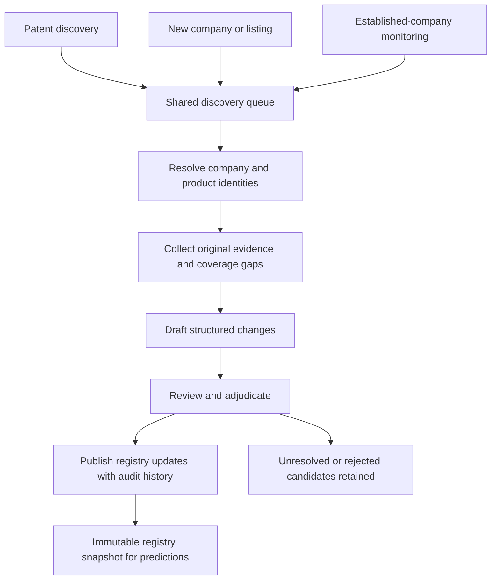

# Company and product discovery: implementation and rollout

Proposed October 14, 2026. This document defines future implementation work; it does not enable jobs, import records or change the live database.

## Objective and starting point

Build three complementary routes into one reviewed company and product registry. Products are the main prediction entities; companies provide identity, ownership, execution and financial context. Preserve stable IDs, evidence and historical knowledge across discoveries and updates.

The MySQL `tracking` database on RDS instance `semaphore` is installed and tested, with 10 tables and 27 audit triggers. As recorded in [RDS_TRACKING_SCHEMA.md](RDS_TRACKING_SCHEMA.md), no company or product seed data has been loaded. The existing [company universe](config/company-universe.v0.5.json), [admission policy](COMPANY_ADMISSION.md), [patent pilot](PATENT_ATHENA.md) and [patent backfill](PATENT_BACKFILL_ATHENA.md) are implementation inputs. Verify their current release pointers and coverage at execution time rather than treating this document as live source status.

Use the existing four sectors: biotech, robotics, semiconductors and energy storage. New listings nominate companies for discovery; admission still requires reviewed sector relevance and legal identity under the established policy. Private companies remain eligible.

## Three discovery routes

| Route | Trigger | Flow | Intended result |
|---|---|---|---|
| Bottom-up: patents | New patent publications/families, examination/petition evidence or newly resolved company matches | Patent and prosecution evidence → applicant/assignee → company → supporting web evidence → product/program | Find identifiable assets, including early development programs. |
| Bottom-up: companies | Newly observed listing, IPO notice/prospectus or other company discovery event | Listing → legal issuer → company evidence inventory → products/programs | Discover companies and establish their initial product inventory. Start with HKEX. |
| Top-down: established companies | Scheduled review or material new evidence | Tracked company → catalogs/pipelines, patents, PR, filings, publications and conferences → inventory comparison | Identify additions, renames, new generations, transfers, lifecycle changes and removals requiring review. |



All routes share identity resolution, evidence collection, review and publication. Repeated discoveries enrich an existing entity instead of generating another company/product ID. Preserve each originating route and its evidence.

## Shared processing stages

### 1. Establish the company identity map

Import the versioned company universe into staging, including company IDs, legal and display names, aliases, external identifiers, listings, sectors, evidence and review states. Reconcile activation decisions against the admission ledger; an imported `collection_enabled` flag alone is not an admission decision.

Generate an insert/update/conflict report before loading RDS. Preserve existing IDs, pending/rejected states and disabled tracking decisions. Maintain a migration mapping for existing alias and identifier IDs because the SQL supporting tables currently use integer keys. Record the source release/hash and imported row mappings in an import manifest.

Reruns must be idempotent. Use stable entity IDs and source identity mappings rather than broad name-based upserts. Detect conflicts in namespaces, identifiers and listings; preserve their evidence for adjudication. Do not let an older source snapshot overwrite a newer reviewed edit.

### 2. Normalize incoming triggers

Represent every discovery trigger as a durable event with route, provider/dataset, source record identity, source/effective date where known, first-observed time, capture time and evidence reference. Preserve corrections as new versions of the same source event.

For HKEX, distinguish a newly observed listing from a genuinely new listing. Bootstrap the initial inventory without labeling every existing issuer a new IPO. Compare subsequent inventories and official notices; distinguish additional listings, renamed issuers, relistings, transfers and depositary securities. A temporary provider omission is not a delisting. Historical imports retain their historical source dates and today's observation time.

### 3. Resolve entities and generate research work

Prefer corroborated identifiers, then reviewed aliases and dated corporate relationships. Fuzzy names produce candidates for review. Track reported patent applicant/assignee identity separately from current ownership; a name match is insufficient to establish either a product link or ownership.

Resolve subsidiary matches explicitly. A subsidiary's patent or publication should not silently become evidence of ownership by its parent. Record affiliation dates and evidence. Papers require author/organization affiliation checks; mentions, acknowledgements and subject-company references have different meanings.

Group patent publications into families only where reliable identifiers are available. Retain the individual publication references and family source. Missing family data remains explicit. Technology clustering helps prioritize research but does not itself establish a product.

### 4. Collect a bounded evidence inventory

Start with saved source observations, then collect missing primary material through the existing source integrations. Search queries combine company/alias, patent number, development code, distinctive technical terms and application. Search results nominate original documents; save the original reference, capture hash and supporting passage/page location.

| Source class | What it can establish after review |
|---|---|
| Prospectuses and issuer filings | Legal issuer, business scope, named programs, disclosed risks and transactions. |
| Official catalogs and pipeline pages | Named products/programs, current positioning and inventory presence. |
| Patents and assignment records | Technical disclosures, reported parties and separately reviewed ownership evidence. |
| USPTO Office Actions and final Petition Decisions | Examination reasoning, cited references and procedural outcomes; nominate technical research and product/program links without inferring ownership or commercial success. |
| Academic articles and conference proceedings | Research assets, experiments and dated affiliations; distinguish peer-reviewed work, preprints, abstracts and talks. |
| PR and partner announcements | Announced launches, partnerships, licenses and milestones; corroborate material relationships. |
| Regulatory records and technical documents | Product identifiers, applicable authorizations, specifications and explicit patent-marking links. |

Aim for broad discovery, with recorded coverage. Do not claim to have found every available article or patent. Record sources checked, query parameters, date ranges, pagination completion, excluded material, access failures and retrieval limits. A failed or empty search is a coverage outcome rather than evidence that the product does not exist.

### US examination and petition evidence for both bottom-up routes

Use the [USPTO examination and petition collectors](USPTO_PROSECUTION_ROLLOUT_PLAN.md), implemented with historical collection from January 1, 2021 now in progress and subsequent additions/corrections. The downstream discovery adapters described here remain proposed. Consume committed source releases and original-document references. Existing patent backfill alone does not supply this evidence.

For patent-led discovery, link Office Actions and decisions by normalized US application identity to publications and reviewed family references. Use examiner text and citations to prioritize technical research and nominate product/program connections. Cited parties and references have explicit roles; they do not establish applicant identity or ownership. Changed prosecution evidence can enqueue research for an existing candidate without creating another product.

For company-led discovery, enrich the issuer's initial evidence inventory with retained prosecution records for resolved legal names, aliases and linked applications. Reuse this evidence during established-company review. Keep applicant/assignee, subsidiary, cited organization and representative roles separate; broad text matches nominate review only.

Historical replay uses durable source-document/version trigger identities, historical action/decision dates and today's observation time. Deduplicate overlapping feeds and both discovery routes. Rejections, petitions and unanswered source searches cannot automatically establish product failure, discontinuation or a company relationship. Record dataset-specific coverage and missing-document outcomes in `source_checks`; unresolved application/product links remain reviewable.

### 5. Extract product candidates and proposed changes

Extract canonical names, brands/development codes, asset type, sector, descriptive technology, lifecycle stage, application/geography, related companies and evidence. Resolve duplicates before assigning `prd_…` IDs. A distinct generation/formulation can receive a new ID linked to its parent; a rename remains the same product with dated aliases.

Classify the outcome as named product, development program, trackable technology/platform, supporting process, or unresolved invention. Review whether platforms/processes meet prediction scope before admitting them. Do not turn each patent family, clinical trial or paper into a product automatically.

Each proposed patent-to-product link states its basis: explicit product patent marking, explicit source attribution, or technical correspondence requiring review. A product can link to many patents, and a patent can support multiple products. Confirming product identity does not automatically verify every patent link.

### 6. Review and publish

The first release uses human review of all proposed identity merges, activations, company/product roles and patent links. Review manifests identify the reviewer, decision, evidence, policy version and before/after state. Rejected and unresolved discoveries remain traceable.

Publish approved changes through a dedicated TLS-only application login with the `tracking_editor` role, UTC sessions, authenticated audit actor/reason and optimistic locking. Provision its credential separately from the RDS administrator. Grant queue/source-tracking writes explicitly as later migrations add those tables; do not broaden the role to database-wide writes.

One bounded transaction publishes a reviewed entity/change set and updates its publication checkpoint. Retry a completed publication by checking its run/decision key; do not duplicate rows or audit updates. RDS DDL uses separately versioned, forward-only migrations because it implicitly commits.

Export an immutable registry snapshot and review/import manifests to S3, then publish the relevant typed references to Athena. Prediction runs record that snapshot version, feature cutoff and evidence observations. Publication must explicitly reconcile the current admission ledger and exported universe contract, preventing two independent active-universe definitions.

## Established-company inventory monitoring

Build a reviewed baseline for each pilot company, then compare later source inventories against it. Normalize renamed pages and aliases before identifying additions or absences. Treat catalogs and pipeline pages as dated source inventories, not complete inventories of all company activity.

| Observed change | Proposed action |
|---|---|
| Named asset not in baseline | Create/reconcile a candidate and review activation. |
| Different name for the same asset | Add alias and update display/canonical name when justified. |
| Materially distinct generation | Create linked product candidate with its own ID. |
| Changed stage, application or authorization | Propose a dated product/context update. |
| Licensing, sale or acquisition | Propose dated company-role changes; preserve prior relationships. |
| Product absent from latest captured inventory | Flag `missing_from_source` for review; check capture completeness and other sources. |
| Explicit discontinuation/withdrawal | Propose lifecycle/tracking change with evidence and effective date. |

No automatic retirement based on disappearance, silence, failed extraction or missing search results. Company suspension, delisting, product discontinuation and prediction exclusion are separate decisions. Preserve historical products and company roles.

## Proposed data and software additions

These are proposed migrations/components; they are not installed yet. Keep bulk documents and observations in S3/Athena. RDS stores compact state and durable cross-references.

| Addition | Minimum contents and behavior |
|---|---|
| `discovery_events` | Route, namespaced trigger identity/version, candidate/company/listing references, dates, evidence and deduplication key. Allows unresolved entities before IDs exist. |
| `discovery_tasks` | Stage, task identity, input hash, status, attempts, lease expiry, checkpoint, error category and next attempt time. |
| `source_checks` | Task, source/query/date scope, completion/coverage outcome, saved capture reference and observation time. |
| `entity_candidates` / `proposed_changes` | Structured candidate/change payload, evidence, matching basis, reviewer decision and publication key. Reviewed payloads are validated before registry writes. |
| `company_relationships` | Dated parent/subsidiary and other relevant corporate links with reviewed evidence. |
| `product_patent_links` | Product ID, namespaced publication reference, optional family reference/source, link basis, review state and evidence. Unique product/publication identity; never unique patent-only identity. |
| `inventory_snapshots` / `inventory_items` | Company, source/run, capture date, completeness and product/candidate presence. Preserves source-specific additions and absences. |
| `entity_review_schedule` | Company/product review cadence, next due time, priority and reason; company scheduling supplements existing product review fields. |
| Import/publication manifests | Source release/hash, stable-ID mappings, reviewed changes, reconciliation counts, snapshot reference and publication status. |

Add foreign keys for resolved entities, uniqueness for idempotency, and explicit checks for status vocabularies. Separate operational task retry state from reviewed registry facts. Extend the audit coverage to new evidence-bearing relationships and links; append operational events where task-state history is needed. Migration tests must cover new tables, triggers and restricted-role grants together.

Suggested components: company importer; listing-difference intake; patent-family discovery; company evidence researcher; inventory comparer; shared review/publisher; snapshot exporter. Reuse existing admission, collection storage, source scheduling and patent matching code where practical.

The following command interface is illustrative and must be implemented. It is not runnable today:

```text
tracking-discovery import-companies --universe <release> --dry-run
tracking-discovery import-companies --review-manifest <approved-manifest>
tracking-discovery discover-patents --cohort <pilot> --publication-limit <cap>
tracking-discovery discover-companies --exchange HKEX --baseline <release>
tracking-discovery research --run <run-id> --task-limit <cap>
tracking-discovery compare-inventory --cohort <pilot> --baseline <snapshot>
tracking-discovery publish --review-manifest <approved-manifest>
tracking-discovery export-snapshot --run <published-run>
```

## Phased implementation and rollout

Advance by acceptance gates rather than fixed calendar dates. Begin with manually launched bounded runs; enable recurring jobs after the pilot passes.

| Phase | Work and deliverables | Exit gate |
|---|---|---|
| 0: contracts and migrations | Confirm current source coverage and release pointers; implement schema additions, source identities, review states and importer mappings; define application login/grants. | Migration, audit and permission checks pass in isolation; no production source or collector behavior changes. |
| 1: company foundation | Dry-run existing-universe import, adjudicate collisions, load reviewed records and publish reconciliation report. | Every input company/listing accounted for as imported, staged conflict or intentionally retained historical record; IDs and admission states preserved; rerun produces no unintended changes. |
| 2: patent pilot | Select eight companies, two per sector where usable evidence exists; review up to ten family/technology items per company. Save researched candidates and patent-link evidence, including bounded historical Office Action/Petition Decision releases and explicit coverage gaps. | All proposed activations and patent links reviewed; duplicate/misattribution issues resolved; retrieval gaps and effort reported. Lack of a product is an acceptable unresolved result. |
| 3: company-discovery pilot | Bootstrap HKEX listing inventory; replay up to five dated listing/IPO events, distinguishing historical replay from live discovery. Research in-scope issuers, including retained USPTO examination/petition evidence for their resolved applications. | Correct treatment of existing issuers, additional listings and identity conflicts; end-to-end new-company → reviewed-product path demonstrated where evidence supports it. Out-of-scope issuers are retained as discovery outcomes. |
| 4: top-down pilot | Establish baselines for the pilot's established companies and compare two captures. Replay known changes or clearly labeled synthetic fixtures if no natural event occurs. | Addition, rename, generation, transfer, absence and explicit discontinuation behaviors verified; absence never auto-retires a product. |
| 5: controlled scheduling | Enable proposed cadences below with bounded queues, checkpoints, quotas, dashboards and alerts. | Retry/resume and duplicate-trigger checks pass; reviewers can keep up with intake; job failures cannot silently change tracking state. |
| 6: expansion | Add more companies, exchanges and sources; broaden cohort in measured batches. | Stable matching/review quality, acceptable coverage and measured cost/workload support each expansion. |

Pilot sizes are initial workload caps, not required product counts or evidence of coverage. If usable source data is missing in a sector, record the gap and repair coverage rather than substituting unrelated entities.

## Proposed operating cadence and resource limits

| Work | Initial cadence |
|---|---|
| Listing/IPO intake | Daily after the relevant source capture; reconcile inventories weekly. |
| Patent discovery | After each successful patent release; process newly available records and changed matches. |
| PR/filing/regulatory event intake | After existing successful source captures. |
| Established-company review | Weekly for highest-priority entities; monthly for others. Material events can bring a review forward. |
| Publications/conference discovery | Weekly, adjusted to provider coverage and event schedules. |
| Unresolved-candidate revisit | Monthly or sooner when new evidence becomes available. |
| Registry snapshot publication | After reviewed batches, with an optional daily consolidated release once operating reliably. |

Run research/extraction outside the micro RDS instance. Begin with one registry writer and one bounded research worker. Keep connections pooled and transactions short. Cap tasks, provider requests, downloads and document size per run; obey existing quota controls and record budget exhaustion as incomplete coverage. Measure workload before raising concurrency or changing instance size.

These cadences are proposals only. Implement them using the repository's existing scheduling/checkpoint mechanisms after phase 5 is accepted; this document creates no schedules.

## Validation, monitoring and recovery

Tests should exercise meaningful behavior: idempotent imports and publications; alias collisions; parent/subsidiary ambiguity; new versus newly observed listings; multiple routes finding one product; patent families lacking reliable identifiers; rejected product links; inventory absence versus explicit retirement; interrupted tasks; stale reviewed changes; and evidence cutoff handling.

Track discovery events by route, identity resolution outcomes, reviewed product additions/changes, rejected links, queue age, source coverage, failed captures, requests/cost per run, and reviewed errors by sector. Product counts and patent counts are activity metrics; evaluate evidence quality and matching accuracy separately. Review a sample of rejected/unresolved items to assess missed discoveries as well as false positives.

Failures pause or retry the affected task with bounded backoff. Capture failures must not publish empty inventories as removals. A reviewed record changing before publication causes a conflict requiring reconciliation rather than a forced overwrite. Source/quota issues remain visible in the run report.

Disable intake/publish jobs independently when repairing a fault. Resume from immutable inputs/checkpoints. Correct published registry facts through audited compensating updates; retain old snapshots and publication manifests. Use database backups for disaster recovery, not routine data-review corrections.

Historical prediction inputs use immutable published snapshots and evidence availability dates. An import today does not establish historical watchlist membership. Do not equate audit statement timestamps with transaction commit visibility when reconstructing historical state; published snapshot manifests define the authoritative available registry version.

## First execution package

The first implementation should deliver the schema-extension migration, application role grants, repeatable company importer, dry-run reconciliation report and pilot discovery queue. Then execute the import and bounded patent pilot, followed by the HKEX and established-company pilots. Broader automation follows only after their acceptance gates pass.
