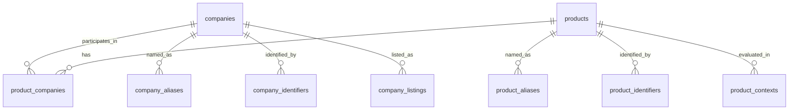

# RDS schema for tracked products and companies

Adapted October 14, 2026 for **Amazon RDS for MySQL 8.4** (the `semaphore` instance). Deployment status is recorded below; the executable migration is [schemas/rds-tracking-mysql.sql](schemas/rds-tracking-mysql.sql).

## Purpose and existing data

The database is the editable registry of the products and companies we track. **Products are the primary unit for prediction**; companies supply ownership, operating and financial context. Keep large source documents, collected observations and model features in the existing S3/Athena pipeline, and reference their evidence from this registry.

Preserve the existing `cmp_…`, `prd_…` and `lst_…` identifiers defined in [the research contract](schemas/research-data.schema.json). The reviewed [company universe](config/company-universe.v0.5.json) provides company identities, aliases, identifiers and listings; its `products` array is currently empty. Product discovery and review are therefore an explicit initial task, not an assumed completed import.

## Entity model

| Table | Purpose |
|---|---|
| `companies` | Editable legal identity, description and tracking controls. |
| `products` | Editable product/program/technology identity, sector, maturity and prediction priority. |
| `product_companies` | Dated roles linking products to developers, owners, manufacturers and licensees. |
| `company_aliases`, `product_aliases` | Former names, local-language names, brands and development codes for matching. |
| `company_identifiers`, `product_identifiers` | Namespaced external identifiers for deterministic matching. |
| `company_listings` | Exchange/ticker identities separate from legal companies. |
| `product_contexts` | Indication/application and geographic scope for distinct prediction targets. |
| `entity_changes` | Automatic before/after history for registry edits. |



A company can have many products, and a product can involve several companies. Do not place a single mandatory `company_id` on a product: discovery may precede company resolution, and licensing or joint development requires multiple roles.

Use one product row for an identifiable asset, program or technology. A materially distinct hardware generation or formulation receives a new ID with `parent_product_id` linking it to its family/predecessor. Renames and code names are aliases of the same ID. Separate indication, application and market combinations into contexts rather than duplicating the product. A clinical trial, patent or regulatory application is evidence associated with a product, not automatically a product identity.

## MySQL 8.4 DDL

IDs are application-generated UUIDs with the existing prefixes. Names are deliberately **not unique**. `NULL` means unknown; do not infer missing dates or turn absent evidence into a negative finding. Timestamps use `DATETIME(6)` storing UTC. Set every connection to `time_zone = '+00:00'`; write triggers reject other session time zones. MySQL databases replace PostgreSQL schemas, so the database is named `tracking`.

Every mutable row carries evidence and review state. `evidence` is a nonempty JSON array of objects with `source`, `reference` and optional `note`; references can be an observation ID, original URL or immutable S3 object URI. The application validates that object structure. `observed_at` records when the supporting information was observed; `updated_at` records the database edit time. These have different meanings.

```sql
-- MySQL 8.4; one-time migration. Stop on the first error; do not use --force.
-- DDL implicitly commits. Install into a new database only.
CREATE DATABASE tracking CHARACTER SET utf8mb4 COLLATE utf8mb4_0900_as_ci;
USE tracking;
SET SESSION time_zone = '+00:00';
SET NAMES utf8mb4;

CREATE TABLE companies (
  company_id varchar(40) CHARACTER SET ascii COLLATE ascii_bin PRIMARY KEY CHECK (REGEXP_LIKE(company_id, '^cmp_[0-9a-f]{8}-[0-9a-f]{4}-4[0-9a-f]{3}-[89ab][0-9a-f]{3}-[0-9a-f]{12}$', 'c')),
  canonical_name varchar(512) NOT NULL CHECK (trim(canonical_name) <> ''),
  display_name varchar(512),
  entity_type varchar(100) NOT NULL DEFAULT 'legal_entity',
  description text,
  website_url varchar(2048),
  domicile_country varchar(2) CHECK (REGEXP_LIKE(domicile_country, '^[A-Z]{2}$', 'c')),
  ownership_status varchar(100) NOT NULL DEFAULT 'unknown'
    CHECK (ownership_status IN ('public', 'private', 'state_owned', 'unknown')),
  entity_status varchar(100) NOT NULL DEFAULT 'unknown'
    CHECK (entity_status IN ('active', 'inactive', 'dissolved', 'unknown')),
  sector_ids json NOT NULL DEFAULT (JSON_ARRAY()) CHECK (JSON_TYPE(sector_ids) = 'ARRAY'),
  collection_enabled boolean NOT NULL DEFAULT false,
  review_status enum('pending', 'verified', 'rejected') NOT NULL DEFAULT 'pending',
  evidence json NOT NULL CHECK (JSON_TYPE(evidence) = 'ARRAY' AND JSON_LENGTH(evidence) > 0),
  observed_at datetime(6) NOT NULL,
  archived_at datetime(6),
  created_at datetime(6) NOT NULL DEFAULT CURRENT_TIMESTAMP(6),
  updated_at datetime(6) NOT NULL DEFAULT CURRENT_TIMESTAMP(6),
  row_version bigint NOT NULL DEFAULT 1 CHECK (row_version > 0)
) ENGINE=InnoDB;

CREATE TABLE products (
  product_id varchar(40) CHARACTER SET ascii COLLATE ascii_bin PRIMARY KEY CHECK (REGEXP_LIKE(product_id, '^prd_[0-9a-f]{8}-[0-9a-f]{4}-4[0-9a-f]{3}-[89ab][0-9a-f]{3}-[0-9a-f]{12}$', 'c')),
  canonical_name varchar(512) NOT NULL CHECK (trim(canonical_name) <> ''),
  display_name varchar(512),
  product_type varchar(100) NOT NULL CHECK (product_type IN ('product', 'development_program', 'technology')),
  sector_id varchar(100) NOT NULL CHECK (sector_id IN ('biotech', 'robotics', 'semiconductors', 'energy_storage')),
  subsector_id varchar(100),
  description text,
  technology_summary text,
  parent_product_id varchar(40) CHARACTER SET ascii COLLATE ascii_bin,
  model_or_version varchar(100),
  lifecycle_status varchar(100) NOT NULL DEFAULT 'unknown'
    CHECK (lifecycle_status IN ('research', 'development', 'commercial', 'discontinued', 'unknown')),
  tracking_status varchar(100) NOT NULL DEFAULT 'candidate'
    CHECK (tracking_status IN ('candidate', 'active', 'paused', 'retired')),
  prediction_priority smallint NOT NULL DEFAULT 3 CHECK (prediction_priority BETWEEN 1 AND 5),
  tracking_rationale text,
  collection_enabled boolean NOT NULL DEFAULT false,
  attributes json NOT NULL DEFAULT (JSON_OBJECT()) CHECK (JSON_TYPE(attributes) = 'OBJECT'),
  review_status enum('pending', 'verified', 'rejected') NOT NULL DEFAULT 'pending',
  evidence json NOT NULL CHECK (JSON_TYPE(evidence) = 'ARRAY' AND JSON_LENGTH(evidence) > 0),
  observed_at datetime(6) NOT NULL,
  last_reviewed_at datetime(6),
  next_review_at datetime(6),
  archived_at datetime(6),
  created_at datetime(6) NOT NULL DEFAULT CURRENT_TIMESTAMP(6),
  updated_at datetime(6) NOT NULL DEFAULT CURRENT_TIMESTAMP(6),
  row_version bigint NOT NULL DEFAULT 1 CHECK (row_version > 0),
  CHECK (parent_product_id IS NULL OR parent_product_id <> product_id),
  FOREIGN KEY (parent_product_id) REFERENCES products(product_id)
) ENGINE=InnoDB;

CREATE TABLE product_companies (
  relationship_id bigint UNSIGNED AUTO_INCREMENT PRIMARY KEY,
  product_id varchar(40) CHARACTER SET ascii COLLATE ascii_bin NOT NULL,
  company_id varchar(40) CHARACTER SET ascii COLLATE ascii_bin NOT NULL,
  role varchar(100) NOT NULL CHECK (role IN ('developer', 'owner', 'manufacturer', 'licensee', 'commercial_partner')),
  territory varchar(100) NOT NULL DEFAULT 'unknown',
  valid_from date,
  valid_to date,
  review_status enum('pending', 'verified', 'rejected') NOT NULL DEFAULT 'pending',
  evidence json NOT NULL CHECK (JSON_TYPE(evidence) = 'ARRAY' AND JSON_LENGTH(evidence) > 0),
  observed_at datetime(6) NOT NULL,
  CHECK (valid_to IS NULL OR valid_from IS NULL OR valid_to > valid_from),
  FOREIGN KEY (product_id) REFERENCES products(product_id),
  FOREIGN KEY (company_id) REFERENCES companies(company_id)
) ENGINE=InnoDB;

CREATE TABLE company_aliases (
  alias_id bigint UNSIGNED AUTO_INCREMENT PRIMARY KEY,
  company_id varchar(40) CHARACTER SET ascii COLLATE ascii_bin NOT NULL,
  alias varchar(512) NOT NULL CHECK (trim(alias) <> ''),
  alias_type varchar(100) NOT NULL, -- former_name, local_name, abbreviation, etc.
  language_code varchar(100),
  valid_from date,
  valid_to date,
  review_status enum('pending', 'verified', 'rejected') NOT NULL DEFAULT 'pending',
  evidence json NOT NULL CHECK (JSON_TYPE(evidence) = 'ARRAY' AND JSON_LENGTH(evidence) > 0),
  observed_at datetime(6) NOT NULL,
  CHECK (valid_to IS NULL OR valid_from IS NULL OR valid_to > valid_from),
  FOREIGN KEY (company_id) REFERENCES companies(company_id)
) ENGINE=InnoDB;

CREATE TABLE product_aliases (
  alias_id bigint UNSIGNED AUTO_INCREMENT PRIMARY KEY,
  product_id varchar(40) CHARACTER SET ascii COLLATE ascii_bin NOT NULL,
  alias varchar(512) NOT NULL CHECK (trim(alias) <> ''),
  alias_type varchar(100) NOT NULL, -- brand, development_code, former_name, etc.
  language_code varchar(100),
  valid_from date,
  valid_to date,
  review_status enum('pending', 'verified', 'rejected') NOT NULL DEFAULT 'pending',
  evidence json NOT NULL CHECK (JSON_TYPE(evidence) = 'ARRAY' AND JSON_LENGTH(evidence) > 0),
  observed_at datetime(6) NOT NULL,
  CHECK (valid_to IS NULL OR valid_from IS NULL OR valid_to > valid_from),
  FOREIGN KEY (product_id) REFERENCES products(product_id)
) ENGINE=InnoDB;

CREATE TABLE company_identifiers (
  identifier_id bigint UNSIGNED AUTO_INCREMENT PRIMARY KEY,
  company_id varchar(40) CHARACTER SET ascii COLLATE ascii_bin NOT NULL,
  namespace varchar(100) COLLATE utf8mb4_0900_as_cs NOT NULL, -- lei, sec_cik, or jurisdiction-qualified registry
  identifier_value varchar(255) COLLATE utf8mb4_0900_as_cs NOT NULL,
  review_status enum('pending', 'verified', 'rejected') NOT NULL DEFAULT 'pending',
  evidence json NOT NULL CHECK (JSON_TYPE(evidence) = 'ARRAY' AND JSON_LENGTH(evidence) > 0),
  observed_at datetime(6) NOT NULL,
  UNIQUE (namespace, identifier_value),
  FOREIGN KEY (company_id) REFERENCES companies(company_id)
) ENGINE=InnoDB;

CREATE TABLE product_identifiers (
  identifier_id bigint UNSIGNED AUTO_INCREMENT PRIMARY KEY,
  product_id varchar(40) CHARACTER SET ascii COLLATE ascii_bin NOT NULL,
  namespace varchar(100) COLLATE utf8mb4_0900_as_cs NOT NULL, -- provider/jurisdiction-qualified product registry
  identifier_value varchar(255) COLLATE utf8mb4_0900_as_cs NOT NULL,
  review_status enum('pending', 'verified', 'rejected') NOT NULL DEFAULT 'pending',
  evidence json NOT NULL CHECK (JSON_TYPE(evidence) = 'ARRAY' AND JSON_LENGTH(evidence) > 0),
  observed_at datetime(6) NOT NULL,
  UNIQUE (namespace, identifier_value),
  FOREIGN KEY (product_id) REFERENCES products(product_id)
) ENGINE=InnoDB;

CREATE TABLE company_listings (
  listing_id varchar(40) CHARACTER SET ascii COLLATE ascii_bin PRIMARY KEY CHECK (REGEXP_LIKE(listing_id, '^lst_[0-9a-f]{8}-[0-9a-f]{4}-4[0-9a-f]{3}-[89ab][0-9a-f]{3}-[0-9a-f]{12}$', 'c')),
  company_id varchar(40) CHARACTER SET ascii COLLATE ascii_bin NOT NULL,
  exchange_mic varchar(4) COLLATE utf8mb4_0900_as_cs NOT NULL,
  ticker varchar(64) COLLATE utf8mb4_0900_as_cs NOT NULL,
  security_type varchar(100) NOT NULL,
  share_class varchar(100),
  currency varchar(3) CHECK (REGEXP_LIKE(currency, '^[A-Z]{3}$', 'c')),
  company_role varchar(100), -- preserve underlying_issuer/depositary distinctions
  depositary_issuer_name varchar(100),
  trading_from date,
  valid_from date,
  valid_to date,
  review_status enum('pending', 'verified', 'rejected') NOT NULL DEFAULT 'pending',
  evidence json NOT NULL CHECK (JSON_TYPE(evidence) = 'ARRAY' AND JSON_LENGTH(evidence) > 0),
  observed_at datetime(6) NOT NULL,
  CHECK (valid_to IS NULL OR valid_from IS NULL OR valid_to > valid_from),
  FOREIGN KEY (company_id) REFERENCES companies(company_id)
) ENGINE=InnoDB;

CREATE TABLE product_contexts (
  context_id bigint UNSIGNED AUTO_INCREMENT PRIMARY KEY,
  product_id varchar(40) CHARACTER SET ascii COLLATE ascii_bin NOT NULL,
  application_key varchar(128) COLLATE utf8mb4_0900_as_cs NOT NULL, -- controlled indication/use-case code
  application_name varchar(512) NOT NULL,
  geography_key varchar(64) COLLATE utf8mb4_0900_as_cs NOT NULL, -- ISO country, explicit region, global or unknown
  development_stage varchar(100), -- sector-specific controlled vocabulary
  regulatory_status varchar(100),
  tracking_enabled boolean NOT NULL DEFAULT false,
  review_status enum('pending', 'verified', 'rejected') NOT NULL DEFAULT 'pending',
  evidence json NOT NULL CHECK (JSON_TYPE(evidence) = 'ARRAY' AND JSON_LENGTH(evidence) > 0),
  observed_at datetime(6) NOT NULL,
  UNIQUE (product_id, application_key, geography_key),
  FOREIGN KEY (product_id) REFERENCES products(product_id)
) ENGINE=InnoDB;

CREATE TABLE entity_changes (
  change_id bigint UNSIGNED AUTO_INCREMENT PRIMARY KEY,
  table_name varchar(64) NOT NULL,
  row_key varchar(64) NOT NULL,
  operation varchar(100) NOT NULL CHECK (operation IN ('INSERT', 'UPDATE', 'DELETE')),
  before_row json,
  after_row json,
  changed_at datetime(6) NOT NULL DEFAULT CURRENT_TIMESTAMP(6),
  changed_by varchar(255) NOT NULL,
  change_reason text NOT NULL
) ENGINE=InnoDB;

CREATE INDEX companies_name_idx ON companies (canonical_name);
CREATE INDEX products_name_idx ON products (canonical_name);
CREATE INDEX products_prediction_queue_idx ON products (tracking_status, review_status, archived_at, sector_id, prediction_priority, next_review_at);
CREATE INDEX product_companies_product_idx ON product_companies (product_id);
CREATE INDEX product_companies_company_idx ON product_companies (company_id);
CREATE INDEX company_aliases_lookup_idx ON company_aliases (alias);
CREATE INDEX company_aliases_company_idx ON company_aliases (company_id);
CREATE INDEX product_aliases_lookup_idx ON product_aliases (alias);
CREATE INDEX product_aliases_product_idx ON product_aliases (product_id);
CREATE INDEX company_identifiers_company_idx ON company_identifiers (company_id);
CREATE INDEX product_identifiers_product_idx ON product_identifiers (product_id);
CREATE INDEX company_listings_company_idx ON company_listings (company_id);
CREATE INDEX company_listings_lookup_idx ON company_listings (exchange_mic, ticker);

CREATE INDEX entity_changes_lookup_idx ON entity_changes (table_name, row_key, changed_at, change_id);
```

Priority `1` is highest. `attributes` holds descriptive sector-specific details such as modality, chip architecture, robot class or battery chemistry. Promote frequently queried attributes into typed columns when their definitions stabilize. Financial time series, trial results, benchmarks, forecasts and model scores belong in separate fact/model tables keyed by `product_id`, optional `context_id` and observation time.

Only use one-to-one identity namespaces in identifier tables. A trial ID, patent number or shared regulatory authorization may cover multiple products; model those as evidence associations instead of forcing uniqueness here. Normalize namespace/value pairs before insertion (for example, fixed-format CIKs and jurisdiction-qualified company numbers). Preserve identifiers as text, including leading zeros.

## Updates and automatic history

The migration installs 27 table-specific MySQL triggers: insert, update and delete for each of the nine registry tables. Each trigger writes a complete JSON before/after row to `entity_changes` in the same InnoDB transaction. Updates to companies/products automatically increment `row_version` and stamp `updated_at`; primary keys and original creation times cannot be changed. Insert auditing runs after auto-increment assignment. See the executable migration for all trigger definitions.

Registry editors must set an authenticated actor and a reason for every transaction. The application supplies these from its trusted session. MySQL session variables persist across transactions: clear them in a `finally` block before returning a connection to the pool, including after rollback. Grant the application explicit `SELECT`, `INSERT`, `UPDATE` and `DELETE` privileges on the nine registry tables, and only `SELECT` on `entity_changes`. Do not grant broad database write privileges, `TRIGGER`, `ALTER`, `DROP` or routine-creation privileges. Triggers run with the migration account's definer privileges; keep that account available. Admin credentials are for migrations, not routine application writes.

```sql
USE tracking;
SET SESSION time_zone = '+00:00';
SET @app_actor = 'registry-editor';
SET @app_change_reason = 'Reviewed updated product description';
START TRANSACTION;
UPDATE products
SET description = ?, evidence = CAST(? AS JSON), observed_at = ?,
    last_reviewed_at = CURRENT_TIMESTAMP(6)
WHERE product_id = ? AND row_version = ?;
-- ? placeholders are bound by the application's MySQL driver.
-- Require affected_rows == 1; otherwise ROLLBACK and reload the product.
-- If successful, read the new version before COMMIT:
SELECT product_id, row_version FROM products WHERE product_id = ?;
COMMIT;
SET @app_actor = NULL, @app_change_reason = NULL;
```

MySQL has no PostgreSQL domains, native array columns or partial indexes. Review states use `ENUM`; evidence uses JSON with an enforced array/nonempty check; company sectors use a JSON array; the prediction queue uses a composite index including its filters. Foreign keys use explicit table-level declarations. Names and aliases use Unicode, case-insensitive and accent-sensitive indexes for discovery; external identifier pairs and application/geography keys use case-sensitive, accent-sensitive collation. Stable IDs use ASCII with case-sensitive comparison. Matching names is candidate discovery, not identity confirmation.

MySQL DDL implicitly commits: this one-time migration deliberately fails if `tracking` already exists and must be run without `--force`. Inspect and resolve partial installations instead of rerunning it blindly. If RDS has binary logging enabled, trigger creation requires `log_bin_trust_function_creators = 1` in a custom parameter group; check this before installing tables. [AWS trigger setup](https://docs.aws.amazon.com/AmazonRDS/latest/UserGuide/CHAP_Troubleshooting.html). Constraint and trigger behavior follows the [MySQL CHECK documentation](https://dev.mysql.com/doc/refman/8.4/en/create-table-check-constraints.html) and [trigger documentation](https://dev.mysql.com/doc/refman/8.4/en/trigger-syntax.html).

Archive companies/products rather than deleting them, and retire products rather than recycling their IDs. Foreign keys intentionally do not cascade deletes. Limit hard deletion to authorized correction workflows. Audit history retains supporting rows that are removed. The audit table uses table/key references rather than foreign keys so deletion does not erase its history.

Date intervals are `[valid_from, valid_to)`; unknown bounds remain unknown. In the writer transaction, validate overlapping listing assignments and duplicate product/company role intervals, and prevent cycles in product parent relationships. Alias collisions across entities are allowed and require contextual matching. Pending or rejected evidence must not become a verified relationship automatically.

## Prediction queries and historical use

Retrieve the current prediction queue at product level; include company context only through reviewed links. `territory = 'unknown'` and missing dates require review before jurisdiction-specific or historical interpretation.

```sql
SELECT p.product_id, p.canonical_name, p.sector_id, p.prediction_priority,
       pc.role, pc.territory, c.company_id, c.canonical_name AS company_name
FROM tracking.products p
LEFT JOIN tracking.product_companies pc
  ON pc.product_id = p.product_id
 AND pc.review_status = 'verified'
 AND (pc.valid_from IS NULL OR pc.valid_from <= CURRENT_DATE)
 AND (pc.valid_to IS NULL OR pc.valid_to > CURRENT_DATE)
LEFT JOIN tracking.companies c
  ON c.company_id = pc.company_id
 AND c.review_status = 'verified' AND c.archived_at IS NULL
WHERE p.tracking_status = 'active'
  AND p.review_status = 'verified'
  AND p.archived_at IS NULL
ORDER BY p.prediction_priority, p.product_id;
```

This returns one row per relationship, so aggregate or select the relevant role before building one-row-per-product model inputs. Product collection can continue even when a related company is not collection-enabled; honor company collection flags separately for company-specific sources.

**Do not train historical predictions against current mutable rows.** The audit log records database knowledge time; effective relationship dates record business time. For each prediction run, publish an immutable registry snapshot and store its version/S3 URI alongside the model version, feature cutoff and evidence observation IDs. Reconstruct past database state using the last audit entry at or before the cutoff (ordered by `changed_at`, then `change_id`), exclude deleted rows, and apply effective dates separately. Filter source evidence by its own availability time as well. Imports performed today cannot establish that information was known in a past prediction window. Full historical evidence revisions remain in the collection store.

## Initial population and rollout

1. Create a staging import from the reviewed company universe, preserving IDs, aliases, external identifiers, listing roles and evidence. Map `source/reference/note` evidence directly; retain pending/rejected states and disabled collection flags. Validate collisions before loading; do not merge by name or ticker alone.
2. Seed products from reviewed pipeline, catalog and regulatory evidence. Assign one stable `prd_…` ID per resolved asset; add aliases, contextual applications and reviewed company roles. Keep ambiguous matches pending and collection disabled until their identity is resolved.
3. Start with the four existing sectors. Maintain company sector JSON arrays from reviewed taxonomy entries; this proposal stores current membership, while source evidence and registry snapshots retain historical classification. Add a normalized dated classification table if sector history becomes a direct query requirement.
4. Export versioned registry snapshots into the existing universe/Athena publication contract. Map aliases and identifiers back to the contract's stable IDs through an explicit migration mapping; supporting identity keys in this proposal do not replace existing exported alias/identifier IDs. The current product contract will need a versioned extension for the richer product fields and contexts.
5. Update collectors to resolve external IDs and reviewed aliases into `company_ids` and `product_ids`. Keep unresolved matches explicit. Company-level filings do not automatically describe every product belonging to the issuer.
6. Before deployment, execute the DDL in a isolated MySQL 8.4 database and verify an import, optimistic-lock conflict, automatic audit entry, ID immutability, restricted audit writes and snapshot reconstruction. Execute the migration only after connection and trigger prerequisites pass; live validation status is recorded below.

## Deployment and validation status

Installed and verified on October 14, 2026. No passwords are stored in these files.

| Setting | Verified value |
|---|---|
| Instance / engine | `semaphore` / MySQL `8.4.9` |
| Database | `tracking` |
| Schema objects | 10 InnoDB tables; 27 audit triggers |
| Parameter group | `semaphore-tracking-mysql84`, `in-sync` after reboot |
| Audit-trigger prerequisite | `log_bin_trust_function_creators = 1` |
| Encrypted connections | `require_secure_transport = 1`; certificate-verified TLS tested |
| Server time zone | `UTC`; writers explicitly set session `+00:00` |
| Network | Private RDS; port 3306 allowed only from `sg-003a787008ae9c7b3` |
| Storage encryption | Enabled |
| Backups | Seven-day retention |
| Deletion protection | Enabled |
| SQL roles | `tracking_reader` and `tracking_editor` created |

The host AWS role has the RDS access needed for these operations; no additional IAM policies were attached during this work. Existing unrelated permissions were left in place. SQL roles are defined in [rds-tracking-mysql-roles.sql](schemas/rds-tracking-mysql-roles.sql). They are ready to grant to a separately provisioned application login; the RDS `admin` account remains the migration account.

The full migration passed first in `tracking_trial_20261014`, an isolated trial database retained with the same empty schema, then in `tracking`. Checks covered all nine registry-table insert triggers, JSON evidence validation, foreign-key rejection, automatic row versions, stale-edit rejection, immutable IDs, required actor metadata, before/after history and delete history. A temporary TLS-only editor login successfully wrote through the audit triggers and was denied direct audit writes and table creation; that login was removed afterward. Verification passed again after the RDS reboot.

All synthetic records and their audit entries were rolled back. **No company or product data has been imported yet.** The reviewed universe import and product discovery remain the next population steps.

[rds-tracking-mysql-smoke.sql](schemas/rds-tracking-mysql-smoke.sql) contains the rollback-only checks. [tracking_mysql_trial.py](tracking_mysql_trial.py) resolves the supplied RDS-managed secret in memory and invokes the MySQL client with certificate verification. Use `--mode inspect` for connection/settings checks and `--mode verify` to rerun installed-schema checks. Installation modes deliberately refuse existing target databases. The public AWS CA bundle is stored in `config/rds-us-east-1-ca-bundle.pem`; it is not a credential.
