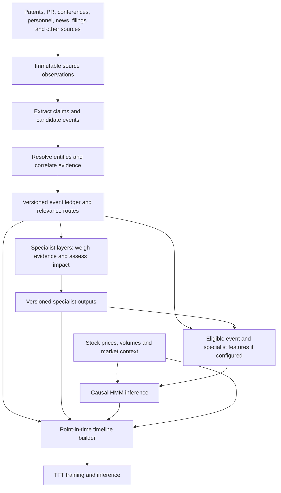

# Event pipeline proposal

Proposed October 14, 2026. This document proposes a new event and model-feature layer; it does not implement models, migrate databases, or enable collection jobs.

The concrete recording and operations plan is in [Implementation plan: recording, scripts, schedules, S3 and Athena](#implementation-plan-recording-scripts-schedules-s3-and-athena).

## Purpose

Convert patents, press releases, academic conferences and publications, leadership changes, news, and other material developments into an evidence-backed timeline. An event defines **what happened, the sources supporting it, the entities involved, its sector and subsector classifications, and the specialist layers to which it is relevant**. Multiple sources can describe one event; one source can describe several events.

Specialist layers assess those events and publish structured, versioned outputs. The TFT (Temporal Fusion Transformer) receives a chronological sequence combining event features, corresponding specialist outputs, HMM (Hidden Markov Model) outputs, and stock prices. Products/programs remain the main research entities; stock forecasts are keyed to individual listings and use explicit, dated links from products to companies and securities.

Build on the existing [research data contract](RESEARCH_DATA_CONTRACT.md), [collection storage](COLLECTION_STORAGE.md), [entity discovery rollout](ENTITY_DISCOVERY_ROLLOUT_PLAN.md), and [model history policy](config/model-data-policy.json). Preserve the approved January 1, 2021 model start, subject to verified coverage and historical availability. Existing collector records and specialist-source adapters are inputs; they do not establish that event correlation or specialist models already exist.

## End-to-end architecture



The HMM input contract is explicit per model version. Start with price/volume regime inputs; evaluate event or specialist inputs as a later variant. The TFT independently receives events and specialist outputs regardless of that HMM choice. There is no feedback from a future TFT prediction or realized outcome into the inputs for the same cutoff.

## What constitutes an event

An event represents a specific development or newly public information, not simply the arrival of a document. Separate the underlying occurrence from when each claim became public and when the pipeline learned it.

| Event family | Examples and distinctions |
|---|---|
| Patent/IP | Application publication, grant, assignment, challenge, expiry. Filing and publication are separate milestones; a patent is not automatically a product or proof of commercial viability. |
| Company announcement | Product launch, partnership, milestone, financing, guidance. A press release is a source format; classify the development it announces. |
| Academic/conference | Conference announced, abstract accepted/published, presentation delivered, proceedings or paper published. Keep meeting dates separate from disclosure dates and link successive milestones. |
| Personnel | CEO/CFO/CTO appointment, departure, interim replacement, role change. Announcement and effective dates can differ. |
| News/information | Newly reported investigation, operational incident, market development, or other material claim. Coverage repeating a known event enriches its evidence rather than creating another occurrence. |
| Regulatory/clinical | Trial start/results, authorization, rejection, safety notice, enforcement action. |
| Commercial/industrial | Contract award, licensing, M&A, production change, benchmark, supply disruption, installation or deployment. |

Allow several companies, products, people, jurisdictions, and sectors per event. A sector-wide policy event can be useful without a company match. Retain unresolved events for review rather than inventing links.

## Processing stages

### 1. Consume committed source observations

Read completed, immutable collector releases with per-source checkpoints. Reuse `record_id`, `observation_id`, payload hashes, source URLs and raw-document references. Normalize legacy personnel or patent output through adapters before using it here. Preserve source coverage and access limitations.

Use bounded batches and the existing memory-budget conventions. Do not introduce a second collection system or repeatedly download documents already retained. Retries may reprocess observations but must not duplicate event links or completed work.

### 2. Extract claims and candidate events

Extract the action, actor, object, dates, geography, quantities/units, and supporting passage/page from each observation. Produce a short factual summary and typed claims, including whether each claim is reported, corroborated, disputed, or withdrawn. Keep forecasts and company assertions distinguishable from observed outcomes.

Rules can handle durable IDs and structured records; text models can propose candidates from prose. Record extractor/model version and input hash. Every material claim needs evidence; unsupported extraction goes to review. Split a document covering several independent developments into separate candidates.

### 3. Resolve identity and correlate sources

Use stable company, product, person and listing IDs from a pinned registry snapshot. Dated ownership, employment and licensing links determine relevance; a mention, affiliation, parent relationship or fuzzy name is not sufficient to establish ownership or direct exposure. Unresolved entities can trigger the discovery queue described in the rollout plan.

Candidate correlation uses identifiers first: patent publication/family, DOI, trial ID, filing accession, product code, transaction ID or a reviewed personnel change. Then compare event type, participants, object, milestone, geography and time interval. Semantic similarity nominates matches; it does not authorize ambiguous merges.

Maintain three relationships:

- **Same event:** a PR, regulatory filing and news article report the same CEO appointment.
- **Related events:** a patent publication, later grant and eventual product launch share context but remain distinct milestones.
- **Duplicate evidence:** syndicated stories or reposts derive from the same original reporting.

Assign a stable `evt_<uuid>` once accepted. Keep candidate matching keys and merge/split decisions separately. A family can contain multiple patent events; membership alone is not an event deduplication key. Merges and splits create dated revisions and redirects while preserving prior snapshots and evidence.

### 4. Classify and route

Use [the existing taxonomy](config/sectors.v1.json): `biotech`, `robotics`, `semiconductors`, and `energy_storage`, with their defined subsector IDs. Store multiple classifications with evidence, confidence, review status and taxonomy version. Document technology classification is independent of company sector membership. An unknown subsector remains explicit and enters review.

Attach relevant specialist layers with a reason, relationship type, relevance weight, routing policy version and eligible entity scope. Relevance describes an evidenced connection; it does not claim statistical correlation or establish impact. Do not route every company event to every specialist solely because the company belongs to a sector.

### 5. Publish event versions and dispatch specialists

Publish immutable event versions with a compact operational state in RDS and bulk evidence/analytics in S3/Athena. Use the existing committed-release pattern and checksums. Publish work through a durable outbox committed with the event state to avoid missing dispatches.

Process specialist tasks at least once with idempotency keys based on event version, entity scope, specialist version, configuration and input snapshot. Use leases, bounded retries, checkpoints and a failed-task queue. A new material claim or correction reruns affected specialists; unchanged reposts need not rerun all layers.

### 6. Build timeline features and model datasets

Join eligible event versions, specialist outputs, causal HMM outputs and prices to the prediction grid using the rules below. Publish immutable feature releases with lineage and coverage manifests. Training and serving use the same transformation contract, with separate availability modes where historical reconstruction requires them.

## Minimum data contracts

These are proposed additions rather than existing tables. Normalize many-to-many links instead of duplicating source documents.

| Record | Required content |
|---|---|
| `events` / `event_versions` | Stable event ID, immutable version ID, type/subtype, title, factual summary, structured claims, occurrence/effective dates and precision, geography, state, first observation, version creation, eligibility time, schema/extractor versions, superseded version and correction reason. |
| `event_evidence` | Event version, source record and observation IDs, source/publisher, URL, captured artifact/hash, supporting passage/page, claim links, source availability/evidence, ingestion time, stance, provenance group, source quality and extraction confidence. |
| `event_entities` | Event version, entity ID/type, role (actor, affected party, owner, partner, employer, subject or mentioned), evidence, confidence, review status and dated relationship reference. |
| `event_classifications` | Event version, sector/subsector IDs, taxonomy version, classification basis, confidence, review status and evidence. |
| `event_relations` | Related event IDs and relation (`same_development`, `follow_up`, `corrects`, `supersedes`, `contradicts`), evidence and decision history. |
| `event_specialist_routes` | Event version, specialist ID/version, relevant entity, relationship, relevance weight, reason/evidence and routing policy version. |
| `specialist_outputs` | Event version, entity scope, specialist/model version, evidence snapshot, cutoff, output creation/eligibility time, typed scores, confidence, horizons, rationale, status and superseded output. |
| `hmm_outputs` | Entity/listing, observation cutoff, output eligibility time, state probabilities, model/scaler version, training interval, input snapshot and inference method. |
| `timeline_features` | Listing/entity, grid timestamp and cutoff, event features/references, specialist and HMM features, prices/volume, coverage/missingness, and feature/universe/model release versions. |

Keep event occurrence time, source public availability, ingestion time, and derived-output eligibility separate. Source temporal fields retain the existing contract's date precision and availability evidence. Each claim and evidence link has its own availability; attaching a new source cannot backdate a richer event version to the earliest source's publication.

Suggested event states: `candidate`, `accepted`, `disputed`, `retracted`, `superseded`. Review status and model eligibility are separate fields. Acceptance does not prove that an event is historically usable.

## Specialist layers and weighting

Create a versioned specialist registry with domain, supported event types, sector/subsector scope, input/output schema, model/rules version, horizons and missing-input policy. The following are proposed layer roles; map them to the actual specialist architecture during implementation.

| Layer | Typical inputs | Example outputs |
|---|---|---|
| IP/technology | Patents, papers, technical releases | Novelty, evidence of differentiation, IP risk, technical relevance. |
| Scientific/clinical | Abstracts, results, papers, trial changes | Evidence strength, efficacy/safety signals, replication and development risk. |
| Regulatory | Approvals, enforcement, policy | Authorization progress, compliance risk, jurisdiction exposure. |
| Product/commercial | Launches, licenses, contracts, deployments | Adoption evidence, milestone progress, commercialization exposure. |
| Operations/supply chain | Capacity, suppliers, manufacturing and incidents | Execution constraints, supply concentration, readiness and disruption. |
| Leadership/workforce | C-level changes, organizational moves | Continuity, relevant experience, execution uncertainty. |
| Financial/market context | Financing, filings, news and sector developments | Funding runway, dilution/exposure indicators, contextual impact. |

Specialists weigh source authority, independent corroboration, contradiction, extraction/entity confidence, novelty, entity exposure and horizon relevance. Treat source count and independent reporting count separately: ten copies of one PR do not constitute ten confirmations. Preserve component weights and policy versions. Start with interpretable rules; calibrate learned weights using time-separated validation.

Outputs should include typed dimension scores with declared units/ranges, estimated direction (`positive`, `negative`, `mixed`, `unknown`), magnitude where defensible, confidence/uncertainty, horizon, evidence IDs and a concise explanation. A scientific score and a predicted stock return are different quantities; do not label every domain assessment as a return forecast.

A specialist can abstain. `not_applicable`, `pending`, `insufficient_evidence`, and `failed` remain distinguishable from a valid zero score. Keep each specialist's output independently available to the TFT; an optional composite is an additional feature with a declared aggregation policy. Late outputs enter subsequent timeline rows without rewriting what earlier rows knew.

## Point-in-time eligibility

Support two explicit dataset modes:

1. **Operational replay:** a feature becomes eligible only after its inputs were publicly available, ingested, and its extraction/review/model processing finished. This reconstructs what the deployed system could have used.
2. **Historical public-information reconstruction:** archived version evidence can establish prior public availability even when capture occurred later. Recomputed derived features require a declared latency policy and models fitted using only earlier training data. Label this mode separately; it is not a replay of past system operation.

For either mode, an event version is eligible only when every claim, identity assertion, classification and routing input actually used by that version is eligible. Specialist eligibility additionally depends on its entire evidence/context snapshot and its processing policy. Unknown public availability is excluded from public-information reconstruction; operational replay may conservatively use ingestion as the observation bound without rewriting `available_at`.

Use conservative end-of-day bounds for date-only availability in a known source timezone. Unknown timezone/partial dates require a declared conservative bound or exclusion; never invent an exact release time. Store UTC instants and the source precision/timezone. Review publication eligibility separately from whether the underlying relationship was already effective.

At each cutoff, select the latest **eligible** version, rather than today's latest version. Later corroboration, retractions, merged identities, full conference results, and revised specialist scores appear only after their own eligibility times. An announcement of a future appointment or meeting can be used when announced, with a scheduled status; future outcomes remain unknown.

Use HMM filtered state probabilities based only on observations through the cutoff. Full-sequence smoothed states and models/scalers fitted on future periods are forbidden as TFT inputs. Generate learned specialist and HMM training features through rolling or expanding chronological folds; record training cutoffs for every model artifact.

## TFT timeline design

Start with one row per listing per exchange trading session and a declared prediction cutoff. A prototype can use the exchange close, generating forecasts after the close and required data latency. Events disclosed or processed after that cutoff first enter the next eligible session. Intraday grids can be added later with the same rules.

Retain the event ledger at its original resolution; aggregate eligible event updates into fixed-grid features for the TFT. Suggested initial features:

- New-event and material-update counts by type, sector/subsector and specialist; independent-source counts and disputed/retracted flags.
- Specialist score summaries by dimension/horizon, confidence, maximum magnitude, relevance-weighted totals, output age and abstention/pending masks.
- Trailing 1/5/20-session counts and score summaries, event age and declared decay features. Evidence updates do not count as new occurrences.
- HMM state probabilities, regime uncertainty and causal transition indicators.
- Available OHLCV, trailing returns/volatility, corporate-action flags and benchmark context.
- Coverage, missingness, collection latency, and market-calendar indicators.

Preserve event-to-output-to-feature lineage so any row can be traced to individual event versions and evidence. Fix feature dimensions through versioned schemas. High-volume days aggregate all eligible updates; any optional capped event representation records truncation and retains full ledger references.

Apply dated product → company → listing mappings. Private-company events can contribute through evidenced partner, competitor or supply-chain exposure but have no invented stock prices. Keep share classes, ADRs, exchanges and currencies distinct; do not duplicate an event's contribution within one listing merely because multiple entity paths lead there. Sector-wide exposure uses a versioned policy and historical membership.

Treat event features, specialist assessments, HMM probabilities and observed prices as time-varying observed inputs. Future realized events, scores and prices are unavailable to the decoder. Calendar features and already announced schedules may be known future inputs; a scheduled conference date does not make its results known.

Initial proposed targets are forward listing returns over 1/5/20 trading sessions, with horizons and price convention fixed in the dataset manifest. Keep target labels separate from inputs. Handle splits, dividends, FX and provider revisions explicitly: do not let a currently adjusted historical price series expose corporate actions that were unknown at the feature cutoff. Use declared total-return label calculations where appropriate.

A zero event count means no eligible events observed under the recorded coverage. Failed collection or missing history produces a coverage mask, not proof that nothing happened. Missing specialist outputs and unavailable HMM states likewise retain masks and ages. Only carry outputs forward under a stated expiry/decay policy.

## Worked example

A fictional robotics company announces a CTO appointment at 09:00. A filing at 10:00 corroborates the change; three syndicated stories repeat the PR. The appointment becomes effective the following month.

1. Create one `personnel.appointment` event with company/person roles, the announcement and effective dates, evidence-backed robotics/subsector classifications, and leadership/workforce routing. Other specialists receive it only where relevance is established.
2. Link the five documents to the same event while recording common provenance for the syndicated stories. Publish an initial version from the PR and a later corroborated version; neither claims the person has already started.
3. The leadership specialist publishes continuity/experience/uncertainty scores and confidence. Record its event version, evidence, model version, horizon and eligibility time.
4. At the close cutoff, use whichever event and specialist versions are eligible, that session's available prices and the HMM filtered probabilities. If the specialist finishes after cutoff, mark it pending for that row and include it at the next eligible cutoff.
5. A later correction changes subsequent inputs. The earlier training row retains its original evidence and score versions.

## Rollout and acceptance criteria

| Phase | Deliverable | Completion gate |
|---|---|---|
| 1. Contracts and pilot | Event schemas, correlation/routing policies, availability modes and hand-reviewed examples across all four sectors. | Each event has a factual summary, evidence, sector/subsector assertions or explicit unknowns, and justified specialist routes or an explicit unroutable state. |
| 2. Event ledger | Bounded adapters, extraction, entity resolution, correlation, review, immutable publication and durable dispatch. | Retries are idempotent; multi-source/multi-event cases and merge/split/correction history preserve provenance. |
| 3. Specialist outputs | Registry, first specialist implementations, score contracts and revision handling. | Every output has reproducible inputs, evidence, version/cutoff, confidence and an explicit completion/abstention state. |
| 4. Timeline and HMM | Daily listing grid, causal HMM inference, price joins and eligibility enforcement. | Replaying a cutoff yields the same rows from pinned releases; unavailable information is excluded and coverage gaps remain visible. |
| 5. TFT evaluation | Chronological training/inference datasets, targets and model comparisons. | Compare price-only, price + HMM, price + events/specialists, and combined TFT inputs with time-separated validation and uncertainty reporting. |

Validation should cover syndicated evidence, distinct milestones, ambiguous entities, cross-sector events, future-effective announcements, date-only releases, late outputs, retractions, missing collection windows, cross-listings and corporate actions. Purge overlapping target horizons at validation boundaries. Evaluate event correlation precision/recall against reviewed examples, then assess predictive value separately; good extraction does not establish forecast usefulness.

Operational metrics include observation-to-event latency, specialist latency/backlog, unresolved links, merge/split review rates, independent evidence counts, disputed events, unknown availability, source coverage and rejected feature leakage. Store run/configuration hashes, checkpoints and release receipts. Bound backfills and inference work to the existing resource budget.

The first implementation should produce a reviewable event ledger and reproducible timeline before training the combined TFT. It should leave every prediction traceable through event versions, specialist and HMM outputs, prices, and the exact information cutoff.


## Implementation plan: recording, scripts, schedules, S3 and Athena

This is the next proposed implementation step. Build the recording pipeline first; specialist execution and TFT feature preparation consume its outputs later. All scripts, schemas, services, paths and event tables below are **proposed**, unless explicitly identified as existing. The bucket and base prefix are taken from the repository's `config/collection-storage.s3.json`; verify configuration and AWS ownership during deployment rather than treating this document as a live infrastructure inspection.

### Recording boundary and initial event types

Create an event when a retained source establishes a specific action, milestone, state change, or newly reported material claim. It must identify an actor/subject or a scoped sector development, describe the action/object, and cite a saved observation and supporting passage or structured field. Dates can remain unknown. A company name match, changed page hash or keyword hit alone creates a candidate, not an accepted event.

Use the following initial type registry in `config/event-types.v1.json`:

| Type | Creation rule | Same-event key or matching basis | What does not create another event |
|---|---|---|---|
| `patent.publication` | A previously unseen official publication identity appears in a committed source. | Authority + normalized publication number + kind code; adapters document normalization. | Re-fetch, metadata enrichment, alternate provider copy, or family membership alone. |
| `patent.grant` | Explicit grant publication or authoritative grant decision is observed. | Official grant identity; link application/publication/family as related objects. | Guessing a grant from changed title or assignee. |
| `patent.assignment` | An authoritative assignment record establishes a transfer. | Authority + assignment instrument/record ID; otherwise reviewed parties + patent scope + effective date. | A corrected applicant spelling or unexplained current-owner snapshot change. |
| `product.launch`, `product.milestone` | An announcement names a product/program and an explicit launch or development milestone. | Product/candidate identity + milestone + market/scope + dated evidence. | Every PR as a generic launch; repeated claims from the same announcement. |
| `commercial.partnership`, `commercial.contract`, `corporate.financing`, `corporate.acquisition` | Explicit named transaction/action with identifiable parties and stage. | Durable transaction ID, or reviewed parties + object + stage + date. | Combining announcement and closing into one indistinguishable milestone. |
| `conference.announced` | An official organizer source identifies a meeting/edition and planned dates. | Organizer + series + edition/year + location/virtual scope. | One event per proceedings article, or a newly discovered old meeting relabeled as newly announced. |
| `research.abstract_published`, `research.presentation`, `research.paper_published` | A specific contribution is published or its delivery is explicitly evidenced. | DOI/abstract ID/session ID + milestone; link the meeting as context. | Inferring a delivered talk from a planned agenda or a conference announcement. |
| `personnel.appointment`, `personnel.departure`, `personnel.role_change` | Evidence explicitly identifies a person, organization, role and change. | Reviewed person + company + role + action + announcement/effective-date interval. | Lexical retrieval hits, job adverts, general biographies or ambiguous company mentions. |
| `news.material_claim` | Original reporting contains a specific material claim not already represented by another typed event. | Claim subject + action/object + scope + occurrence interval + original-reporting provenance. | Syndicated copies, opinion-only coverage or routine mentions without a new claim. |
| `regulatory.decision`, `clinical.results`, `operations.change` | An authoritative record or explicit evidence establishes the decision, results disclosure or operational change. | Regulator/trial/asset ID + decision/milestone + jurisdiction/stage. | An unchanged inventory snapshot or a coverage gap. |

One source can produce multiple candidates. A PR describing a CTO appointment and product launch produces two events. A filing and article confirming the appointment attach to the same event. A subsequent departure is a new event. Corrections/retractions revise the original event and produce update records; a separate corrective action can also be a related event where it is itself a development.

For phase one, automatically accept only exact-identifier, structured primary-source milestones that pass the configured rule and classification checks. Review all prose-extracted candidates, uncertain identity links, source-equivalence decisions, merges and splits. Acceptance records the policy/reviewer and does not automatically grant historical feature eligibility. Accepted unresolved sector-level events can remain unroutable until classifications or routes are established.

### Scripts and responsibilities

| Proposed file | Responsibility and inputs | Durable output |
|---|---|---|
| `event_contract.py` and `schemas/event-data.schema.json` | Validate candidates, accepted versions, evidence links, classifications, routes and release manifests. Reuse temporal and identity helpers from `research_contract.py`. | Validation reports; no network at import time. |
| `event_source_adapters.py` | Translate committed patent, disclosure/PR, news, conference, personnel and regulatory envelopes into a common extraction input. Preserve parent observation IDs and evidence. | Normalized input passed to extraction; no independent fetching. |
| `event_extract.py` | Extract structured candidates with bounded rules/text-model calls; store extractor/config/input hashes and evidence spans. | Immutable candidate batches and extraction receipts. |
| `event_correlate.py` | Match candidates to events using source identifiers, claim/entity context and reviewed decisions. | Match proposals, accepted evidence attachments, related-event proposals, or review tasks. |
| `event_review.py` | `export`, `validate-decisions`, and `apply` reviewed JSONL decisions; enforce expected versions and record actor/reason. | Immutable decisions and optimistic-locking state changes. No unattended approval of ambiguous proposals. |
| `event_operations.py` | `daily`, `historical`, `reconcile`, `status`, `retry`. Discover eligible parent manifests, queue tasks, acquire leases, invoke extraction/correlation, and publish ledger changes. | RDS task state, outbox rows, input checkpoints, ledger batches and commit receipts. |
| `event_athena.py` | Prepare bounded Parquet releases and table descriptors from committed event-ledger batches; validate hashes and links. | Local staged release and validation report. |
| `event_publication.py` | Upload release, register explicit partitions, verify Athena counts/joins, and expose its commit marker. | Verified release receipt and Athena-visible release marker. |
| `event_reconcile.py` | Repair RDS/S3/outbox/publication disagreements using transaction and receipt identities. Never infer success from object presence alone. | Repair receipts or explicit unresolved failures. Called by operations. |
| `event_monitoring.py` | Report queue age, acceptance/review counts, late evidence, failures, missing availability and publication lag. | Monitoring report using existing monitoring conventions. |

Do not extend `patent_events.py` into the unified orchestrator: its existing snapshot comparisons and legacy IDs are adapter inputs/candidate logic, not the canonical event identity scheme. Likewise, `personnel_archive.py` is existing source retrieval, not proof of a personnel movement. Reuse `collection_storage.py`, committed-manifest validation, and streaming publication helpers where their contracts fit. An event publisher needs the additional release visibility protocol below; calling `window_publication.py` unchanged is insufficient.

Add `config/event-pipeline.v1.json`, `config/event-routing.v1.json` and `config/event-athena.json`. Pin allowed source/dataset pairs, source-commit discovery adapters, taxonomy/universe references, acceptance rules, correlation thresholds, batch budgets, model/extractor versions and the approved history start. Do not write credentials into these files.

### Trigger discovery and checkpointing

Consume source data immediately after **collection commit**, without waiting for its separate source Athena publication. Each adapter must prove the source manifest is committed using its task's terminal history, then validate batch references and hashes. For the initial implementation consume complete source tasks only; retain incomplete/failed scopes in coverage reporting. Source collection completeness is not comprehensive real-world coverage.

Use existing source publication queues as discovery hints where available. Provide source-specific manifest discovery for feeds without those queues. Queue entries never substitute for commit validation. A periodic reconciliation scan identifies previously missed manifests. Record an inventory cursor plus manifest identities; timestamps alone can miss late or out-of-order commits.

Key an extraction task by `(source manifest hash, extractor version, extraction config hash, registry snapshot hash)`. Key a candidate by `(observation_id, extractor version/config, stable extracted-claim locator)`. Across new collection runs, use logical source ID and material claim/content hashes to recognize unchanged reporting; observation IDs alone are insufficient.

Record every input's result as processed, pending review, excluded with reason, or failed. The input checkpoint may advance after its candidates and review tasks are durable; it must not imply those candidates have been accepted. Separate daily and historical queue/checkpoint identities. Process current sources before bounded backfill work.

### Proposed RDS migration and transaction boundary

Add a forward-only `schemas/rds-events-mysql.sql` migration to the existing `tracking` database. Keep the bulk event document in S3; RDS holds small indexed state:

- `event_heads`: stable event ID, current version/sequence, status, compact type/entity/matching fields, optimistic-lock version, committed ledger reference.
- `event_match_keys`: namespaced exact keys and their event mappings; uniqueness applies only to keys whose policy guarantees one event. Ambiguous composite keys nominate candidates rather than imposing uniqueness.
- `event_input_tasks`: idempotency key, source manifest/hash, lane, checkpoint, status, attempts, lease owner/expiry and retry time.
- `event_review_tasks` and `event_decisions`: candidate references, proposed action, reviewer, evidence and expected head version.
- `event_outbox`: transaction ID, immutable payload reference/hash, commit sequence, export status and downstream dispatch state. Retain until S3 export/receipts are verified.

Use existing TLS/UTC/audit conventions with an explicitly scoped application role. These tables do not exist yet. Registry admission remains separate: an event worker cannot activate a company/product as a side effect.

For each bounded change set: write immutable candidate/version payloads to S3 staging; in one RDS transaction lock affected heads, enforce idempotency and expected versions, write heads/decision/outbox, then commit. An exporter reads committed outbox rows, writes the immutable ledger commit manifest and verifies referenced object hashes before acknowledging export. Downstream workers read exported commits, not uncommitted staging files. A crash before RDS commit leaves harmless unreferenced objects; a crash after commit is recovered from the outbox. S3 and RDS are not one atomic transaction.

A version ID is a hash of the canonical version payload excluding its own ID. Include the assigned event ID and monotonic event sequence. Retries reuse the exact serialized payload and transaction key; they do not regenerate timestamps or UUIDs. Concurrent attachments either serialize under the head lock or retry against the new head; no evidence is silently overwritten.

### Exact proposed S3 layout

Configured base URI: `s3://data-collection-059416028963-us-east-1-an/research-data/`.

All paths below are relative to that base. Leave original collector `raw/` and source manifests in place; link to them rather than copying entire documents.

```text
events/
  candidates/ingestion_date=YYYY-MM-DD/run_id=run_<uuid>/
    part-<sequence>-<hash>.jsonl
  versions/recorded_date=YYYY-MM-DD/transaction_id=<id>/
    part-<sequence>-<hash>.jsonl
  decisions/decision_date=YYYY-MM-DD/<decision-id>-<hash>.json
  commits/commit_date=YYYY-MM-DD/<transaction-id>.json
  configurations/<config-kind>/<hash>.json
operations/events/
  input-inventory/<source>/<dataset>/<inventory-revision>.json
  checkpoints/<task-hash>/head.json
  publication-queue/<window-id>.json
  publication-receipts/<window-id>/<release-id>.json
  publication-failures/<failure-id>.json
  reconciliation/<run-id>.json
curated/events/releases/<release-id>/
  event_versions/part-<sequence>.parquet
  event_claims/part-<sequence>.parquet
  event_evidence/part-<sequence>.parquet
  event_entities/part-<sequence>.parquet
  event_classifications/part-<sequence>.parquet
  event_specialist_routes/part-<sequence>.parquet
  event_relations/part-<sequence>.parquet
  event_updates/part-<sequence>.parquet
  event_coverage/part-<sequence>.parquet
  release.json
  verifications/<verification-hash>.json
curated/events/committed-releases/<release-id>/commit.parquet
athena-results/events/
```

Use UTC recording/ingestion dates for physical layout, never event occurrence dates: today's evidence about an old event is written today. `event_updates` records creation, evidence enrichment, correction, retraction, merge and split, including affected versions and processing times. `event_coverage` records processed source manifest/scope, observations/candidates/acceptances, exclusions, pending review, errors and availability gaps.

A release is an immutable, bounded delta of complete **event versions** plus all child rows for those versions, not an entire ledger snapshot. Revisions therefore retain earlier evidence sets, and an as-of reader chooses one version before joining its children. A release ID is derived from input commit hashes, schema/config versions and curation version. The release manifest lists every file/hash/count and input commit sequence. If the publisher reaches a budget mid-input, it finishes a durable sub-batch with explicit continuation; it never declares an unprocessed source scope complete.

Use conditional immutable writes, existing configured encryption and scoped IAM. Only checkpoint pointers are mutable. Original evidence deletion, staging cleanup and retention changes are separate policies; no automatic deletion is introduced here.

### Athena catalog and visibility

Propose database `optima_events_research`, workgroup `optima-events-research`, region `us-east-1`, query results under `athena-results/events/`. Start with the existing publisher's enforced 100 MiB query-scan cap for smoke checks; broad historical queries require deliberate workgroup/budget configuration rather than silently raising the limit.

Register external Parquet tables `event_versions_releases`, `event_claims_releases`, `event_evidence_releases`, `event_entities_releases`, `event_classifications_releases`, `event_specialist_routes_releases`, `event_relations_releases`, `event_updates_releases`, and `event_coverage_releases`. Partition each by `recorded_date` and `release_id`; explicitly register the exact per-table release prefix. Each release contains one UTC recorded date; split multi-day input into separate releases. Use strings for IDs, UTC timestamps for derived eligibility/recording instants, and retain original structured date precision in separate columns/JSON. Avoid partitioning by entity or event ID.

Add `event_release_commits`, partitioned by `release_id`, whose one-row Parquet marker records the release hash, recording date, input commit range and verified counts. The marker partition is registered **last**, after upload, checksum verification, all data partitions and Athena verification succeed. Normal query views join data partitions to this marker. Thus partially registered releases are invisible through normal views; unrestricted physical tables are for publisher diagnostics. A reconciliation pass can retry registration and marker creation safely.

A logical event version is published in one owning release. Persist its release assignment before upload; use unique version/transaction identities and a publisher lock to prevent duplicate delta publication. On schema or curation changes, create a separate catalog generation or an explicit supersession policy rather than exposing two owners for one version. The commit marker must never endorse a release with missing child tables.

Expose views named `event_versions`, `event_claims`, `event_evidence`, `event_entities`, `event_classifications`, `event_specialist_routes`, `event_relations`, `event_updates`, and `event_coverage` that join their physical table to committed markers. Add `events_current` for operational browsing by greatest event sequence. This is **not** the historical feature view: pending/disputed/retracted latest states must remain visible, rather than filtering them out and resurrecting an older accepted version.

Illustrative query against the committed logical views (timestamp is a UTC feature cutoff):

```sql
WITH eligible AS (
  SELECT v.*,
         row_number() OVER (
           PARTITION BY event_id ORDER BY event_sequence DESC
         ) AS rn
  FROM optima_events_research.event_versions v
  WHERE v.operational_eligible_at <= TIMESTAMP '2026-10-14 14:00:00'
), selected AS (
  SELECT * FROM eligible WHERE rn = 1
)
SELECT e.event_id, e.event_version_id, e.event_type, e.summary,
       c.sector_id, c.subsector_id, s.specialist_id,
       count(DISTINCT d.observation_id) AS source_observations
FROM selected e
LEFT JOIN optima_events_research.event_classifications c
  ON e.event_version_id = c.event_version_id
LEFT JOIN optima_events_research.event_specialist_routes s
  ON e.event_version_id = s.event_version_id
LEFT JOIN optima_events_research.event_evidence d
  ON e.event_version_id = d.event_version_id
WHERE e.status = 'accepted'
GROUP BY e.event_id, e.event_version_id, e.event_type, e.summary,
         c.sector_id, c.subsector_id, s.specialist_id;
```

Selecting the eligible latest state **before** the accepted-state filter ensures a retraction removes the event from subsequent active features. Use a separate explicit historical-reconstruction eligibility column/mode; never substitute public availability for operational eligibility silently. Correlation redirects are also versioned; historical queries do not apply today's merges to yesterday's cutoff. Filter recording-date/release partitions where the query scope permits it. Lineage queries retrieve sources through `event_version_id` and follow the original observation/artifact references.

### Run schedule and limits

Use proposed systemd units under `systemd/`, with `Persistent=true`, one process lock per worker, `optima-data.slice`, and the existing shared heavy-job admission wrapper. Frequencies below are elapsed intervals and do not depend on daylight saving time. Report backlog and actual completion latency: a 15-minute timer is not a 15-minute delivery guarantee.

| Proposed timer/service stem | Cadence | Work per admitted invocation |
|---|---|---|
| `optima-events-daily` | Every 15 minutes | Discover current commits; process at most 4 input sub-batches or 5,000 observations total, stop after 10 minutes, and checkpoint. |
| `optima-events-historical` | Every 60 minutes | One bounded historical sub-batch, at most 5,000 observations/10 minutes; defer when the daily queue is backlogged. |
| `optima-events-publication` | Every 15 minutes | Publish at most 2 single-date delta releases, each capped at 5,000 event versions or 64 MiB encoded data. |
| `optima-events-reconcile` | Every 60 minutes | Repair at most 100 outbox/publication tasks and rescan an inventory shard. Rotate through all shards rather than scanning the full archive each run. |
| `optima-events-monitoring` | Every 30 minutes | Read bounded metadata and export lag/failure/review metrics. |

Start extraction/correlation and Parquet publication at proposed `MemoryHigh=384M`, `MemoryMax=512M`, no swap; reconciliation/monitoring at 128 MiB. Treat these as deployment targets pending representative measurements. Serialize heavy workers under the existing lock; admit light workers only if the aggregate memory audit permits them. Stream JSONL and Parquet in row groups of at most 64 rows/about 2 MiB, spool indexes to disk/RDS, and avoid whole-history Python sets. Cap external model requests separately (initially 20 calls/invocation); unprocessed candidates remain queued. Large/invalid records create explicit review/error tasks rather than disappearing.

Review is human-driven through `event_review.py`; applying decisions makes new ledger commits, which the next publication run exports. Reconciliation also handles events impacted by registry/routing changes through explicitly queued reevaluation tasks, without rewriting past event versions. Do not enable these timers during the documentation or offline implementation step.

### Proposed CLI contract and build sequence

These commands describe interfaces to implement; they are not runnable today:

```bash
.venv-athena/bin/python -B event_operations.py daily --config config/event-pipeline.v1.json --dry-run
.venv-athena/bin/python -B event_operations.py historical --start-date 2021-01-01 --end-date 2021-02-01 --dry-run
.venv-athena/bin/python -B event_review.py export --limit 100 --output reports/event-review.jsonl
.venv-athena/bin/python -B event_review.py validate-decisions --input reports/event-decisions.jsonl
.venv-athena/bin/python -B event_publication.py --max-releases 2 --prepare-only
.venv-athena/bin/python -B event_operations.py status
```

Implement in this order:

1. Schema/configuration and adapters, with fictional examples covering patent publication, multi-source CTO appointment, conference announcement versus presentation, and a PR with two developments.
2. Offline extraction/correlation plus reviewed decisions; demonstrate stable identities, evidence deduplication and append-only corrections using the local storage backend.
3. RDS migration/role and transactional outbox, followed by a bounded real-source pilot using saved committed observations. Validate recovery at each RDS/S3 crash boundary.
4. S3 Parquet publication, Athena catalog/views/commit markers and lineage queries. Verify rows, hashes, dangling links, latest-state selection, duplicate ownership and invisibility of partial releases.
5. Resource-limited daily service pilot; measure latency and peak memory before enabling historical work. Reconcile a deliberately interrupted invocation without duplicate events.

Recording is complete when a newly committed source can reproducibly become a candidate or accepted event, receive further corroborating sources without duplication, be reviewed/corrected, and appear through verified Athena views with sector/subsector and specialist routes plus exact evidence lineage. For this step, publish route records and a durable downstream dispatch cursor; specialist scoring jobs acknowledge event-version IDs later. Their outputs will live in separately versioned specialist releases, followed by HMM/timeline releases, rather than being added to or mutating the event ledger.
